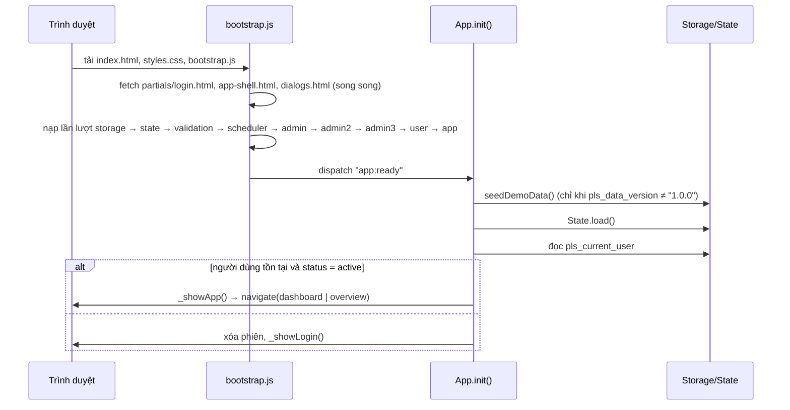
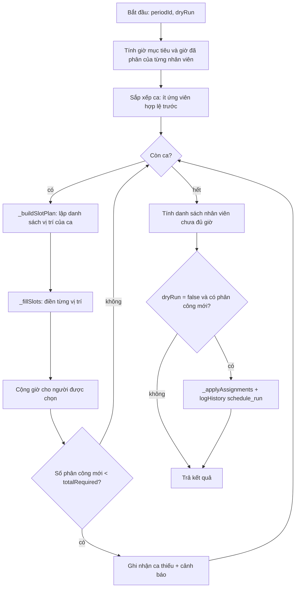
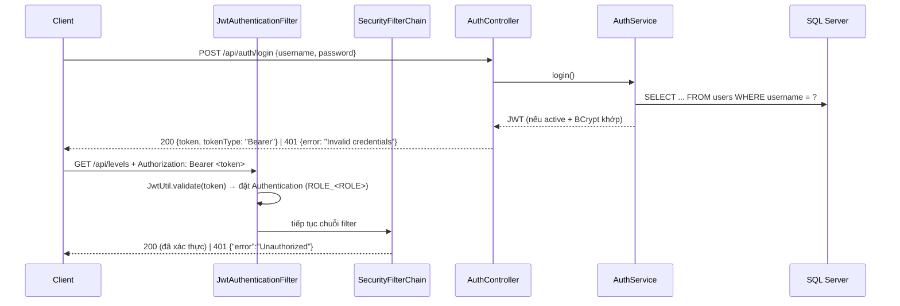

# Kiến trúc hệ thống

> **Mục đích:** mô tả cấu trúc mã nguồn, luồng khởi động, quản lý trạng thái, thuật toán phân lịch và kiến trúc bảo mật của backend.
>
> **Phạm vi:** toàn bộ thư mục `Schedule-Manager/` tại thời điểm viết tài liệu.

---

## 1. Tổng quan

Repository chứa **hai ứng dụng độc lập** trong cùng một thư mục gốc:

```
┌──────────────────────────────┐          ┌──────────────────────────────────┐
│  Frontend SPA (trình duyệt)  │          │  Backend REST API (Spring Boot)  │
│  index.html + partials/      │   chưa   │  cổng 8081, profile "sqlserver"  │
│  css/ + js/                  │  kết nối │  /api/auth, /api/health,         │
│                              │ ───╳───► │  /api/levels                     │
│  Lưu trữ: localStorage       │          │  Lưu trữ: SQL Server (Flyway)    │
└──────────────────────────────┘          └──────────────────────────────────┘
```

| Đặc điểm | Frontend | Backend |
|---|---|---|
| Ngôn ngữ/nền tảng | HTML5, CSS3, JavaScript (có dùng cú pháp ES2020 như `?.`, `??`), không framework, không bundler | Java 21, Spring Boot 3.5.6 |
| Cách chạy | Máy chủ HTTP tĩnh bất kỳ (bắt buộc HTTP, không chạy qua `file://`) | `mvn spring-boot:run` hoặc file JAR |
| Lưu trữ | `localStorage` (khóa tiền tố `pls_`) | SQL Server qua JDBC (`JdbcTemplate`), schema quản lý bằng Flyway |
| Xác thực | So khớp mật khẩu dạng rõ ở client | BCrypt + JWT (không trạng thái) |
| Phạm vi nghiệp vụ | Đầy đủ các màn hình Admin/Nhân viên | Đăng nhập, đăng xuất, health check, đọc Level |

Frontend chưa gọi backend; backend không phục vụ các tệp frontend (không có thư mục `src/main/resources/static`).

---

## 2. Cấu trúc thư mục

```
Schedule-Manager/
├── index.html                  # Trang gốc SPA, chứa 3 mount point data-include
├── partials/
│   ├── login.html              # Màn hình đăng nhập + 4 nút tài khoản demo
│   ├── app-shell.html          # Sidebar, topbar, breadcrumb, vùng #main-content
│   └── dialogs.html            # Overlay mobile, modal, toast, hộp xác nhận
├── css/styles.css              # Biến màu, layout, responsive, print
├── js/
│   ├── bootstrap.js            # Tải partial + nạp tuần tự các script
│   ├── storage.js              # Lớp localStorage, dữ liệu demo, logHistory
│   ├── state.js                # Cache trạng thái + getter/mutation + tiện ích định dạng
│   ├── validation.js           # Validate biểu mẫu, SafetyCheck, UniqueCheck
│   ├── scheduler.js            # Thuật toán phân lịch, công bố, phân công thủ công
│   ├── admin.js                # Admin: Tổng quan, Nhân sự, Level
│   ├── admin2.js               # Admin: Kỳ đăng ký, Lịch, Quản lý ca
│   ├── admin3.js               # Admin: Quy tắc, Phân lịch tự động, Công bố, Lịch sử
│   ├── user.js                 # Nhân viên: Tổng quan, Đăng ký rảnh, Lịch, Hồ sơ
│   └── app.js                  # Router, modal, toast, confirm, đăng nhập, sự kiện toàn cục
├── tests/
│   ├── browser-smoke.html      # Trang chạy smoke test trên trình duyệt
│   └── browser-smoke.js
├── src/main/java/org/dacnpm/schedulemanager/
│   ├── ManageSchedule.java     # @SpringBootApplication – điểm vào backend
│   ├── api/auth/               # AuthController, AuthService, LoginRequest, LoginResponse
│   ├── api/health/             # HealthController, DatabaseHealthController
│   ├── api/levels/             # LevelController, LevelRepository, LevelResponse
│   ├── domain/user/            # UserRecord, UserRepository
│   └── security/               # SecurityConfig, JwtUtil, JwtAuthenticationFilter
├── src/main/resources/
│   ├── application.properties             # tên ứng dụng, profile mặc định sqlserver
│   ├── application-sqlserver.properties   # cổng, datasource, JWT
│   └── db/migration/V1..V5__*.sql         # Flyway migration
├── src/test/...                # JUnit 5 + MockMvc + H2 (profile test)
├── pom.xml                     # Cấu hình Maven
├── .env.example                # Mẫu biến môi trường backend
├── api.http                    # Ví dụ request cho REST Client
└── .vscode/                    # launch.json, tasks.json
```

---

## 3. Kiến trúc Frontend

### 3.1. Mô hình phân lớp

```
┌─────────────────────────────────────────────────────────────┐
│ Giao diện (View)                                            │
│ Admin, AdminPeriod, AdminCalendar, AdminShift, AdminRules,  │
│ AdminAutoSchedule, AdminPublish, AdminHistory, UserView     │
├─────────────────────────────────────────────────────────────┤
│ Điều phối (App): router, modal, toast, confirm, đăng nhập   │
├──────────────────────────────┬──────────────────────────────┤
│ Nghiệp vụ: Scheduler         │ Kiểm tra: Validate, V,       │
│                              │ SafetyCheck, UniqueCheck     │
├──────────────────────────────┴──────────────────────────────┤
│ Trạng thái: State (cache bộ nhớ, get / mut)                 │
├─────────────────────────────────────────────────────────────┤
│ Lưu trữ: Storage (localStorage, JSON) + seedDemoData()      │
└─────────────────────────────────────────────────────────────┘
```

Các module được khai báo là **biến toàn cục** (IIFE trả về đối tượng) và gọi nhau trực tiếp; HTML sinh động dùng thuộc tính `onclick="Module.ham(...)"`.

### 3.2. Trách nhiệm từng tệp

| Tệp | Đối tượng toàn cục | Trách nhiệm chính |
|---|---|---|
| `bootstrap.js` | `appScripts`, `bootstrap()` | Tải partial bằng `fetch`, nạp script theo thứ tự, phát sự kiện `app:ready`; hiển thị lỗi và nút "Thử tải lại" nếu tải thất bại (thông báo riêng khi mở bằng `file://`). |
| `storage.js` | `STORAGE_KEYS`, `DATA_VERSION`, `Storage`, `seedDemoData()`, `logHistory()`, `resetDemoData()` | Đọc/ghi JSON vào `localStorage`; CRUD chung (`getAll`, `upsert`, `deleteById`); sinh ID dạng `prefix_timestamp_random`; khởi tạo dữ liệu demo; ghi lịch sử (tối đa 500 mục). |
| `state.js` | `State`, `calcShiftDuration()`, `formatDate()`, `formatDateTime()`, `STATUS_LABELS`, `renderBadge()`, `escHtml()`, `debounce()` | Cache dữ liệu; getter (`State.get.*`) và mutation (`State.mut.*`) ghi đồng thời vào cache và `localStorage`; tính giờ mục tiêu, giờ đã phân, thống kê tổng quan. |
| `validation.js` | `V`, `Validate`, `SafetyCheck`, `UniqueCheck`, `showFieldErrors()`, `clearFormErrors()` | Kiểm tra biểu mẫu; ràng buộc an toàn khi phân công; kiểm tra trùng mã/tên; hiển thị lỗi gắn `aria-invalid` và `aria-describedby`. |
| `scheduler.js` | `Scheduler` | `run`, `publishShifts`, `manualAssign`, `removeAssignment`, `preRunCheck`. |
| `admin.js` | `Admin` | Tổng quan Admin; quản lý nhân sự; quản lý Level. |
| `admin2.js` | `AdminPeriod`, `AdminCalendar`, `AdminShift` | Kỳ đăng ký; lịch tháng/tuần/ngày; ca làm việc, chi tiết ca, phân công thủ công, công bố một ca. |
| `admin3.js` | `AdminRules`, `AdminAutoSchedule`, `AdminPublish`, `AdminHistory` | Quy tắc; phân lịch tự động; duyệt và công bố; lịch sử và báo cáo. |
| `user.js` | `UserView` | 4 màn hình của nhân viên. |
| `app.js` | `ADMIN_ROUTES`, `USER_ROUTES`, `App`, `quickLogin()`, `togglePasswordVisibility()` | Khởi tạo, đăng nhập/đăng xuất, sidebar/topbar, router, modal, confirm, toast, phím tắt và trợ năng. |

### 3.3. Luồng khởi động



### 3.4. Bộ định tuyến (router)

`App.navigate(routeId)`:

1. Nếu chưa đăng nhập → hiển thị màn hình đăng nhập.
2. Chọn bảng route theo vai trò (`ADMIN_ROUTES` hoặc `USER_ROUTES`); route không tồn tại → chuyển về route đầu tiên của vai trò.
3. Cập nhật trạng thái `active`/`aria-current` của sidebar và breadcrumb.
4. Gán `#main-content.innerHTML = route.render()`; nếu route có `afterRender` (Lịch Admin, Lịch của tôi) thì gọi sau một vòng `setTimeout(0)`.
5. Đóng menu mobile và menu tài khoản.

| Vai trò | `id` route | Nhãn | Hàm render |
|---|---|---|---|
| Admin | `dashboard` | Tổng quan | `Admin.renderDashboard()` |
| Admin | `users` | Quản lý nhân sự | `Admin.renderUsers()` |
| Admin | `periods` | Cấu hình đăng ký | `AdminPeriod.render()` |
| Admin | `calendar` | Lịch làm việc | `AdminCalendar.render()` + `init()` |
| Admin | `shifts` | Quản lý ca | `AdminShift.render()` |
| Admin | `rules` | Quy tắc phân lịch | `AdminRules.render()` |
| Admin | `auto-schedule` | Phân lịch tự động | `AdminAutoSchedule.render()` |
| Admin | `publish` | Duyệt & công bố | `AdminPublish.render()` |
| Admin | `history` | Lịch sử & báo cáo | `AdminHistory.render()` |
| Nhân viên | `overview` | Tổng quan | `UserView.renderOverview()` |
| Nhân viên | `register` | Đăng ký thời gian rảnh | `UserView.renderRegister()` |
| Nhân viên | `my-schedule` | Lịch làm việc của tôi | `UserView.renderMySchedule()` + `initMySchedule()` |
| Nhân viên | `profile` | Thông tin cá nhân | `UserView.renderProfile()` |

Router không dùng URL/hash; tải lại trang luôn mở route mặc định của vai trò.

### 3.5. Quản lý trạng thái

- `State.load()` đọc toàn bộ khóa `pls_*` vào đối tượng `_data` trong bộ nhớ.
- Getter trả về **bản sao nông** của mảng/đối tượng (`[..._data.users]`, `{ ..._data.rules }`).
- Mutation (`saveUser`, `savePeriod`, `saveFreeTime`, `saveShift`, `saveAssignment`, `saveAllAssignments`, `saveRules`, `deleteShift`, `deleteLevel`, `removeAssignment`, `setCurrentUser`, `clearCurrentUser`, …) cập nhật `_data` **và** ghi ngay xuống `localStorage`; các mutation `save*` tự sinh `id`, gán `createdAt`/`updatedAt` (riêng phân công gán `assignedAt`).
- `deleteShift()` đồng thời xóa mọi phân công của ca đó.
- Lịch sử (`logHistory`) ghi thẳng vào `localStorage` qua `Storage`; mảng `history` trong `State` chỉ được nạp lại khi gọi `State.load()` – trong mã chỉ xảy ra lúc khởi động (`App.init`) và trong `App.resetDemo`. Vì vậy bản ghi mới chỉ xuất hiện trên màn hình Tổng quan/Lịch sử sau khi tải lại trang.

### 3.6. Các phép tính dùng chung (`State.get`)

| Hàm | Công thức / quy tắc |
|---|---|
| `calcShiftDuration(start, end)` | `(phút kết thúc − phút bắt đầu) / 60`; nếu kết thúc ≤ bắt đầu thì cộng 24 giờ (ca qua đêm). |
| `targetHoursForUser(userId)` | `rate = user.targetRate`; nếu `rate` falsy và có Level → `rules.levelTargetRates[levelId] \|\| 100`; kết quả `Math.round(standardHours × (rate \|\| 100) / 100)`. |
| `assignedHoursByUser(userId, start, end)` | Tổng thời lượng các ca mà user được phân (lọc theo khoảng ngày nếu có). |
| `unregisteredUsersInPeriod(periodId)` | Nhân viên `role = user`, `status = active` (giới hạn theo `applicableUserIds` nếu mảng không rỗng) chưa có bản đăng ký `submitted`. |
| `dashboardStats(periodId)` | Đếm ca trong kỳ, ca đã công bố, ca nháp, ca đủ/thiếu người (**chỉ tính trên ca đã công bố**), tổng giờ mục tiêu/đã phân và `progressPercent = Math.round(đã phân / mục tiêu × 100)`. |

### 3.7. Thành phần giao diện dùng chung (`App`)

| Thành phần | Hành vi |
|---|---|
| Modal (`openModal`, `closeModal`) | Một modal tại một thời điểm; nút footer tạo động; đóng bằng nút ×, click nền hoặc `Esc`; khóa cuộn trang; gắn `aria-hidden` cho `#app-shell`; giữ focus trong modal (focus trap) và trả focus về phần tử đã mở. |
| Hộp xác nhận (`confirm`) | Kiểu `info`/`warn`/`danger`; tùy chọn bắt buộc nhập lý do (`requireReason`); ưu tiên xử lý `Esc` trước modal. |
| Toast (`toast`) | Kiểu `info`/`success`/`warning`/`error`; tự đóng sau 4 giây; tối đa 5 toast cùng lúc (toast cũ nhất bị gỡ). |
| Sidebar | Thu gọn/mở rộng trên desktop; trên màn hình ≤ 768 px hiển thị dạng ngăn kéo có lớp phủ; `inert` khi đóng. |
| Bảng/lịch rộng | `_syncTableKeyboardAccess()` gán `tabindex="0"` và `aria-label` cho vùng cuộn ngang để thao tác bằng bàn phím. |

### 3.8. Responsive

Các breakpoint trong `css/styles.css`: `1024px` (lưới thống kê, form 3 cột → 2 cột), `768px` (sidebar dạng ngăn kéo, form 1 cột, modal neo đáy), `640px`, `480px` (thống kê 1 cột, lịch thu gọn). Có hỗ trợ `prefers-reduced-motion` và kiểu in (`@media print` ẩn sidebar, topbar, nút, modal, toast).

---

## 4. Ràng buộc an toàn khi phân công (`SafetyCheck`)

`SafetyCheck.validateAssignment(userId, shift, periodId, isAdminOverride)` trả về `{ valid, errors[], warnings[] }`:

| Kiểm tra | Hàm | Quy tắc | Mức độ |
|---|---|---|---|
| Trùng ca | `checkShiftOverlap` | So với các ca đã phân của user, cách ca mới ≤ 1 ngày; trùng khi `aStart < bEnd && bStart < aEnd` (tính cả ca qua đêm) | Lỗi – không thể bỏ qua |
| Thời gian rảnh | `checkFreeTime` | Bản đăng ký phải `submitted`; có ngày của ca; một khung giờ bao phủ trọn ca | Lỗi; nếu `isAdminOverride` → cảnh báo `[Admin override]` |
| Giới hạn giờ | `checkHoursLimit` | Tổng giờ trong ngày + ca mới ≤ `maxHoursPerDay`; tổng giờ trong tuần (Thứ Hai–Chủ Nhật) + ca mới ≤ `maxHoursPerWeek` | Lỗi – không thể bỏ qua |
| Nghỉ tối thiểu | `checkMinRest` | Với ca cách ≤ 2 ngày, khoảng nghỉ trước/sau ca mới phải ≥ `minRestBetweenShifts` giờ | Cảnh báo – không chặn |
| Level | `checkLevelEligibility` | Level của user trùng Level yêu cầu, hoặc tồn tại quy tắc `{ higherLevelId: level user, lowerLevelId: level yêu cầu }` | Dùng để lọc ứng viên cho vị trí theo Level |

Dữ liệu dùng để kiểm tra là `State.get.assignments()` và `State.get.shifts()` tại thời điểm gọi.

---

## 5. Thuật toán phân lịch tự động

Thuật toán là **heuristic tham lam** (chú thích đầu `js/scheduler.js`: "Không tuyên bố tối ưu toàn cục. Không tự ý phân sai điều kiện để lịch trông đầy đủ.").

### 5.1. Đầu vào

| Dữ liệu | Nguồn |
|---|---|
| Kỳ | `State.get.periodById(periodId)` |
| Quy tắc | `State.get.rules()` |
| Nhân viên | `State.get.activeUsers()` – `role = user` và `status = active` |
| Ca cần phân | Ca có `date` trong `[startDate, endDate]` của kỳ và `status ≠ published` |
| Giờ mục tiêu / đã phân | `targetHoursForUser()`, `assignedHoursByUser()` trong khoảng ngày của kỳ |

Nếu không tìm thấy kỳ, chưa có quy tắc, hoặc không có ca cần phân → trả về `{ success: false, error }`.

### 5.2. Các bước



### 5.3. Lập danh sách vị trí (`_buildSlotPlan`)

| Chế độ ca | Danh sách vị trí được tạo |
|---|---|
| `user` (B – Theo User) | Một vị trí `mandatory` cho mỗi người bắt buộc chưa được phân; một vị trí `preferred` cho mỗi người ưu tiên chưa được phân; thêm vị trí `flex` cho phần còn lại: `totalRequired − (số bắt buộc + số ưu tiên)`. |
| `level` (A – Theo Level) | Với mỗi dòng `levelRequirements`, tạo `count` vị trí `level` gắn `levelId`. |
| `combined` (C – Kết hợp) | Các vị trí `mandatory`, `preferred` như chế độ B; nếu `remaining = totalRequired − (bắt buộc + ưu tiên) > 0` thì thêm toàn bộ vị trí `level` và `remaining − tổng vị trí Level` vị trí `flex`. |

### 5.4. Điền vị trí (`_fillSlots`)

Duyệt lần lượt từng vị trí; dừng khi số người của ca (đã có + mới) đạt `totalRequired`.

| Loại vị trí | Cách chọn người |
|---|---|
| `mandatory` | Kiểm tra `validateAssignment` cho đúng người được chỉ định; không hợp lệ → ghi vào `rejectedCandidates`, **không tìm người thay**. |
| `preferred` | Kiểm tra người được chỉ định; không hợp lệ → ghi lý do và tìm ứng viên tốt nhất **cùng Level** với người ưu tiên. |
| `level` | Tìm ứng viên tốt nhất đạt `checkLevelEligibility` với `levelId` của vị trí. |
| `flex` | Tìm ứng viên tốt nhất, không ràng buộc Level. |

`_findBestCandidate()`: lọc nhân viên chưa có trong ca, đạt điều kiện Level (nếu có), qua `validateAssignment` (không override); sắp xếp theo `giờ mục tiêu − giờ đã phân` **giảm dần**; chọn người đầu tiên. Mỗi phân công tạo ra có `assignedBy: 'auto'`, `status: 'confirmed'`.

### 5.5. Kết quả trả về

| Trường | Ý nghĩa |
|---|---|
| `success`, `periodId`, `period` | Trạng thái và kỳ được phân |
| `assignments` | Danh sách phân công mới |
| `understaffed[]` | `{ shift, required, filled, missing }` – `filled` là số phân công mới trong lần chạy |
| `underTarget[]` | `{ user, target, assigned, diff }` với `diff > 0`, sắp xếp giảm dần |
| `rejectedCandidates[]` | `{ shiftId, userId, reasons[] }` |
| `warnings[]`, `log[]` | Cảnh báo và nhật ký từng bước |
| `totalShifts`, `totalAssignments` | Số ca đã xét, số phân công mới |

### 5.6. Áp dụng kết quả (`_applyAssignments`)

Khi Admin chọn **Áp dụng kết quả**, giao diện gọi lại `Scheduler.run(periodId, { dryRun: false })` (thuật toán được chạy lại, không dùng lại kết quả nháp đã hiển thị). Nếu có phân công mới: gộp vào danh sách phân công, đặt trạng thái **mọi ca đã xét** thành `draft`, ghi lịch sử `schedule_run`.

### 5.7. Công bố và phân công thủ công

| Hàm | Hành vi |
|---|---|
| `publishShifts(shiftIds, force)` | Ca có số phân công < `totalRequired`: `force = false` → trả `{ success: false, errors }`; `force = true` → chỉ cảnh báo. Thành công → đặt `status = 'published'`, ghi lịch sử `schedule_publish`. |
| `manualAssign(userId, shiftId, periodId, reason, adminOverride)` | Ca đã công bố bị từ chối nếu không override; chạy `validateAssignment` (override); từ chối nếu nhân viên đã có trong ca; lưu phân công `assignedBy: 'admin'`; ghi lịch sử `manual_assign` (kèm `after` và lý do). |
| `removeAssignment(asgnId, reason)` | Xóa phân công; nếu ca đã công bố thì ghi lịch sử `manual_unassign` (kèm `before`). |
| `preRunCheck(periodId)` | Trả danh sách vấn đề cần lưu ý trước khi chạy (không chặn nút chạy). |

### 5.8. Hạn chế đã xác định từ mã nguồn

1. `validateAssignment()` đọc phân công đã lưu trong `State`; các phân công mới tạo ở những ca trước **trong cùng lần chạy** chưa được đưa vào kiểm tra trùng ca, giới hạn giờ ngày/tuần và nghỉ tối thiểu.
2. `maxHoursPerPeriod` có trong dữ liệu quy tắc mặc định nhưng không có trên biểu mẫu và không được kiểm tra.
3. `schedulingPriority` và `understaffedPolicy` được lưu nhưng thuật toán và chức năng công bố không đọc.
4. Vị trí `mandatory`/`preferred` không kiểm tra Level; phân công thủ công cũng không kiểm tra Level.
5. Ước lượng độ khó của ca (`_countEligible`) không tính điều kiện Level.
6. Cột "Đã phân" của ca thiếu chỉ đếm phân công mới trong lần chạy, không cộng phân công đã có trước đó.

---

## 6. Kiến trúc Backend

### 6.1. Phân lớp

```
HTTP request
   │
   ▼
JwtAuthenticationFilter  ──►  SecurityFilterChain (permitAll / authenticated)
   │
   ▼
Controller (api/*)       AuthController, HealthController, DatabaseHealthController, LevelController
   │
   ▼
Service                  AuthService
   │
   ▼
Repository (JDBC)        UserRepository, LevelRepository  ──►  JdbcTemplate ──► SQL Server
```

| Lớp | Profile | Vai trò |
|---|---|---|
| `ManageSchedule` | — | Điểm vào `@SpringBootApplication` |
| `AuthController` | — | `POST /api/auth/login`, `POST /api/auth/logout` |
| `AuthService` | `sqlserver` | Tìm user → lọc `status = 'active'` → so BCrypt → phát JWT |
| `LoginRequest` / `LoginResponse` | — | Record `{ username, password }` / `{ token, tokenType = "Bearer" }` |
| `HealthController` | — | `GET /api/health` |
| `DatabaseHealthController` | `sqlserver` | `GET /api/health/database` – chạy `SELECT 1` |
| `LevelController`, `LevelRepository`, `LevelResponse` | `sqlserver` | `GET /api/levels` – đọc bảng `levels` sắp theo `sort_order` |
| `UserRecord`, `UserRepository` | `sqlserver` | Đọc `id, username, password_hash, role, status` theo `username` |
| `SecurityConfig` | — | Bean `PasswordEncoder` (BCrypt), `JwtAuthenticationFilter`, `SecurityFilterChain` |
| `JwtUtil` | — | Phát hành và xác minh JWT |

### 6.2. Cấu hình

| Tệp | Thuộc tính |
|---|---|
| `application.properties` | `spring.application.name=schedule-manager-api`, `spring.profiles.active=sqlserver` |
| `application-sqlserver.properties` | `server.port=8081`; `spring.config.import=optional:file:.env[.properties]`; URL `jdbc:sqlserver://${DB_HOST:localhost}:${DB_PORT:1433};databaseName=${DB_NAME:ScheduleManager};encrypt=true;trustServerCertificate=${DB_TRUST_SERVER_CERTIFICATE:false}`; `DB_USERNAME` (mặc định `schedulemanagerproject`), `DB_PASSWORD`; Hikari `connection-timeout=5000`; `app.jwt.secret=${JWT_SECRET}`; `app.jwt.expiration-ms=${JWT_EXPIRATION_MS:86400000}` |
| `src/test/resources/application-test.properties` | H2 in-memory (`MODE=MSSQLServer`), tắt Flyway, tắt nhập `.env`, JWT secret dùng cho test |

### 6.3. Bảo mật



- **Phiên:** `SessionCreationPolicy.STATELESS`; CSRF tắt.
- **JWT:** ký bằng khóa HMAC tạo từ `JWT_SECRET` (`Keys.hmacShaKeyFor`); claim `sub` = id người dùng, `username`, `role`, `iat`, `exp` (mặc định 24 giờ).
- **Quyền:** `JwtAuthenticationFilter` gán authority `ROLE_` + `role.toUpperCase()` (ví dụ `ROLE_ADMIN`); hiện chưa có quy tắc truy cập nào dựa trên authority này.
- **Endpoint công khai:** `POST /api/auth/login`, `POST /api/auth/logout`, `GET /api/health`, `GET /api/health/database`. Mọi đường dẫn khác yêu cầu JWT hợp lệ.
- **Token sai/hết hạn/thiếu:** filter không đặt Authentication; entry point trả `401` với thân `{"error":"Unauthorized"}`.
- **Đăng xuất:** không thu hồi token; client tự hủy token (chú thích trong `AuthService`).
- **Chống dò tài khoản:** sai mật khẩu, tài khoản không tồn tại, tài khoản `inactive` đều trả cùng `401 Invalid credentials`.

### 6.4. Truy cập dữ liệu và migration

- Truy vấn bằng `JdbcTemplate` với tham số `?` (không ghép chuỗi SQL).
- Flyway chạy các migration trong `classpath:db/migration` khi khởi động với profile `sqlserver`; lịch sử lưu ở bảng `flyway_schema_history`.
- Chi tiết lược đồ: [database.md](./database.md).

---

## 7. Ghi chú phạm vi

- Frontend là bản demo phía trình duyệt: mật khẩu dạng rõ, phân quyền phía client; không dùng dữ liệu cá nhân hoặc mật khẩu thật.
- Backend mới cung cấp nền tảng xác thực và lược đồ CSDL; các API nghiệp vụ tương ứng với màn hình frontend chưa được xây dựng.
