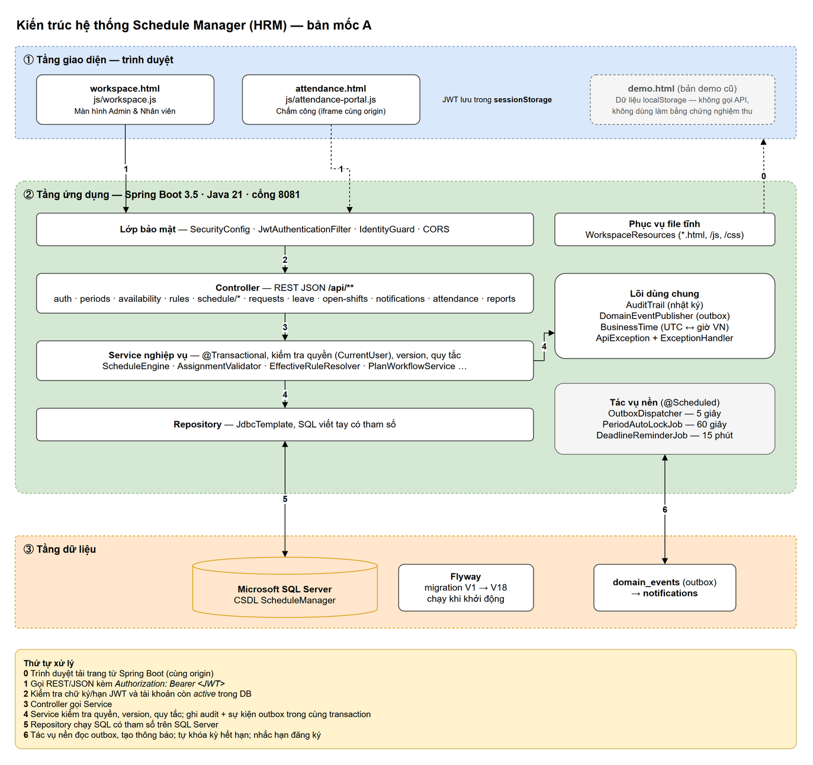
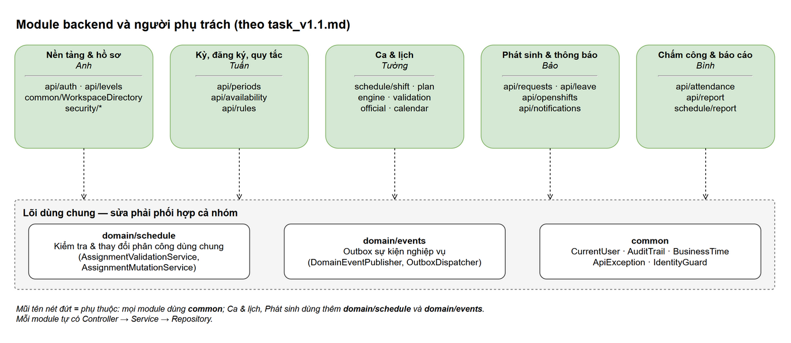
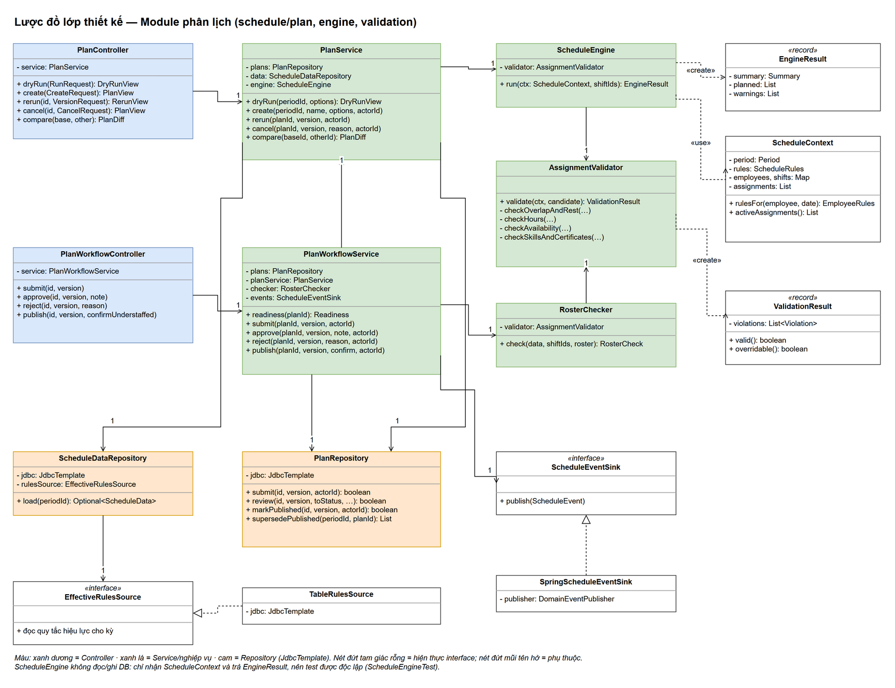
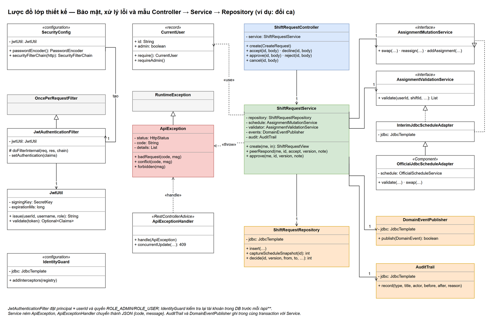

# Kiến trúc hệ thống

> Đối chiếu với mã nguồn nhánh `main`, commit `a8a6da6` (04/11/2026 — bản tích hợp mốc A).
> Sơ đồ ở dạng `.drawio.png`: xem được như ảnh thường, mở bằng [draw.io](https://www.drawio.com/) để sửa tiếp (sơ đồ gốc được nhúng trong file).

## Tài liệu liên quan

| Tài liệu | Nội dung |
|---|---|
| [use-cases.md](use-cases.md) | Tác nhân và 7 lược đồ use case |
| [flows.md](flows.md) | Lưu đồ hoạt động, sơ đồ tuần tự, sơ đồ trạng thái |
| [database.md](database.md) | Mô hình miền, ERD V1–V18, quy ước dữ liệu |
| [api.md](api.md) | Danh sách API |
| [../HUONG_DAN/HUONG_DAN_CHAY_HE_THONG.md](../HUONG_DAN/HUONG_DAN_CHAY_HE_THONG.md) | Cách chạy, kiểm thử, phục hồi |

## Mục lục

1. [Tổng quan](#1-tổng-quan)
2. [Công nghệ sử dụng](#2-công-nghệ-sử-dụng)
3. [Sơ đồ kiến trúc](#3-sơ-đồ-kiến-trúc)
4. [Module và người phụ trách](#4-module-và-người-phụ-trách)
5. [Tổ chức mã nguồn backend](#5-tổ-chức-mã-nguồn-backend)
6. [Frontend](#6-frontend)
7. [Bảo mật](#7-bảo-mật)
8. [Chức năng đáng chú ý và cách triển khai](#8-chức-năng-đáng-chú-ý-và-cách-triển-khai)
9. [Lược đồ lớp thiết kế](#9-lược-đồ-lớp-thiết-kế)
10. [Giới hạn đã biết](#10-giới-hạn-đã-biết)

---

## 1. Tổng quan

Schedule Manager là hệ thống HRM ưu tiên **quản lý lực lượng lao động**: nhân viên đăng ký thời gian rảnh theo kỳ, hệ thống tự phân lịch theo quy tắc, quản trị viên duyệt và công bố lịch, nhân viên đổi ca / xin nghỉ / nhận ca trống, chấm công, rồi tổng hợp báo cáo.

Kiến trúc 3 tầng:

- **Giao diện** — HTML/CSS/JavaScript thuần chạy trong trình duyệt, gọi REST API.
- **Ứng dụng** — Spring Boot (Java 21) chứa toàn bộ nghiệp vụ, kiểm tra quyền và ràng buộc.
- **Dữ liệu** — Microsoft SQL Server; schema quản lý bằng Flyway.

Nguyên tắc chung: **backend và database là nguồn dữ liệu chuẩn**; frontend chỉ hiển thị và thu thập dữ liệu, không tự quyết định nghiệp vụ.

## 2. Công nghệ sử dụng

| Thành phần | Công nghệ | Dùng để làm gì | Lý do chọn |
|---|---|---|---|
| Ngôn ngữ backend | Java 21 | Viết toàn bộ nghiệp vụ | Bản LTS; có `record` gọn cho DTO |
| Framework | Spring Boot 3.5.6 (web, jdbc, security, actuator) | REST API, DI, transaction, lịch chạy nền | Chuẩn phổ biến, nhiều tài liệu, tích hợp sẵn bảo mật |
| Truy cập dữ liệu | Spring JDBC (`JdbcTemplate`), SQL viết tay | Đọc/ghi SQL Server | Kiểm soát chính xác câu SQL, khóa (`UPDLOCK`), version; **không dùng JPA** |
| Database | Microsoft SQL Server | Lưu dữ liệu nghiệp vụ | Yêu cầu của đồ án; hỗ trợ khóa hàng, transaction mạnh |
| Migration | Flyway (`V1`…`V18`) | Tạo/sửa schema theo phiên bản | Mỗi thay đổi là một file có số thứ tự, không sửa file cũ |
| Xác thực | Spring Security + JWT (jjwt 0.13.0) + BCrypt | Đăng nhập, cấp và kiểm tra token, băm mật khẩu | API không trạng thái (stateless), dễ dùng chung cho nhiều trang |
| Tác vụ nền | `@Scheduled` của Spring | Gửi thông báo (outbox), tự khóa kỳ, nhắc hạn | Có sẵn trong Spring, không cần thêm hệ thống hàng đợi |
| Frontend | HTML, CSS, JavaScript thuần | Màn hình Admin/Nhân viên, chấm công | Không cần build; dễ chạy và dễ đọc |
| Kiểm thử backend | JUnit 5, Spring Boot Test, Spring Security Test, H2 | Unit test, test controller, test tích hợp | H2 cho test nhanh; test SQL Server thật cho tích hợp |
| Kiểm thử E2E | Playwright 1.64.1 (chỉ devDependency), PowerShell | Kịch bản HTTP và trình duyệt | Chạy trình duyệt thật, chụp ảnh, nhiều viewport |
| Giám sát | Spring Actuator, `/api/health`, `/api/health/database` | Kiểm tra ứng dụng và kết nối DB | Đơn giản, đủ cho bản V1 |

Không dùng: JPA/Hibernate, Lombok, Swagger/OpenAPI, Docker, framework frontend, bundler.

## 3. Sơ đồ kiến trúc



Một request đi qua các bước:

1. Trình duyệt tải `workspace.html` / `attendance.html` từ Spring Boot (cùng origin, cổng `8081`). Cách chạy tách: `HUONG_DAN/frontend-server.mjs` phục vụ giao diện ở cổng `8080` và chuyển `/api` sang `8081`.
2. Mỗi lời gọi API gửi `Authorization: Bearer <JWT>`.
3. `JwtAuthenticationFilter` kiểm tra chữ ký và hạn của token; `IdentityGuard` kiểm tra lại tài khoản trong DB (còn `active`, đúng role).
4. Controller nhận JSON, gọi Service.
5. Service kiểm tra quyền, trạng thái, version, ràng buộc; ghi dữ liệu, **audit** và **sự kiện outbox trong cùng một transaction**.
6. Repository chạy SQL có tham số trên SQL Server.
7. Tác vụ nền đọc outbox để tạo thông báo, tự khóa kỳ hết hạn và nhắc hạn đăng ký.

Code liên quan: `security/SecurityConfig.java`, `security/JwtAuthenticationFilter.java`, `common/IdentityGuard.java`, `common/WorkspaceResources.java`, `domain/events/OutboxDispatcher.java`.

## 4. Module và người phụ trách



| Module | Người phụ trách | Package chính |
|---|---|---|
| Nền tảng, tài khoản, hồ sơ | Anh | `api/auth`, `api/levels`, `common/WorkspaceDirectory`, `security` |
| Kỳ, đăng ký rảnh, quy tắc | Tuấn | `api/periods`, `api/availability`, `api/rules` |
| Ca và vòng đời lịch | Tường | `schedule/*` (shift, plan, engine, validation, official, calendar) |
| Đổi ca, nghỉ phép, ca trống, thông báo | Bảo | `api/requests`, `api/leave`, `api/openshifts`, `api/notifications`, `domain/events` |
| Chấm công, dashboard, báo cáo | Bình | `api/attendance`, `api/report`, `schedule/report` |

Phần **lõi dùng chung** (`common`, `domain/schedule`, `domain/events`) được nhiều module gọi; sửa phần này phải phối hợp cả nhóm (xem `task_v1.1.md`).

## 5. Tổ chức mã nguồn backend

Package gốc `org.dacnpm.schedulemanager`, chia theo module nghiệp vụ. Mỗi module theo mẫu:

```text
Controller (REST, record request/response)
   → Service (@Transactional, quyền, ràng buộc, audit, sự kiện)
      → Repository (JdbcTemplate + SQL có tham số)
         → SQL Server
```

| Package | Vai trò |
|---|---|
| `api/<module>/` | Controller, Service, Repository, DTO của từng module |
| `schedule/<sub>/` | Module lịch: `engine` (thuật toán), `validation` (kiểm tra ràng buộc), `plan` (phương án), `official` (lịch chính thức), `shift`, `calendar`, `report` |
| `domain/schedule/` | Interface dùng chung để kiểm tra và thay đổi phân công (`AssignmentValidationService`, `AssignmentMutationService`) |
| `domain/events/` | Outbox sự kiện: `DomainEventPublisher`, `OutboxDispatcher` |
| `common/` | `CurrentUser`, `IdentityGuard`, `AuditTrail`, `BusinessTime`, `ApiException` + handler, endpoint nền tảng (`/api/me`, `/api/audit`) |
| `security/` | `SecurityConfig`, JWT, CORS |

Quy ước:

- Bean truy cập DB gắn `@Profile("sqlserver")`; profile `test` dùng H2 và tắt Flyway.
- Lỗi nghiệp vụ ném `ApiException(status, code, message)`; `@RestControllerAdvice` chuyển thành JSON `{code, message}`.
- Mutation quan trọng có cột `version` (khóa lạc quan) và ghi audit trước/sau.

## 6. Frontend

| Trang | File | Vai trò |
|---|---|---|
| `index.html` | — | Chuyển hướng sang `workspace.html` |
| `workspace.html` | `js/workspace.js`, `css/workspace.css` | Giao diện chính cho Admin và Nhân viên (kỳ, đăng ký, quy tắc, ca, phương án, lịch, đổi ca, nghỉ phép, ca trống, thông báo, báo cáo, nhân viên, nhật ký) |
| `attendance.html` | `js/attendance-portal.js`, `css/attendance.css` | Chấm công, nhúng trong workspace bằng iframe cùng origin, dùng chung JWT |
| `demo.html` | `js/bootstrap.js` + các script cũ, `partials/`, `css/styles.css` | **Bản demo cũ** dùng `localStorage`; không phải luồng vận hành, không dùng làm bằng chứng nghiệm thu |

- `js/workspace.js` có hàm `api(path, method, body)` dùng chung: gắn JWT, gửi JSON, đọc lỗi.
- JWT lưu trong `sessionStorage` (khóa `attendance_jwt`), mất khi đóng tab; đăng xuất xóa token phía trình duyệt.
- Màn hình Admin bị ẩn với Nhân viên (`shifts`, `plans`, `directory`, `audit`), nhưng **backend vẫn là nơi quyết định quyền**.

## 7. Bảo mật

| Cơ chế | Cách làm | File |
|---|---|---|
| Băm mật khẩu | BCrypt qua bean `PasswordEncoder` dùng chung | `SecurityConfig` |
| Đăng nhập | Sai tài khoản / sai mật khẩu / bị khóa đều trả `401 Invalid credentials` (không lộ tài khoản có tồn tại hay không) | `AuthService` |
| JWT | Ký HMAC, khóa `JWT_SECRET` ≥ 32 ký tự từ `.env`, có thời hạn `JWT_EXPIRATION_MS` | `JwtUtil` |
| Kiểm tra lại mỗi request | Tài khoản bị khóa hoặc đổi role thì token cũ bị từ chối (`401 SESSION_INVALID`) | `IdentityGuard` |
| Phân quyền | `/api/schedule/**` yêu cầu `ROLE_ADMIN`; quyền chi tiết kiểm tra trong Service (`CurrentUser.requireAdmin()`); Employee chỉ thấy dữ liệu của mình | `SecurityConfig`, các Service |
| Chống SQL injection | Mọi SQL dùng tham số `?` | Repository |
| CORS | Chỉ cho origin `:8000`, `:5500`, method `GET`/`POST` trên `/api/**` | `AttendanceCorsConfig` |
| Bí mật | `DB_PASSWORD`, `JWT_SECRET` nằm trong `.env` (không commit); chỉ `.env.example` được commit | `application-sqlserver.properties` |

## 8. Chức năng đáng chú ý và cách triển khai

### 8.1. Thuật toán phân lịch tự động

- **Là gì:** tự chọn nhân viên cho các ca của kỳ, dựa trên đăng ký rảnh và quy tắc.
- **Cách làm:** thuật toán **tham lam (greedy)**. Ca có ít ứng viên hợp lệ nhất được xếp trước. Với mỗi vị trí trống, mọi ứng viên phải qua `AssignmentValidator` (**ràng buộc cứng**), sau đó xếp hạng bằng **tiêu chí mềm** (thuộc danh sách ưu tiên của ca, đúng Level, gần giờ mục tiêu, chia đều số ca). Người được chọn còn được kiểm tra lại ngay trước khi chốt.
- **Điểm quan trọng:** không tìm được người hợp lệ thì **giữ thiếu người và ghi lý do**, không bao giờ nới ràng buộc để lấp chỗ.
- **Nằm ở:** `schedule/engine/ScheduleEngine.java`, `schedule/validation/AssignmentValidator.java`. Lưu đồ: [flows.md §1.2](flows.md#12-thuật-toán-phân-lịch-tự-động).

### 8.2. Bộ kiểm tra ràng buộc dùng chung

- **Là gì:** một chỗ duy nhất kiểm tra phân công có hợp lệ không, gồm trùng ca, nghỉ tối thiểu giữa 2 ca, giờ/ngày/tuần/kỳ, số ngày làm liên tiếp, thời gian rảnh, ngày bị chặn, Level, vị trí, kỹ năng, chứng chỉ, địa điểm.
- **Vì sao cần:** phân lịch tự động, sửa tay, đổi ca, nhận ca trống đều dùng chung, nên kết quả luôn nhất quán.
- **Nằm ở:** `schedule/validation/AssignmentValidator.java`, `ViolationCode.java`; module khác gọi qua `domain/schedule/AssignmentValidationService`.

### 8.3. Quy tắc có phạm vi và ngày hiệu lực

- **Là gì:** mỗi tham số (giờ tối đa, nghỉ tối thiểu, chính sách thiếu người…) có thể đặt cho công ty, chi nhánh, loại nhân viên, nhóm hoặc từng người, kèm ngày bắt đầu hiệu lực.
- **Cách chọn giá trị:** phạm vi cụ thể hơn thắng: **user > group > employee_type > branch > company**; cùng phạm vi thì lấy ngày hiệu lực gần nhất không sau ngày đang xét. Hai giá trị cùng mức, cùng ngày thì báo xung đột, không tự chọn.
- **Áp dụng an toàn:** thay đổi phải **xem trước → xác nhận**; `rule_revision` chặn việc áp dụng một bản xem trước đã cũ (`STALE_PREVIEW`). Bản cũ được giữ lại (`superseded`), không xóa.
- **Nằm ở:** `api/rules/EffectiveRuleResolver.java`, `api/rules/RuleService.java`.

### 8.4. Khóa lạc quan và chống ghi đè

- **Là gì:** mỗi bản ghi quan trọng (kỳ, ca, phương án, yêu cầu, phân công, bản ghi công) có cột `version`. Client gửi kèm version đang thấy; câu `UPDATE … WHERE version = ?` không đổi dòng nào thì trả **409** để người dùng tải lại.
- **Tranh khóa SQL Server:** lỗi tranh khóa được chuyển thành `409 RETRY_REQUIRED` (không trả 500), transaction được hoàn tác.
- **Nằm ở:** các Repository, `common/ApiExceptionHandler.java`, `schedule/ScheduleErrorAdvice.java`.

### 8.5. Vòng đời phương án lịch và công bố có kiểm soát

- **Là gì:** phương án đi qua `draft → pending_approval → approved → published`; công bố mới tạo lịch chính thức mà nhân viên nhìn thấy.
- **Khi công bố:** khóa kỳ trong transaction, kiểm tra kỳ đã `locked`, đủ ngoại lệ đã duyệt, chính sách thiếu người (`block` thì chặn, `warn` thì yêu cầu xác nhận); thay lịch chính thức đúng bằng phương án; phương án cũ chuyển `superseded`; phát sự kiện thông báo.
- **Nằm ở:** `schedule/plan/PlanWorkflowService.java`. Sơ đồ: [flows.md §1.3](flows.md#13-gửi-duyệt-duyệt-và-công-bố-lịch), [§3.2](flows.md#32-phương-án-lịch).

### 8.6. Outbox sự kiện và thông báo

- **Là gì:** khi có thay đổi nghiệp vụ, sự kiện được ghi vào bảng `domain_events` **trong cùng transaction** (`Propagation.MANDATORY`). Rollback thì sự kiện cũng mất, không có thông báo "ma".
- **Gửi thông báo:** `OutboxDispatcher` chạy mỗi 5 giây, giành "lease" từng sự kiện, tạo `notifications` (UNIQUE `event_id + recipient_id` để chống trùng). Lỗi thì thử lại sau 2ⁿ phút; quá số lần thì chuyển `dead`.
- **Nằm ở:** `domain/events/DomainEventPublisher.java`, `domain/events/OutboxDispatcher.java`. Sơ đồ: [flows.md §2.3](flows.md#23-gửi-thông-báo-qua-outbox).

### 8.7. Đổi ca có snapshot lịch

- **Là gì:** khi gửi yêu cầu đổi/thay ca, hệ thống chụp version của các phân công liên quan. Lúc đồng nghiệp đồng ý và lúc Admin duyệt, hệ thống kiểm tra lại snapshot và ràng buộc. Nếu lịch đã đổi thì chặn, không đổi nhầm.
- **Duyệt lặp an toàn:** duyệt lần hai trả lại kết quả cũ, không đổi lịch lần nữa.
- **Nằm ở:** `api/requests/ShiftRequestService.java`, `ShiftRequestRepository.captureScheduleSnapshot`, migration `V17`.

### 8.8. Thời gian nghiệp vụ theo giờ server

- **Là gì:** mọi thời điểm lưu **UTC**; ngày giờ ca và hạn đăng ký hiểu theo `Asia/Ho_Chi_Minh`. Hạn đăng ký luôn kiểm tra bằng giờ server (`Clock`), không tin giờ trình duyệt. Form mở trước hạn nhưng gửi sau hạn vẫn bị chặn.
- **Nằm ở:** `common/BusinessTime.java`, `common/TimeConfig.java`, `api/periods/RegistrationWindow.java`, `api/periods/PeriodAutoLockJob.java`.

### 8.9. Nhật ký thao tác (audit)

- **Là gì:** thao tác quan trọng ghi người làm, thời điểm, dữ liệu trước/sau và lý do vào bảng `history`; chấm công có bảng riêng `attendance_audit`. Không ghi mật khẩu hay hash.
- **Nằm ở:** `common/AuditTrail.java`; xem qua `GET /api/audit` (chỉ Admin).

## 9. Lược đồ lớp thiết kế

### 9.1. Module phân lịch



`ScheduleEngine` không đọc/ghi DB: nhận `ScheduleContext`, trả `EngineResult`, nhờ vậy test độc lập được (`ScheduleEngineTest`). `PlanService` lo chạy thuật toán và lưu phương án; `PlanWorkflowService` lo duyệt và công bố.

### 9.2. Bảo mật, xử lý lỗi và mẫu Controller → Service → Repository



Ví dụ module đổi ca: `ShiftRequestService` dùng lõi lịch qua interface (`AssignmentMutationService`, `AssignmentValidationService`), ghi `AuditTrail` và `DomainEventPublisher` trong cùng transaction.

Mô hình miền (các lớp dữ liệu nghiệp vụ) nằm ở [database.md §2](database.md#2-mô-hình-miền).

## 10. Giới hạn đã biết

Theo báo cáo bàn giao mốc A (`HUONG_DAN/BAO_CAO_BAN_GIAO_MOC_A_VA_KE_HOACH_MOC_B.md`):

- Thuật toán phân lịch là heuristic tham lam, chưa chứng minh tối ưu toàn cục.
- Đăng xuất chỉ xóa JWT ở trình duyệt; chưa có cơ chế thu hồi từng token.
- Phân quyền V1 chỉ có Admin và Employee; ma trận vai trò mở rộng thuộc mốc B.
- `js/workspace.js` còn tập trung nhiều màn hình trong một file; chấm công vẫn dùng iframe.
- Chưa có màn hình vận hành để xem/thử lại sự kiện outbox bị `dead`.
- Chưa triển khai production (HTTPS, quản lý secret, backup ngoài máy, giám sát).
