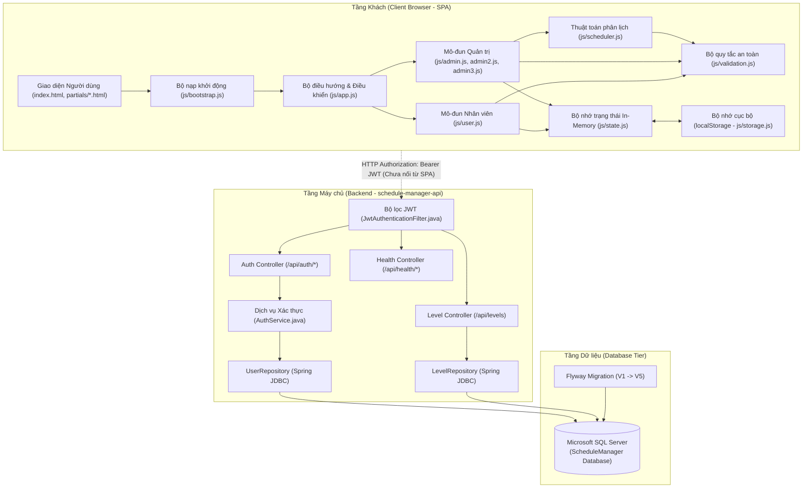
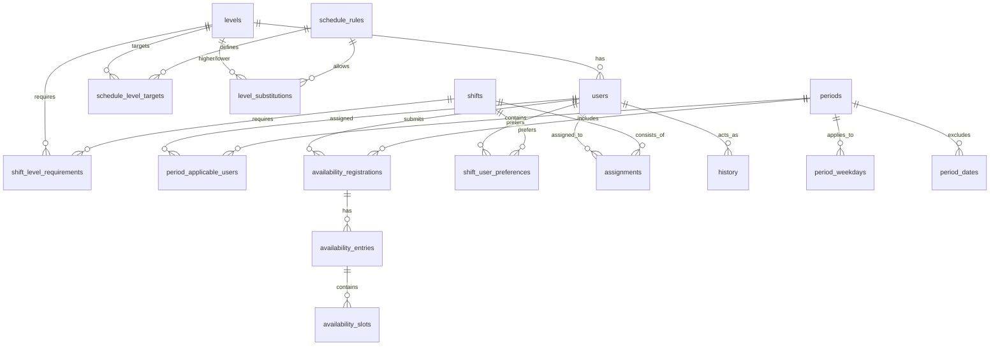
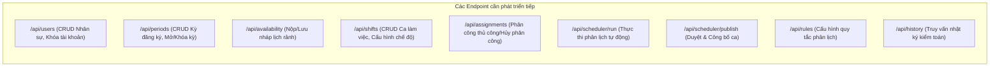
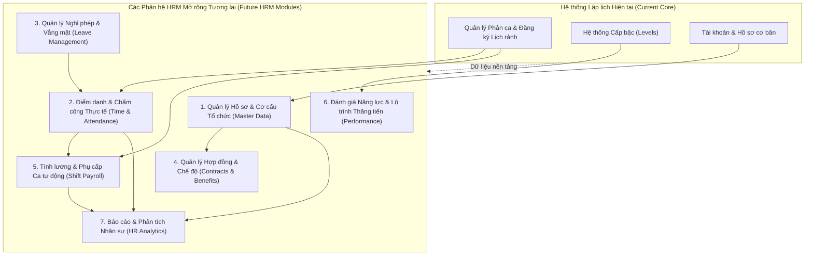

# BÁO CÁO ĐẶC TẢ YÊU CẦU CHỨC NĂNG HỆ THỐNG
## (FUNCTIONAL REQUIREMENTS SPECIFICATION)
### Dự án: Hệ thống Phân lịch Làm việc Tự động (Schedule Manager)
*Cơ sở phân tích hiện trạng và tài liệu tiền đề cho việc mở rộng thành Hệ thống Quản trị Nguồn nhân lực (HRM)*

---

**Thông tin tài liệu:**
- **Tên dự án:** Schedule Manager (`schedule-manager-api` / `ManageSchedule`)
- **Vai trò thực hiện:** Software Analyst (Chuyên viên Phân tích Phần mềm)
- **Phương pháp phân tích:** Codebase Inspection & Reverse Engineering (Truy vết mã nguồn tĩnh, lược đồ cơ sở dữ liệu, bộ kiểm thử và kiểm chứng luồng hoạt động)
- **Tình trạng phân tích:** Dựa trên toàn bộ mã nguồn thực tế tại thời điểm kiểm tra
- **Phiên bản tài liệu:** 1.0.0

---

## MỤC LỤC

1. [TỔNG QUAN HỆ THỐNG](#1-tổng-quan-hệ-thống)
   - 1.1. Tên dự án và mục đích hệ thống
   - 1.2. Bài toán nghiệp vụ đang giải quyết
   - 1.3. Phạm vi chức năng hiện tại
   - 1.4. Công nghệ sử dụng (Tech Stack)
   - 1.5. Kiến trúc hệ thống và luồng giao tiếp giữa các thành phần
2. [CÁC TÁC NHÂN HỆ THỐNG (ACTORS & PERMISSIONS)](#2-các-tác-nhân-hệ-thống-actors--permissions)
   - 2.1. Danh sách tác nhân được xác minh trong code
   - 2.2. Ma trận phân quyền và phạm vi truy cập
   - 2.3. Phân biệt quyền hạn thực thi Backend và thể hiện Frontend
3. [DANH SÁCH YÊU CẦU CHỨC NĂNG (FUNCTIONAL REQUIREMENTS)](#3-danh-sách-yêu-cầu-chức-năng-functional-requirements)
   - 3.1. Phân hệ Quản lý Tài khoản & Xác thực (FR-ACC)
   - 3.2. Phân hệ Quản lý Nhân sự & Cấp bậc (FR-EMP)
   - 3.3. Phân hệ Quản lý Kỳ đăng ký lịch (FR-PER)
   - 3.4. Phân hệ Đăng ký Thời gian rảnh (FR-AVA)
   - 3.5. Phân hệ Quản lý Ca làm việc & Quy tắc phân lịch (FR-SCH)
   - 3.6. Phân hệ Phân lịch tự động & Phân công thủ công (FR-ENG)
   - 3.7. Phân hệ Duyệt, Công bố & Quản lý Phân công (FR-PUB)
   - 3.8. Phân hệ Báo cáo & Nhật ký Kiểm toán (FR-REP)
   - 3.9. Phân hệ Tiện ích Khung ứng dụng & Trợ năng (FR-SYS)
4. [ĐẶC TẢ NGHIỆP VỤ LỊCH LÀM VIỆC CHUYÊN SÂU](#4-đặc-tả-nghiệp-vụ-lịch-làm-việc-chuyên-sâu)
   - 4.1. Đăng ký thời gian rảnh và kiểm soát hạn chót
   - 4.2. Cấu hình ca làm việc và các chế độ nhân sự
   - 4.3. Thuật toán phân lịch tự động (Heuristic / Constraint-Satisfaction)
   - 4.4. Bộ kiểm tra an toàn và xung đột lịch (Safety Check Engine)
   - 4.5. Phân công theo Cấp bậc (Level) và Cơ chế thay thế cấp bậc
   - 4.6. Kiểm soát mục tiêu giờ làm việc
   - 4.7. Cơ chế Duyệt và Công bố lịch
   - 4.8. Giám sát tổng giờ làm và sai lệch mục tiêu
5. [YÊU CẦU PHI CHỨC NĂNG VÀ AN NINH HỆ THỐNG](#5-yêu-cầu-phi-chức-năng-và-an-ninh-hệ-thống)
   - 5.1. Xác thực và Kiểm soát phiên (Stateless JWT Security)
   - 5.2. Kiểm tra tính hợp lệ dữ liệu (Input Validation)
   - 5.3. Xử lý lỗi và Ngăn ngừa lộ lọt thông tin
   - 5.4. Bảo vệ thông tin nhạy cảm và Mật khẩu người dùng
   - 5.5. Nhật ký hoạt động và Khả năng kiểm toán (Audit Trail)
   - 5.6. Thiết kế trợ năng (Accessibility - a11y) và Đáp ứng giao diện (Responsive)
   - 5.7. Hiệu năng và Khả năng mở rộng
6. [DỮ LIỆU VÀ CƠ SỞ DỮ LIỆU](#6-dữ-liệu-và-cơ-sở-dữ-liệu)
   - 6.1. Kiến trúc lưu trữ hai tầng (Dual-Tier Persistence)
   - 6.2. Lược đồ cơ sở dữ liệu quan hệ Backend (SQL Server Migrations V1–V5)
   - 6.3. Mô hình dữ liệu Frontend (LocalStorage Data Models)
   - 6.4. Đánh giá tính sẵn sàng của dữ liệu thực tế và Kế hoạch đồng bộ
7. [API VÀ TÍCH HỢP HỆ THỐNG](#7-api-và-tích-hợp-hệ-thống)
   - 7.1. Danh mục API Backend đã triển khai thực tế
   - 7.2. Tình trạng tích hợp giữa Frontend và Backend hiện tại
   - 7.3. Đặc tả các API còn thiếu cần xây dựng để đồng bộ hoàn toàn
8. [TỔNG KẾT HIỆN TRẠNG TRIỂN KHAI](#8-tổng-kết-hiện-trạng-triển-khai)
   - 8.1. Ma trận đánh giá trạng thái các phân hệ
   - 8.2. Danh sách giới hạn và khiếm khuyết kỹ thuật đã xác minh
   - 8.3. Các điểm chưa thể xác minh từ mã nguồn
9. [ĐỀ XUẤT HƯỚNG PHÁT TRIỂN MỞ RỘNG HỆ THỐNG HRM TƯƠNG LAI](#9-đề-xuất-hướng-phát-triển-mở-rộng-hệ-thống-hrm-tương-lai)
   - 9.1. Quản lý Hồ sơ Nhân sự Toàn diện (Employee Master Data)
   - 9.2. Hệ thống Điểm danh & Chấm công Thực tế (Time & Attendance)
   - 9.3. Quản lý Nghỉ phép & Vắng mặt (Leave Management)
   - 9.4. Quản lý Hợp đồng Lao động & Bảo hiểm (Employment Contracts)
   - 9.5. Tính lương & Phụ cấp Ca tự động (Shift Payroll & Compensation)
   - 9.6. Đánh giá Hiệu suất & Lộ trình Thăng tiến (Performance & Level Progression)
   - 9.7. Phân tích Dữ liệu Nguồn nhân lực (HR Analytics & Dashboards)

---

## 1. TỔNG QUAN HỆ THỐNG

### 1.1. Tên dự án và mục đích hệ thống
Theo thông tin ghi nhận trong tệp cấu hình `pom.xml`, tiêu đề `index.html` và mã nguồn:
- **Tên dự án:** Schedule Manager (Mã định danh Maven: `ManageSchedule`, Tên ứng dụng Spring Boot: `schedule-manager-api`).
- **Mục đích:** Cung cấp giải pháp phần mềm hỗ trợ quản trị viên lập kế hoạch phân ca làm việc, thu thập thời gian rảnh của nhân viên, tự động sắp xếp nhân sự vào các ca trực dựa trên ràng buộc năng lực/cấp bậc và giờ làm mục tiêu, đồng thời hỗ trợ nhân viên theo dõi lịch làm việc cá nhân.

### 1.2. Bài toán nghiệp vụ đang giải quyết
Hệ thống giải quyết bài toán quản lý và điều phối lao động đặc thù theo ca kíp (như nhà hàng, bán lẻ, dịch vụ y tế, vận hành dịch vụ):
1. **Thu thập lịch rảnh không tập trung:** Thay vì khai báo thủ công phân tán qua bảng tính hoặc tin nhắn, nhân viên được cấp giao diện chuẩn để đăng ký khung giờ rảnh trong từng kỳ cụ thể kèm hạn chót đóng đăng ký.
2. **Xung đột ca và vi phạm lao động:** Nhân viên thường xuyên bị trùng ca, không đủ thời gian nghỉ giữa 2 ca liên tiếp (nghỉ ca đêm - sáng hôm sau), hoặc làm quá số giờ quy định trong ngày/tuần.
3. **Phân bổ thiếu cân bằng:** Sự chênh lệch giữa giờ làm thực tế và giờ làm mục tiêu theo hợp đồng/cấp bậc (Level) của nhân viên.
4. **Đáp ứng cơ cấu kỹ năng trong ca:** Mỗi ca trực yêu cầu một cơ cấu nhân sự nhất định (ví dụ: cần ít nhất 1 Trưởng ca Level 4, 1 Nhân viên kỳ cựu Level 3, 2 Nhân viên chính thức Level 2 và 2 Nhân viên mới Level 1).
5. **Thiếu cơ chế chạy thử nghiệm (Simulation):** Quản lý không thể biết trước lịch có bị thiếu hụt (understaffed) hay không trước khi chính thức áp dụng.

### 1.3. Phạm vi chức năng hiện tại
Hệ thống hiện tại gồm 2 thành phần độc lập trong cùng một repository:
1. **Phần ứng dụng SPA Frontend (`index.html`, `js/*`, `partials/*`):**
   - Đã hiện thực hóa toàn bộ logic nghiệp vụ trên trình duyệt: xác thực người dùng phía client, quản lý nhân viên, quản lý cấp bậc (Level), tạo kỳ đăng ký, nhân viên đăng ký thời gian rảnh, tạo ca làm việc, cấu hình quy tắc phân lịch, chạy thuật toán phân lịch tự động (hỗ trợ Dry-run), phân công thủ công có kiểm tra ràng buộc, duyệt và công bố lịch, xem lịch dạng Tháng/Tuần/Ngày, theo dõi nhật ký thay đổi và báo cáo số giờ làm.
   - Lưu trữ toàn bộ dữ liệu nghiệp vụ bằng `localStorage` với bộ dữ liệu mẫu (Seed Demo Data) phong phú.
2. **Phần Backend API (`src/main/java/*`, `src/main/resources/*`):**
   - Đã xây dựng nền tảng dịch vụ Spring Boot 3.5.6 với Spring Security và cơ chế phát hành/xác thực JWT không trạng thái (Stateless).
   - Đã triển khai kiểm tra trạng thái dịch vụ và kết nối cơ sở dữ liệu (`/api/health`, `/api/health/database`).
   - Đã triển khai API đăng nhập xác thực tài khoản qua mật khẩu mã hóa BCrypt (`/api/auth/login`), API đăng xuất (`/api/auth/logout`) và API tra cứu danh mục cấp bậc (`/api/levels`).
   - Đã hoàn thiện toàn bộ thiết kế lược đồ cơ sở dữ liệu quan hệ cho toàn bộ nghiệp vụ quản lý nhân sự và phân ca thông qua 5 tệp Flyway Migration (`V1` đến `V5`).

> [!IMPORTANT]
> **Hiện trạng tích hợp:** Frontend hiện tại **chưa kết nối mạng** với Backend API. Toàn bộ trải nghiệm nghiệp vụ trên giao diện người dùng đang chạy độc lập trên bộ nhớ trình duyệt (`localStorage`). Backend API hiện tại đang đóng vai trò là tầng dịch vụ nền móng (Core Infrastructure) chuẩn bị cho việc di trú toàn bộ dữ liệu và logic phân lịch từ Frontend sang Máy chủ.

### 1.4. Công nghệ sử dụng (Tech Stack)

| Tầng kiến trúc | Công nghệ / Thư viện | Phiên bản | Bằng chứng mã nguồn |
|---|---|---|---|
| **Backend Framework** | Spring Boot (Starter Web, Actuator, Security, JDBC) | 3.5.6 | `pom.xml` |
| **Ngôn ngữ Backend** | Java | 21 | `pom.xml` (`<java.version>21</java.version>`) |
| **Cơ sở dữ liệu** | Microsoft SQL Server (mssql-jdbc) | Runtime Driver | `pom.xml`, `application-sqlserver.properties` |
| **Cơ sở dữ liệu kiểm thử**| H2 Database Engine (In-Memory) | Scope Test | `pom.xml`, `application-test.properties` |
| **Database Migration** | Flyway Core & Flyway SQL Server | Bản tích hợp Spring | `pom.xml`, `src/main/resources/db/migration/*` |
| **Xác thực & Bảo mật** | Spring Security 6.x + JJWT (API, Impl, Jackson) | 0.13.0 | `pom.xml`, `SecurityConfig.java`, `JwtUtil.java` |
| **Mã hóa mật khẩu** | Spring Security BCryptPasswordEncoder (Cost factor 10) | Mặc định Spring | `SecurityConfig.java`, `AuthService.java` |
| **Frontend Core** | HTML5, CSS3 thuần, Vanilla JavaScript (ES6+) | Chuẩn W3C/ECMAScript | `index.html`, `css/styles.css`, `js/*.js` |
| **Cơ chế nạp Module SPA**| Custom Dynamic Bootstrapper qua Fetch API | Tự phát triển | `js/bootstrap.js` |
| **Lưu trữ Frontend** | Web Storage API (`localStorage`) | Chuẩn HTML5 | `js/storage.js` |
| **Phông chữ & Kiểu dáng**| Google Fonts (Inter) | SVG Icons nội tuyến | `index.html`, `partials/app-shell.html` |
| **Kiểm thử tự động** | JUnit 5, Spring Boot Test, Mockito, MockMvc, Browser Smoke Suite | 5.x / Custom Runner | `src/test/java/*`, `tests/browser-smoke.*` |

### 1.5. Kiến trúc hệ thống và luồng giao tiếp giữa các thành phần

---

## 2. CÁC TÁC NHÂN HỆ THỐNG (ACTORS & PERMISSIONS)

### 2.1. Danh sách tác nhân được xác minh trong code

1. **Quản trị viên (Admin):**
   - **Định danh trong code:** `role = 'admin'` (xác thực tại `V1__create_levels_and_users.sql`, `UserRecord.java`, `admin.js`, `app.js`).
   - **Tài khoản mặc định:** `admin` (mật khẩu frontend demo: `admin123`; mật khẩu backend seed: `Admin@123`).
   - **Phạm vi quản lý:** Toàn quyền quản trị hệ thống, bao gồm cấu hình danh mục nhân sự, kỳ đăng ký, ca làm việc, thiết lập ràng buộc thuật toán, điều phối nhân sự, duyệt công bố ca và kiểm toán hệ thống.

2. **Nhân viên (User / Staff):**
   - **Định danh trong code:** `role = 'user'` (xác thực tại check constraint `ck_users_role CHECK (role IN ('admin', 'user'))`).
   - **Tài khoản mặc định demo:** `nv001` đến `nv012` (mật khẩu demo: `user123`).
   - **Phạm vi quản lý:** Quản lý thông tin cá nhân, tự đổi mật khẩu, xem lịch làm việc được phân công, khai báo thời gian rảnh theo từng kỳ đăng ký được mở.

3. **Tiến trình Phân lịch Tự động (System / Scheduler Engine):**
   - **Định danh trong code:** `assignedBy: 'auto'` (tại `scheduler.js:218`, `storage.js:370`).
   - **Vai trò:** Thực thi thuật toán sắp xếp tự động dựa trên ràng buộc thời gian rảnh, năng lực cấp bậc và giới hạn giờ làm việc của nhân sự.

### 2.2. Ma trận phân quyền và phạm vi truy cập

| Khu vực / Chức năng nghiệp vụ | Quản trị viên (Admin) | Nhân viên (User) | Ghi chú bằng chứng code |
|---|:---:|:---:|---|
| **Đăng nhập & Đổi mật khẩu cá nhân** | Toàn quyền | Toàn quyền | `app.js:94`, `user.js:593` |
| **Bảng điều khiển Tổng quan (Dashboard)** | Xem thống kê toàn hệ thống | Xem thống kê cá nhân | `admin.js:11`, `user.js:14` |
| **Quản lý danh sách Nhân sự (Thêm/Sửa/Khóa)** | Toàn quyền | Không có quyền | `admin.js:148` (`ADMIN_ROUTES`) |
| **Quản lý Cấp bậc & Màu sắc (Levels)** | Toàn quyền | Chỉ xem cấp bậc bản thân | `admin.js:419`, `user.js:555` |
| **Quản lý Kỳ đăng ký (Tạo/Mở/Khóa/Nhân bản)** | Toàn quyền | Không có quyền | `admin2.js:11` |
| **Đăng ký thời gian rảnh cá nhân** | Không khả dụng (Admin không có Level) | Toàn quyền trong kỳ mở | `user.js:130` |
| **Xem danh sách nhân viên đã gửi lịch rảnh**| Toàn quyền xem mọi NV | Không có quyền | `admin2.js:313` |
| **Tạo, sửa, xóa, sao chép ca làm việc** | Toàn quyền | Không có quyền | `admin2.js:567` |
| **Xem lịch làm việc tổng hợp (Tháng/Tuần/Ngày)**| Xem toàn bộ nhân sự | Chỉ xem ca của mình | `admin2.js:358`, `user.js:411` |
| **Cấu hình quy tắc phân lịch (Rules)** | Toàn quyền | Không có quyền | `admin3.js:12` |
| **Chạy phân lịch tự động (Thử nghiệm & Áp dụng)**| Toàn quyền | Không có quyền | `admin3.js:199` |
| **Phân công / Hủy phân công thủ công** | Toàn quyền (Có Override) | Không có quyền | `admin2.js:1022`, `scheduler.js:327` |
| **Duyệt và Công bố lịch ca** | Toàn quyền (Có Force Publish)| Không có quyền | `admin3.js:375`, `scheduler.js:299` |
| **Xem Nhật ký Kiểm toán (Audit History)** | Toàn quyền | Không có quyền | `admin3.js:535` |
| **Xem Báo cáo Tổng hợp Giờ làm & Tỷ lệ đạt**| Toàn quyền | Xem giờ cá nhân | `admin3.js:641`, `user.js:60` |
| **Khôi phục dữ liệu mẫu (Reset Demo)** | Toàn quyền | Toàn quyền (Thao tác thử nghiệm)| `app.js:616` |

### 2.3. Phân biệt quyền hạn thực thi Backend và thể hiện Frontend

- **Tại Frontend (SPA):**
  - Việc kiểm soát quyền hạn được thực thi qua cấu hình danh sách tuyến đường (`ADMIN_ROUTES` vs `USER_ROUTES` trong `app.js:9-26`).
  - Khi người dùng đăng nhập thành công, biến trạng thái `State.get.currentUser()` lưu thông tin vai trò. Thanh điều hướng Sidebar được dựng động dựa trên vai trò này.
  - Các hàm kiểm tra form hoặc modal đều ẩn nút bấm hoặc ngăn chặn render màn hình nếu vai trò không tương ứng. Tuy nhiên, do toàn bộ mã JavaScript và `localStorage` nằm trên máy khách, cơ chế bảo vệ này chỉ mang tính chất giao diện (UI Protection), người dùng am hiểu kỹ thuật có thể can thiệp biến bộ nhớ.
- **Tại Backend (Spring Boot API):**
  - Quyền hạn được thực thi nghiêm ngặt tại tầng lọc bảo mật `SecurityConfig.java:80-89` và `JwtAuthenticationFilter.java:60-73`.
  - Bộ lọc trích xuất Claim `role` từ JWT, gán tiền tố Spring Security `ROLE_ADMIN` hoặc `ROLE_USER`.
  - Endpoint `/api/levels` hiện được cấu hình yêu cầu xác thực (`.anyRequest().authenticated()`).
  - Mật khẩu lưu trữ tại Backend được mã hóa một chiều qua hàm băm BCrypt, ngăn chặn hoàn toàn việc so khớp plain-text.

---

## 3. DANH SÁCH YÊU CẦU CHỨC NĂNG (FUNCTIONAL REQUIREMENTS)

### 3.1. Phân hệ Quản lý Tài khoản & Xác thực (FR-ACC)

#### FR-ACC-01: Đăng nhập hệ thống (Authentication)
- **Mô tả chức năng:** Xác thực danh tính người dùng bằng tên đăng nhập và mật khẩu. Cấp quyền truy cập vào không gian làm việc tương ứng với vai trò.
- **Tác nhân thực hiện:** Quản trị viên, Nhân viên.
- **Điều kiện tiên quyết:** Tài khoản đã được tạo trong hệ thống và ở trạng thái hoạt động (`status = 'active'`).
- **Luồng xử lý chính (Main Flow):**
  1. Người dùng truy cập hệ thống, giao diện hiển thị màn hình đăng nhập (`partials/login.html`).
  2. Người dùng nhập `username` và `password`, nhấn nút "Đăng nhập".
  3. Hệ thống tìm kiếm bản ghi người dùng khớp `username` và kiểm tra mật khẩu.
  4. Hệ thống kiểm tra trạng thái tài khoản: nếu `active`, lưu thông tin phiên làm việc vào `State.mut.setCurrentUser()` (và Backend trả về JWT token).
  5. Hệ thống chuyển hướng người dùng đến trang chủ tương ứng (Admin -> `dashboard`; User -> `overview`).
- **Luồng ngoại lệ / Lỗi (Exception Flows):**
  - *EX-01 (Bỏ trống trường):* Nếu người dùng để trống tên đăng nhập hoặc mật khẩu, hệ thống hiển thị thông báo lỗi inline dưới trường tương ứng ("Vui lòng nhập tên đăng nhập" / "Vui lòng nhập mật khẩu").
  - *EX-02 (Sai thông tin đăng nhập):* Nếu không tìm thấy username hoặc mật khẩu không khớp, hệ thống hiển thị thông báo lỗi chung: "Tên đăng nhập hoặc mật khẩu không đúng" (trên Backend trả về HTTP 401 Unauthorized `{"error": "Invalid credentials"}`).
  - *EX-03 (Tài khoản bị khóa):* Nếu tài khoản có `status = 'inactive'`, hệ thống chặn truy cập và báo: "Tài khoản đã bị khóa. Vui lòng liên hệ Admin" (Backend trả về HTTP 401).
- **Dữ liệu đầu vào & Đầu ra:**
  - Đầu vào: `username` (string), `password` (string).
  - Đầu ra: Phiên làm việc hợp lệ (`currentUser` object gồm `id`, `username`, `role`, `fullName`) và JWT token (phía Backend).
- **Quy tắc nghiệp vụ:** Không phân biệt thông báo lỗi sai username hay sai mật khẩu nhằm chống tấn công vét cạn liệt kê tài khoản (Username Enumeration Prevention).
- **Trạng thái triển khai:**
  - Frontend: Hoàn chỉnh (`app.js:94-112`).
  - Backend API: Hoàn chỉnh (`AuthController.java:27-33`, `AuthService.java:56-61`).
- **Bằng chứng mã nguồn:** `partials/login.html`, `js/app.js` (L94–L112), `src/main/java/org/dacnpm/schedulemanager/api/auth/AuthController.java`.

#### FR-ACC-02: Đăng xuất hệ thống (Logout)
- **Mô tả chức năng:** Chấm dứt phiên làm việc hiện tại của người dùng, dọn dẹp trạng thái đăng nhập và đưa người dùng về màn hình đăng nhập.
- **Tác nhân thực hiện:** Quản trị viên, Nhân viên.
- **Điều kiện tiên quyết:** Người dùng đang đăng nhập.
- **Luồng xử lý chính:**
  1. Người dùng mở menu tài khoản ở Topbar và nhấn "Đăng xuất".
  2. Hệ thống hiển thị hộp thoại xác nhận (Confirm Dialog): "Xác nhận đăng xuất?".
  3. Người dùng chọn "Xác nhận".
  4. Hệ thống xóa thông tin phiên trong `localStorage` (`Storage.remove('pls_current_user')`), đặt lại `_currentRoute = null`, ẩn khung ứng dụng và hiển thị màn hình đăng nhập.
- **Quy tắc nghiệp vụ:** Backend sử dụng kiến trúc Stateless JWT nên không lưu session trên server; việc đăng xuất do client chủ động hủy bỏ Token (`AuthController.java:40-43`).
- **Trạng thái triển khai:** Hoàn chỉnh trên cả Frontend và Backend.
- **Bằng chứng mã nguồn:** `js/app.js` (L121–L127), `AuthController.java` (L40–L43).

#### FR-ACC-03: Đổi mật khẩu cá nhân (Change Password)
- **Mô tả chức năng:** Cho phép người dùng đang đăng nhập chủ động thay đổi mật khẩu tài khoản cá nhân.
- **Tác nhân thực hiện:** Nhân viên (và Quản trị viên thông qua chỉnh sửa người dùng).
- **Điều kiện tiên quyết:** Người dùng đã đăng nhập vào hệ thống.
- **Luồng xử lý chính:**
  1. Người dùng vào mục "Thông tin cá nhân" (`profile`) và nhấn "Đổi mật khẩu".
  2. Hệ thống hiển thị modal form yêu cầu: Mật khẩu hiện tại, Mật khẩu mới, Xác nhận mật khẩu mới.
  3. Người dùng nhập thông tin và nhấn "Lưu thay đổi".
  4. Hệ thống kiểm tra: Mật khẩu hiện tại phải trùng khớp với mật khẩu đang lưu; Mật khẩu mới phải có ít nhất 6 ký tự; Mật khẩu xác nhận phải trùng khớp tuyệt đối với mật khẩu mới.
  5. Cập nhật mật khẩu trong `State` và `Storage`, ghi nhật ký kiểm toán và hiển thị thông báo Toast thành công. Đóng modal.
- **Luồng ngoại lệ:**
  - *EX-01:* Mật khẩu hiện tại không đúng -> Báo lỗi inline trường mật khẩu cũ.
  - *EX-02:* Mật khẩu mới dưới 6 ký tự -> Báo lỗi "Mật khẩu phải có ít nhất 6 ký tự".
  - *EX-03:* Xác nhận mật khẩu không khớp -> Báo lỗi "Mật khẩu xác nhận không khớp".
- **Trạng thái triển khai:** Hoàn chỉnh trên Frontend. Chưa có Backend API tương ứng.
- **Bằng chứng mã nguồn:** `js/user.js` (L593–L646).

---

### 3.2. Phân hệ Quản lý Nhân sự & Cấp bậc (FR-EMP)

#### FR-EMP-01: Quản lý danh sách nhân sự (Staff List & Filtering)
- **Mô tả chức năng:** Xem toàn bộ danh sách nhân viên trong doanh nghiệp, hỗ trợ tìm kiếm nhanh theo mã/tên/username, lọc theo Cấp bậc (Level) và trạng thái hoạt động.
- **Tác nhân thực hiện:** Quản trị viên.
- **Điều kiện tiên quyết:** Đăng nhập với vai trò Admin.
- **Luồng xử lý chính:**
  1. Admin chọn menu "Quản lý nhân sự" (`users`).
  2. Hệ thống truy vấn toàn bộ danh sách nhân sự từ `State.get.users()`, nạp danh mục cấp bậc `State.get.levels()`.
  3. Hiển thị bảng danh sách gồm: Mã NV, Họ và tên, Tên đăng nhập, Cấp bậc (badge màu), Tỷ lệ giờ mục tiêu (Target Rate), Trạng thái (Đang hoạt động / Tạm khóa), Ngày vào làm, Số điện thoại và Thao tác.
  4. Khi Admin nhập từ khóa vào ô tìm kiếm hoặc chọn bộ lọc Level/Trạng thái, bảng dữ liệu tự động cập nhật không cần tải lại trang.
- **Trạng thái triển khai:** Hoàn chỉnh trên Frontend (`localStorage`). Backend đã có schema bảng `users` nhưng chưa triển khai controller `GET /api/users`.
- **Bằng chứng mã nguồn:** `js/admin.js` (L148–L252).

#### FR-EMP-02: Thêm mới nhân sự (Create Staff)
- **Mô tả chức năng:** Tiếp nhận hồ sơ nhân viên mới vào hệ thống phân lịch.
- **Tác nhân thực hiện:** Quản trị viên.
- **Luồng xử lý chính:**
  1. Admin nhấn nút "+ Thêm nhân viên" tại màn hình quản lý nhân sự.
  2. Modal biểu mẫu mở ra gồm các trường: Mã NV (`code`), Họ tên (`fullName`), Tên đăng nhập (`username`), Mật khẩu (`password`), Vai trò (`role`: Admin/Nhân viên), Cấp bậc (`levelId`), Tỷ lệ giờ mục tiêu (`targetRate`), Ngày vào làm (`joinDate`), Điện thoại (`phone`), Email (`email`), Ghi chú (`note`).
  3. Admin nhập dữ liệu và nhấn "Lưu".
  4. Hệ thống kiểm tra hợp lệ dữ liệu (Validation Engine):
     - `code`: Bắt buộc, tối đa 20 ký tự, không được trùng với mã đã có (`UniqueCheck.userCode`).
     - `fullName`: Bắt buộc, tối đa 100 ký tự.
     - `username`: Bắt buộc, 3–30 ký tự chỉ gồm chữ thường/số/gạch dưới (`^[a-z0-9_]{3,30}$`), duy nhất toàn hệ thống (`UniqueCheck.username`).
     - `password`: Bắt buộc, ít nhất 6 ký tự.
     - `role`: Bắt buộc. Nếu là 'user', bắt buộc phải chọn `levelId`.
     - `targetRate`: Bắt buộc là số từ 0% đến 200% (mặc định 100%).
  5. Nếu dữ liệu hợp lệ, hệ thống tạo bản ghi mới với ID sinh tự động (`usr_timestamp_random`), trạng thái mặc định `active`, lưu vào `State.mut.saveUser()`, ghi nhật ký hệ thống `logHistory('user_create')`, đóng modal và tải lại bảng nhân sự.
- **Trạng thái triển khai:** Hoàn chỉnh trên Frontend. Schema Backend `V1` hỗ trợ đầy đủ các ràng buộc trên.
- **Bằng chứng mã nguồn:** `js/admin.js` (L254–L367), `js/validation.js` (L55–L76, L314–L327).

#### FR-EMP-03: Cập nhật thông tin nhân sự (Update Staff)
- **Mô tả chức năng:** Chỉnh sửa thông tin hồ sơ, cấp bậc hoặc điều chỉnh tỷ lệ giờ mục tiêu của nhân viên.
- **Tác nhân thực hiện:** Quản trị viên.
- **Luồng xử lý chính:**
  1. Admin nhấn biểu tượng "Chỉnh sửa" tại dòng nhân viên tương ứng.
  2. Hệ thống mở modal, điền sẵn toàn bộ dữ liệu hiện tại của nhân viên. Trường mật khẩu được để trống (chỉ nhập khi muốn đặt lại mật khẩu cho nhân viên).
  3. Admin sửa các trường thông tin cần thiết và nhấn "Lưu".
  4. Hệ thống xác thực tính hợp lệ (bỏ qua kiểm tra trùng với chính ID của nhân viên đang sửa).
  5. Cập nhật bản ghi trong `State`, đồng bộ `localStorage`, ghi nhật ký kiểm toán `logHistory('user_update')`.
- **Trạng thái triển khai:** Hoàn chỉnh trên Frontend.
- **Bằng chứng mã nguồn:** `js/admin.js` (L254–L367).

#### FR-EMP-04: Khóa / Kích hoạt tài khoản nhân sự (Toggle Staff Status)
- **Mô tả chức năng:** Tạm dừng hoạt động của tài khoản nhân viên (nghỉ việc, tạm nghỉ dài hạn) hoặc kích hoạt lại tài khoản bị khóa.
- **Tác nhân thực hiện:** Quản trị viên.
- **Luồng xử lý chính:**
  1. Admin nhấn nút "Khóa" hoặc "Kích hoạt" tại cột thao tác.
  2. Hệ thống kiểm tra: Không cho phép Admin tự khóa tài khoản của chính mình (`u.id === currentUser.id`).
  3. Hệ thống hiển thị hộp thoại xác nhận yêu cầu nhập lý do (`requireReason: true`).
  4. Admin nhập lý do và bấm "Xác nhận".
  5. Trạng thái người dùng được chuyển đổi giữa `active` và `inactive`. Ghi nhật ký kiểm toán kèm lý do. Nhân viên bị khóa sẽ không thể đăng nhập hoặc tham gia phân lịch tự động.
- **Trạng thái triển khai:** Hoàn chỉnh trên Frontend.
- **Bằng chứng mã nguồn:** `js/admin.js` (L369–L381).

#### FR-EMP-05: Quản lý danh mục Cấp bậc (Level Management)
- **Mô tả chức năng:** Thiết lập danh mục cấp bậc kỹ năng nhân sự (ví dụ: Level 1 - Mới, Level 2 - Chính thức, Level 3 - Kỳ cựu, Level 4 - Trưởng ca), cấu hình màu nhận diện và thứ tự ưu tiên.
- **Tác nhân thực hiện:** Quản trị viên.
- **Luồng xử lý chính:**
  1. Admin mở modal "Quản lý Level" từ màn hình nhân sự.
  2. Hệ thống hiển thị danh sách các Level hiện có sắp xếp theo thứ tự `order`.
  3. Admin có thể:
     - Thêm mới Level: Nhập Tên Level (tối đa 50 ký tự, không trùng lặp), Thứ tự (số nguyên dương), Màu sắc (mã Hex picker), Mô tả.
     - Sửa inline: Chỉnh sửa trực tiếp tên, thứ tự hoặc màu của Level đã có.
     - Xóa Level: Hệ thống kiểm tra xem có nhân viên nào đang được gán Level này không (`State.get.users().some(u => u.levelId === levelId)`). Nếu còn nhân viên, hệ thống cảnh báo và từ chối xóa.
- **Trạng thái triển khai:**
  - Frontend: Hoàn chỉnh (`admin.js:419–L524`).
  - Backend API: Đã có API lấy danh sách `GET /api/levels` (`LevelController.java:21-24`, `LevelRepository.java:19-30`). Chưa có API thêm/sửa/xóa Level.
- **Bằng chứng mã nguồn:** `js/admin.js` (L419–L524), `LevelController.java`, `V1__create_levels_and_users.sql`, `V2__seed_initial_levels.sql`.

---

### 3.3. Phân hệ Quản lý Kỳ đăng ký lịch (FR-PER)

#### FR-PER-01: Quản lý danh sách kỳ đăng ký (Period Management)
- **Mô tả chức năng:** Thiết lập các chu kỳ phân lịch làm việc (theo tháng, tuần hoặc giai đoạn đặc biệt), quản lý vòng đời của kỳ phân lịch.
- **Tác nhân thực hiện:** Quản trị viên.
- **Vòng đời trạng thái của kỳ đăng ký:**
  - `draft` (Bản nháp): Đang cấu hình, chưa mở cho nhân viên thấy.
  - `not_open` (Chưa mở): Đã lên kế hoạch nhưng chưa đến thời điểm mở `openAt`.
  - `open` (Đang mở): Nhân viên được phép vào đăng ký thời gian rảnh.
  - `locked` (Đã khóa): Đã hết hạn hoặc Admin chủ động khóa sổ để chốt dữ liệu phân lịch.
- **Bằng chứng mã nguồn:** `js/admin2.js` (L11–L80), `V5__create_schedule_domain.sql` (`ck_periods_status`).

#### FR-PER-02: Tạo mới và Cấu hình kỳ đăng ký (Create/Configure Period)
- **Mô tả chức năng:** Tạo một kỳ đăng ký mới với đầy đủ các tham số điều kiện biên.
- **Tác nhân thực hiện:** Quản trị viên.
- **Các thông số cấu hình được xác minh trong code:**
  - `name`: Tên kỳ (ví dụ: "Kỳ tháng 10/2026").
  - `cycle`: Chu kỳ (`monthly`, `weekly`, `custom`).
  - `startDate`, `endDate`: Khoảng ngày áp dụng của kỳ (bắt buộc `endDate >= startDate`).
  - `openAt`: Thời điểm bắt đầu cho phép đăng ký (DateTime).
  - `deadline`: Hạn chót nộp đăng ký (bắt buộc `deadline > openAt`).
  - `autoLock`: Cờ tự động khóa đăng ký khi chạm mốc `deadline`.
  - `allowEditAfterDeadline`: Cho phép nhân viên chỉnh sửa sau hạn chót hay không (Boolean).
  - `allowReopenByAdmin`: Cho phép Admin mở lại kỳ đã khóa hay không (Boolean).
  - `requiredDaysOfWeek`: Mảng các thứ trong tuần áp dụng (0 = Chủ nhật, 1..6 = Thứ 2 đến Thứ 7).
  - `exemptDates`: Danh sách các ngày miễn đăng ký (ngày lễ, ngày nghỉ đặc thù).
  - `applicableUserIds`: Danh sách nhân viên áp dụng (để trống nghĩa là áp dụng cho toàn bộ nhân viên hoạt động).
- **Trạng thái triển khai:** Hoàn chỉnh trên Frontend. Lược đồ Backend tại `V5__create_schedule_domain.sql` (bảng `periods`, `period_applicable_users`, `period_weekdays`, `period_dates`) ánh xạ chính xác 100% cấu trúc này.
- **Bằng chứng mã nguồn:** `js/admin2.js` (L85–L260), `js/validation.js` (L86–L102).

#### FR-PER-03: Thao tác vòng đời kỳ đăng ký (Open / Lock / Reopen / Copy Period)
- **Mô tả chức năng:** Thay đổi trạng thái vận hành của kỳ hoặc nhân bản kỳ sang tháng kế tiếp.
- **Tác nhân thực hiện:** Quản trị viên.
- **Luồng xử lý chính:**
  - *Mở kỳ (`openPeriod`):* Chuyển trạng thái từ `draft`/`not_open` sang `open`. Ghi log lịch sử.
  - *Khóa kỳ (`lockPeriod`):* Chuyển trạng thái sang `locked`. Ngăn chặn toàn bộ thao tác nộp hoặc chỉnh sửa lịch rảnh từ nhân viên.
  - *Mở lại kỳ (`reopenPeriod`):* Nếu kỳ được cấu hình `allowReopenByAdmin: true`, cho phép chuyển trạng thái từ `locked` về `open`.
  - *Sao chép kỳ (`copyPeriod`):* Tự động lấy cấu hình kỳ hiện tại, tăng tháng thêm 1 đơn vị, tạo ngày bắt đầu/kết thúc tương ứng và mở sẵn form cho Admin chỉnh sửa nhanh.
- **Trạng thái triển khai:** Hoàn chỉnh trên Frontend.
- **Bằng chứng mã nguồn:** `js/admin2.js` (L261–L312).

#### FR-PER-04: Giám sát tiến độ đăng ký của nhân viên (Monitor Registrations)
- **Mô tả chức năng:** Thống kê danh sách nhân viên thuộc diện áp dụng của kỳ và tình trạng nộp lịch rảnh của từng người.
- **Tác nhân thực hiện:** Quản trị viên.
- **Luồng xử lý chính:**
  1. Admin bấm nút "Xem đăng ký" tại một kỳ cụ thể.
  2. Modal hiển thị danh sách nhân sự áp dụng, kèm huy hiệu trạng thái: "Đã gửi đăng ký" (Xanh lá), "Bản nháp" (Vàng) hoặc "Chưa đăng ký" (Đỏ).
  3. Cho phép bấm xem chi tiết từng ngày và khung giờ rảnh cụ thể mà nhân viên đã đăng ký.
- **Trạng thái triển khai:** Hoàn chỉnh trên Frontend.
- **Bằng chứng mã nguồn:** `js/admin2.js` (L313–L356).

---

### 3.4. Phân hệ Đăng ký Thời gian rảnh (FR-AVA)

#### FR-AVA-01: Khai báo khung giờ rảnh theo ngày (Declare Availability Slots)
- **Mô tả chức năng:** Nhân viên lựa chọn các ngày trong kỳ và khai báo một hoặc nhiều khoảng thời gian có thể đi làm.
- **Tác nhân thực hiện:** Nhân viên (`role = 'user'`).
- **Điều kiện tiên quyết:** Kỳ đăng ký đang ở trạng thái `open` và chưa quá hạn `deadline` (hoặc kỳ cho phép chỉnh sửa sau hạn).
- **Luồng xử lý chính:**
  1. Nhân viên chọn menu "Đăng ký thời gian rảnh" (`register`).
  2. Hệ thống hiển thị lịch theo từng tuần của kỳ đang mở. Các ngày miễn đăng ký (`exemptDates`) hoặc ngày đóng được đánh dấu rõ ràng.
  3. Nhân viên nhấn vào một ngày hợp lệ để mở modal nhập khung giờ:
     - Thêm một hoặc nhiều khung giờ trong ngày: Giờ bắt đầu (`start`) và Giờ kết thúc (`end`).
     - Sử dụng lối tắt "Cả ngày" (Tự động điền `06:00` đến `23:59`).
     - Sử dụng nút "Xóa ngày" (Xóa trắng đăng ký của ngày đó).
  4. Hệ thống kiểm tra hợp lệ: Giờ kết thúc phải lớn hơn giờ bắt đầu; các khung giờ trong cùng một ngày không được chồng lấn nhau.
  5. Lưu vào cấu trúc dữ liệu bản nháp.
- **Trạng thái triển khai:** Hoàn chỉnh trên Frontend. Lược đồ CSDL Backend đã hỗ trợ cấu trúc phân cấp: `availability_registrations` -> `availability_entries` (ngày) -> `availability_slots` (khung giờ).
- **Bằng chứng mã nguồn:** `js/user.js` (L130–L374).

#### FR-AVA-02: Lưu bản nháp và Gửi chính thức đăng ký (Save Draft & Submit)
- **Mô tả chức năng:** Cho phép nhân viên lưu lại tiến độ khai báo để tiếp tục chỉnh sửa sau, hoặc nộp chính thức cho người quản lý.
- **Tác nhân thực hiện:** Nhân viên.
- **Luồng xử lý chính:**
  - *Lưu nháp (`saveDraft`):* Đánh dấu bản ghi có `status = 'draft'`. Thuật toán phân lịch tự động sẽ không coi nhân viên này là ứng viên sẵn sàng.
  - *Gửi đăng ký (`submitRegistration`):*
    1. Hệ thống kiểm tra xem nhân viên đã đăng ký đủ các ngày yêu cầu trong tuần chưa (`requiredDaysOfWeek`).
    2. Nếu chưa đủ, hiển thị cảnh báo xác nhận nhưng vẫn cho phép nộp nếu người dùng đồng ý.
    3. Cập nhật `status = 'submitted'`, ghi nhận mốc thời gian `submittedAt = new Date().toISOString()`.
    4. Hiển thị thông báo Toast thành công. Bản đăng ký chính thức trở thành dữ liệu đầu vào cho Thuật toán phân lịch.
- **Trạng thái triển khai:** Hoàn chỉnh trên Frontend.
- **Bằng chứng mã nguồn:** `js/user.js` (L375–L408).

---

### 3.5. Phân hệ Quản lý Ca làm việc & Quy tắc phân lịch (FR-SCH)

#### FR-SCH-01: Quản lý danh mục Ca làm việc (Shift Management)
- **Mô tả chức năng:** Thiết lập danh sách các ca làm việc cần bố trí nhân sự trong từng ngày.
- **Tác nhân thực hiện:** Quản trị viên.
- **Các thuộc tính của ca làm việc:**
  - `name`: Tên ca (ví dụ: "Ca sáng", "Ca tối", "Ca đêm").
  - `date`: Ngày trực (`YYYY-MM-DD`).
  - `startTime`, `endTime`: Giờ bắt đầu và kết thúc (`HH:MM`). Hệ thống hỗ trợ ca làm việc xuyên đêm qua ngày hôm sau (Overnight Shift, ví dụ: 22:00 hôm nay đến 06:00 sáng hôm sau).
  - `totalRequired`: Tổng số lượng nhân viên cần cho ca.
  - `status`: Trạng thái ca (`not_scheduled`: Chưa xếp; `draft`: Đã xếp nháp; `full`: Đã đủ người; `understaffed`: Thiếu người; `published`: Đã công bố).
- **Bằng chứng mã nguồn:** `js/admin2.js` (L567–L728), `js/state.js` (L294–L300), `V5__create_schedule_domain.sql` (`shifts`).

#### FR-SCH-02: Cấu hình chế độ nhân sự trong ca (Staffing Assignment Modes)
- **Mô tả chức năng:** Cho phép Admin linh hoạt quy định cơ cấu nhân sự cho từng ca theo 3 chế độ nghiệp vụ:
  1. **Chế độ theo Cấp bậc (`mode = 'level'`):**
     - Admin định nghĩa số lượng nhân sự cụ thể cho từng Level (ví dụ: Level 1: 2 người, Level 2: 2 người, Level 3: 1 người, Level 4: 1 người).
     - Ràng buộc: Tổng số người yêu cầu theo các Level phải bằng chính xác `totalRequired`.
  2. **Chế độ theo Nhân viên cụ thể (`mode = 'user'`):**
     - Chỉ định trực tiếp nhân viên cụ thể vào ca theo 2 mức:
       * *Bắt buộc (`mandatory`):* Thuật toán bắt buộc phải gán nhân viên này vào ca (nếu đủ điều kiện an toàn).
       * *Ưu tiên (`preferred`):* Thuật toán sẽ ưu tiên chọn người này trước nếu họ rảnh; nếu họ bận/trùng lịch sẽ tìm người khác thay thế.
     - Ràng buộc: Số nhân viên bắt buộc không được vượt quá `totalRequired`.
  3. **Chế độ Kết hợp (`mode = 'combined'`):**
     - Kết hợp cả chỉ định nhân viên trực tiếp (bắt buộc/ưu tiên) và các vị trí cần lấp đầy theo tiêu chuẩn Level.
     - Ràng buộc: Số người bắt buộc + Số lượng yêu cầu theo Level không được vượt quá `totalRequired`. Số chỗ còn lại sẽ là vị trí linh hoạt (Flex slots).
- **Trạng thái triển khai:** Hoàn chỉnh trên Frontend. Lược đồ Backend `V5` chứa bảng `shift_level_requirements` và `shift_user_preferences` để phục vụ chính xác 3 chế độ này.
- **Bằng chứng mã nguồn:** `js/admin2.js` (L730–L923), `js/validation.js` (L121–L157).

#### FR-SCH-03: Cấu hình quy tắc phân lịch toàn cục (Schedule Rules)
- **Mô tả chức năng:** Thiết lập các tham số khống chế giới hạn lao động và thuật toán tối ưu.
- **Tác nhân thực hiện:** Quản trị viên.
- **Các quy tắc được xác minh trong code:**
  - `standardHours`: Giờ làm việc chuẩn định mức trong một kỳ (mặc định 80 giờ).
  - `maxHoursPerDay`: Giới hạn giờ làm việc tối đa trong một ngày (mặc định 12 giờ).
  - `maxHoursPerWeek`: Giới hạn giờ làm việc tối đa trong một tuần (mặc định 48 giờ).
  - `maxHoursPerPeriod`: Giới hạn giờ làm việc tối đa trong toàn bộ kỳ (mặc định 80 giờ).
  - `minRestBetweenShifts`: Thời gian nghỉ tối thiểu bắt buộc giữa 2 ca liên tiếp (mặc định 8 giờ).
  - `levelTargetRates`: Tỷ lệ % giờ mục tiêu theo Level (Level 1: 75%, Level 2: 100%, Level 3: 100%, Level 4: 100%).
  - `levelSubstitutions`: Danh sách ma trận cho phép cấp bậc cao thay thế cho cấp bậc thấp khi thiếu nhân sự (ví dụ: Level 4 thay được Level 3, 2, 1; Level 3 thay được 2, 1; Level 2 thay được 1).
  - `schedulingPriority`: Tiêu chí ưu tiên xếp lịch:
    * `most_needed`: Ưu tiên người còn thiếu nhiều giờ nhất so với mục tiêu.
    * `least_hours`: Ưu tiên người hiện đang có tổng số giờ phân công ít nhất.
  - `understaffedPolicy`: Chính sách khi phát hiện ca thiếu nhân sự (`warn`: Cảnh báo và cho phép xử lý tiếp; `block`: Chặn không cho công bố).
- **Trạng thái triển khai:** Hoàn chỉnh trên Frontend. Lược đồ Backend `V5` tạo bảng `schedule_rules`, `schedule_level_targets`, `level_substitutions` và nạp sẵn bản ghi mặc định `rules_main`.
- **Bằng chứng mã nguồn:** `js/admin3.js` (L12–L197), `js/storage.js` (L110–L136), `V5__create_schedule_domain.sql` (L142–L221).

---

### 3.6. Phân hệ Phân lịch tự động & Phân công thủ công (FR-ENG)

#### FR-ENG-01: Kiểm tra tiền điều kiện trước khi phân lịch (Pre-run Inspection)
- **Mô tả chức năng:** Rà soát dữ liệu đầu vào của kỳ phân lịch trước khi thực thi thuật toán để tránh lỗi phân bổ rỗng.
- **Tác nhân thực hiện:** Quản trị viên.
- **Nội dung kiểm tra:** Kiểm tra sự tồn tại của kỳ; kiểm tra đã tạo ca làm việc trong khoảng ngày của kỳ chưa; cảnh báo số lượng nhân viên chưa nộp lịch rảnh; kiểm tra xem có ca nào chưa chọn chế độ nhân sự hay không.
- **Trạng thái triển khai:** Hoàn chỉnh (`scheduler.js:375-396`, `admin3.js:256-273`).

#### FR-ENG-02: Phân lịch tự động với chế độ Chạy thử (Dry Run vs Apply Run)
- **Mô tả chức năng:** Vận hành thuật toán điều phối nhân sự tự động cho toàn bộ các ca chưa công bố trong kỳ.
- **Tác nhân thực hiện:** Quản trị viên.
- **Luồng xử lý chính:**
  1. Admin chọn kỳ và bấm "Chạy thử (Dry Run)" hoặc "Chạy & Áp dụng".
  2. Thuật toán phân lịch (`Scheduler.run`) thực thi theo nguyên lý Heuristic:
     - Sắp xếp thứ tự các ca: Ca nào có ít ứng viên đủ điều kiện nhất (Most Constrained) sẽ được ưu tiên xếp trước.
     - Với mỗi ca, xây dựng danh sách các vị trí cần điền (Slots): Vị trí bắt buộc -> Vị trí ưu tiên -> Vị trí theo Level -> Vị trí linh hoạt.
     - Lọc danh sách ứng viên hợp lệ qua Bộ kiểm tra an toàn (`SafetyCheck`): Không trùng giờ, có đăng ký rảnh bao phủ trọn ca, không vi phạm giới hạn giờ/ngày, giờ/tuần, đạt điều kiện nghỉ ca và phù hợp Level (hoặc có thể thay thế cấp bậc).
     - Chấm điểm và lựa chọn ứng viên tối ưu nhất (người còn thiếu nhiều giờ so với mục tiêu nhất).
  3. Kết thúc thuật toán, hệ thống xuất báo cáo kết quả chi tiết:
     - Danh sách phân công mới.
     - Danh sách ca bị thiếu người (Understaffed) kèm số lượng thiếu.
     - Danh sách ứng viên bị từ chối kèm lý do chi tiết (ví dụ: bận giờ rảnh, vượt quá giờ/ngày, không đủ thời gian nghỉ).
     - Danh sách nhân viên chưa đạt chỉ tiêu giờ làm việc.
     - Nhật ký thực thi từng bước (Execution Log).
  4. Nếu là chế độ "Chạy thử", không có dữ liệu nào bị thay đổi trong bộ nhớ. Nếu là "Chạy & Áp dụng", toàn bộ phân công được ghi vào State/Storage và cập nhật trạng thái ca.
- **Trạng thái triển khai:** Hoàn chỉnh trên Frontend (`js/scheduler.js`).
- **Bằng chứng mã nguồn:** `js/scheduler.js` (L10–L295), `js/admin3.js` (L199–L373).

#### FR-ENG-03: Phân công nhân sự thủ công (Manual Assignment & Admin Override)
- **Mô tả chức năng:** Cho phép Quản trị viên trực tiếp gán một nhân viên vào ca trực bất kỳ, hỗ trợ cơ chế ghi đè ràng buộc khi cần thiết.
- **Tác nhân thực hiện:** Quản trị viên.
- **Luồng xử lý chính:**
  1. Tại chi tiết ca làm việc, Admin nhấn "Thêm phân công".
  2. Chọn nhân viên từ danh sách nhân sự đang hoạt động.
  3. Hệ thống chạy `SafetyCheck.validateAssignment` trong thời gian thực:
     - Nếu nhân viên đáp ứng mọi điều kiện: Nút xác nhận sáng lên bình thường.
     - Nếu vi phạm ràng buộc không thể vượt qua (như trùng lịch với ca khác cùng giờ): Hệ thống chặn hoàn toàn và hiển thị lỗi màu đỏ.
     - Nếu vi phạm ràng buộc có thể châm chước (nhân viên không khai báo rảnh ngày đó, hoặc ca đã công bố): Hệ thống hiển thị cảnh báo màu vàng, yêu cầu Admin tích chọn "Ghi đè ràng buộc (Admin Override)" và bắt buộc nhập Lý do giải trình (`reason`).
  4. Khi xác nhận, phân công được lưu với `assignedBy = 'admin'`, ghi nhận lý do và cập nhật nhật ký kiểm toán.
- **Trạng thái triển khai:** Hoàn chỉnh trên Frontend.
- **Bằng chứng mã nguồn:** `js/admin2.js` (L1022–L1084), `js/scheduler.js` (L327–L355).

#### FR-ENG-04: Xóa phân công nhân sự (Remove Assignment)
- **Mô tả chức năng:** Hủy bỏ việc phân công một nhân viên ra khỏi ca trực.
- **Tác nhân thực hiện:** Quản trị viên.
- **Luồng xử lý chính:**
  1. Tại chi tiết ca, Admin bấm biểu tượng "Xóa" bên cạnh tên nhân viên được phân công.
  2. Nếu ca trực đã ở trạng thái "Đã công bố", hệ thống bật hộp thoại xác nhận yêu cầu nhập lý do rút nhân viên khỏi ca.
  3. Xóa bản ghi phân công trong `State.assignments`, cập nhật lại trạng thái ca (nếu thiếu người chuyển sang `understaffed`), ghi log lịch sử kiểm toán.
- **Trạng thái triển khai:** Hoàn chỉnh trên Frontend.
- **Bằng chứng mã nguồn:** `js/admin2.js` (L1009–L1020), `js/scheduler.js` (L358–L372).

---

### 3.7. Phân hệ Duyệt, Công bố & Quản lý Phân công (FR-PUB)

#### FR-PUB-01: Duyệt và Công bố lịch ca (Shift Publishing)
- **Mô tả chức năng:** Chuyển trạng thái ca làm việc từ nháp (`draft`/`not_scheduled`) sang chính thức (`published`) để nhân viên có thể nhìn thấy trên lịch cá nhân.
- **Tác nhân thực hiện:** Quản trị viên.
- **Luồng xử lý chính:**
  1. Admin vào màn hình "Duyệt & công bố" (`publish`) hoặc xem chi tiết một ca.
  2. Lựa chọn danh sách các ca cần công bố (hỗ trợ chọn từng ca hoặc "Chọn tất cả").
  3. Nhấn "Công bố các ca đã chọn".
  4. Hệ thống kiểm tra tình trạng đủ nhân sự của từng ca:
     - Nếu toàn bộ các ca đều đủ người: Tiến hành cập nhật trạng thái `published` ngay lập tức.
     - Nếu có ca bị thiếu nhân sự: Hệ thống cảnh báo danh sách các ca bị thiếu và số người thiếu. Nếu chính sách quy tắc là `warn`, Admin có quyền chọn "Buộc công bố (Force Publish)" kèm xác nhận cảnh báo. Nếu chính sách là `block`, hệ thống chặn hoàn toàn thao tác công bố.
  5. Ca sau khi công bố sẽ hiển thị huy hiệu xanh "Đã công bố", hiển thị trên lịch cá nhân của nhân viên và ghi nhật ký hệ thống.
- **Trạng thái triển khai:** Hoàn chỉnh trên Frontend.
- **Bằng chứng mã nguồn:** `js/admin3.js` (L375–L533), `js/scheduler.js` (L299–L324).

#### FR-PUB-02: Theo dõi lịch làm việc cá nhân của Nhân viên (My Schedule)
- **Mô tả chức năng:** Cho phép nhân viên theo dõi toàn bộ các ca làm việc mình đã được phân công và đã được công bố.
- **Tác nhân thực hiện:** Nhân viên.
- **Luồng xử lý chính:**
  1. Nhân viên chọn menu "Lịch làm việc của tôi" (`my-schedule`).
  2. Hệ thống truy vấn các ca có `userId == currentUser.id` và `shift.status === 'published'`.
  3. Hiển thị dưới 2 dạng trực quan:
     - *Dạng Tháng (Month View):* Hiển thị ô lịch các ngày trong tháng, làm nổi bật những ngày có ca trực kèm giờ làm.
     - *Dạng Tuần (Week View):* Hiển thị dạng bảng lưới các ngày trong tuần kèm thông tin chi tiết: Tên ca, Giờ làm, Thời lượng ca, và danh sách các đồng nghiệp cùng trực trong ca.
  4. Cung cấp các nút điều hướng: Xem tháng/tuần trước (`prev`), kế tiếp (`next`) hoặc quay về hôm nay (`today`).
- **Trạng thái triển khai:** Hoàn chỉnh trên Frontend.
- **Bằng chứng mã nguồn:** `js/user.js` (L411–L545).

---

### 3.8. Phân hệ Báo cáo & Nhật ký Kiểm toán (FR-REP)

#### FR-REP-01: Nhật ký Kiểm toán hệ thống (Audit Trail / Activity History)
- **Mô tả chức năng:** Ghi nhận tự động mọi biến động dữ liệu và thao tác nhạy cảm trong hệ thống để phục vụ công tác thanh tra, hậu kiểm.
- **Tác nhân thực hiện:** Hệ thống tự động ghi; Quản trị viên truy vấn xem.
- **Cấu trúc bản ghi nhật ký:**
  - `id`: Định danh duy nhất (`hist_timestamp_random`).
  - `type`: Loại sự kiện (`period_create`, `period_open`, `period_lock`, `schedule_run`, `schedule_publish`, `manual_assign`, `manual_unassign`, `user_create`, `user_update`).
  - `title`, `detail`: Tiêu đề và mô tả chi tiết sự kiện.
  - `actor`: Người thực hiện (Username hoặc ID của Admin/System).
  - `timestamp`: Thời điểm diễn ra (ISO DateTime).
  - `before`, `after`: Ảnh chụp dữ liệu dạng JSON trước và sau khi thay đổi (JSON Snapshot).
  - `reason`: Lý do giải trình nghiệp vụ (nếu có).
- **Tính năng giao diện:** Xem danh sách phân trang (tối đa 500 bản ghi lưu trữ), lọc nhanh theo loại sự kiện hoặc theo tác nhân.
- **Trạng thái triển khai:** Hoàn chỉnh trên Frontend (`js/storage.js:470-488`, `js/admin3.js:535-632`). Lược đồ CSDL Backend `V5` chứa bảng `history` có kiểm tra tính hợp lệ JSON (`ISJSON(before_json) = 1`).
- **Bằng chứng mã nguồn:** `js/storage.js` (L470–L488), `js/admin3.js` (L535–L632), `V5__create_schedule_domain.sql` (L182–L199).

#### FR-REP-02: Báo cáo Thống kê Giờ làm việc & Tỷ lệ đạt mục tiêu (Workforce Hours Report)
- **Mô tả chức năng:** Kết xuất số liệu tổng hợp về giờ công lao động của toàn bộ nhân viên trong một kỳ phân lịch.
- **Tác nhân thực hiện:** Quản trị viên.
- **Các chỉ số báo cáo được xác minh trong code:**
  - Tổng số nhân viên đang hoạt động.
  - Tổng số ca trực trong kỳ (phân loại ca đã công bố, ca nháp, ca đủ người, ca thiếu người).
  - Bảng chi tiết từng nhân viên: Mã NV, Họ tên, Cấp bậc, Số giờ mục tiêu (`targetHours = standardHours * targetRate / 100`), Số giờ đã phân công thực tế (`assignedHours`), Tỷ lệ hoàn thành mục tiêu (`assignedHours / targetHours * 100%`), và Trạng thái hoàn thành (Đạt / Chưa đạt).
- **Trạng thái triển khai:** Hoàn chỉnh trên Frontend.
- **Bằng chứng mã nguồn:** `js/admin3.js` (L641–L686), `js/state.js` (L93–L158).

---

### 3.9. Phân hệ Tiện ích Khung ứng dụng & Trợ năng (FR-SYS)

#### FR-SYS-01: Chuyển đổi vai trò kiểm thử nhanh (Demo Role Switcher)
- **Mô tả chức năng:** Hỗ trợ nhà phát triển và người kiểm thử chuyển đổi nhanh chóng giữa tài khoản Quản trị viên và các nhân viên mẫu (`admin`, `nv001`, `nv002`, `nv003`) trực tiếp trên thanh Topbar mà không cần đăng xuất/đăng nhập lại.
- **Bằng chứng mã nguồn:** `js/app.js` (L183–L214).

#### FR-SYS-02: Khôi phục Dữ liệu Mẫu (Reset Demo Data)
- **Mô tả chức năng:** Xóa sạch toàn bộ dữ liệu hiện tại trong `localStorage` và nạp lại gói dữ liệu mẫu chuẩn (Seed Demo Data) theo phiên bản `DATA_VERSION = '1.0.0'`.
- **Yêu cầu an toàn:** Bắt buộc hiển thị hộp thoại xác nhận cảnh báo mức độ nguy hiểm (`type: 'danger'`), yêu cầu người dùng xác nhận thao tác không thể hoàn tác.
- **Bằng chứng mã nguồn:** `js/app.js` (L616–L645), `js/storage.js` (L78–L394, L491–L495).

#### FR-SYS-03: Trợ năng và Điều hướng bàn phím (Accessibility & Keyboard Nav)
- **Mô tả chức năng:** Đảm bảo toàn bộ ứng dụng tuân thủ tiêu chuẩn trợ năng cho người khuyết tật:
  - Focus Trap bên trong Modal Dialog và Confirm Dialog (người dùng nhấn phím `Tab`/`Shift+Tab` không bị lọt focus ra nền ngoài; nhấn `Esc` đóng modal và trả lại focus cho nút kích hoạt ban đầu).
  - Khả năng cuộn bảng biểu lịch làm việc bằng bàn phím (`tabindex="0"` khi nội dung bị tràn ngang `scrollWidth > clientWidth`).
  - Toàn bộ các trường nhập liệu đều có `label` liên kết qua `for/id` và thuộc tính `aria-describedby` trỏ tới phần tử thông báo lỗi `aria-live="polite"`.
- **Bằng chứng mã nguồn:** `js/app.js` (L243–L255, L369–L397, L591–L612), `js/validation.js` (L329–L383), `tests/browser-smoke.js`.

---

## 4. ĐẶC TẢ NGHIỆP VỤ LỊCH LÀM VIỆC CHUYÊN SÂU

### 4.1. Đăng ký thời gian rảnh và kiểm soát hạn chót
1. **Quy tắc khung giờ:**
   - Mỗi khoảng rảnh có `start` và `end` theo định dạng 24 giờ (`HH:MM`).
   - Ca làm việc của nhân viên được coi là "được bao phủ bởi thời gian rảnh" nếu và chỉ nếu tồn tại ít nhất một khung giờ rảnh trong ngày thỏa mãn:
     $$\text{slot.start} \le \text{shift.startTime} \quad \text{và} \quad \text{slot.end} \ge \text{shift.endTime}$$
   - Đối với ca qua đêm, giờ kết thúc được cộng thêm 1440 phút (24 giờ) để so sánh tính bao phủ toán học chính xác (`validation.js:203-212`).
2. **Kiểm soát hạn chót (Deadline Enforcement):**
   - Khi thời gian thực tế `Date.now() > new Date(period.deadline)` và cấu hình `period.autoLock === true`:
     - Trạng thái kỳ được xem là đã khóa đối với nhân viên.
     - Nếu `period.allowEditAfterDeadline === false`, toàn bộ các nút bấm thêm/sửa/xóa khung giờ rảnh trên giao diện nhân viên bị vô hiệu hóa (`disabled`) và chuyển sang chế độ chỉ đọc (Read-only View).

### 4.2. Cấu hình ca làm việc và các chế độ nhân sự
1. **Ca qua đêm (Overnight Shifts):**
   - Được nhận diện khi $\text{endTime} \le \text{startTime}$ (ví dụ: `22:00` đến `06:00`).
   - Thời lượng ca được tính toán tự động:
     $$\text{Thời lượng (giờ)} = \frac{(\text{Giờ kết thúc} + 24\text{h}) - \text{Giờ bắt đầu}}{60}$$
     (Ví dụ: từ 22:00 đến 06:00 sáng hôm sau là 8.0 giờ công).
2. **Ba chế độ phân công:**
   - **Level Mode:** Ràng buộc chặt chẽ số lượng nhân viên theo từng cấp bậc kỹ năng. Phù hợp cho các vị trí trực ca đòi hỏi cân bằng chuyên môn.
   - **User Mode:** Chỉ định đích danh nhân sự chủ chốt (bắt buộc hoặc ưu tiên). Phù hợp cho các ca đặc thù cần đích danh quản lý hoặc chuyên gia.
   - **Combined Mode:** Kết hợp linh hoạt cả nhân viên cố định và cơ cấu cấp bậc bổ trợ.

### 4.3. Thuật toán phân lịch tự động (Heuristic / Constraint-Satisfaction)
Thuật toán phân lịch trong `js/scheduler.js` được hiện thực hóa theo nguyên lý giải bài toán thỏa mãn ràng buộc (CSP - Constraint Satisfaction Problem) kết hợp chiến lược Heuristic:
1. **Chiến lược sắp xếp ca (Most-Constrained-First Heuristic):**
   - Thuật toán đếm số lượng ứng viên hợp lệ cho từng ca:
     $$C(\text{shift}) = \sum_{u \in \text{Users}} \mathbb{I}(\text{SafetyCheck}(u, \text{shift}) == \text{Valid})$$
   - Sắp xếp các ca theo thứ tự tăng dần của $C(\text{shift})$. Ca nào có ít người có thể làm được nhất sẽ được bố trí nhân sự trước để tránh tình trạng "bế tắc tài nguyên" ở các ca khó.
2. **Xây dựng kế hoạch vị trí (Slot Planning):**
   - Tách ca thành một mảng các vị trí cần điền theo thứ tự ưu tiên:
     $$\text{Mandatory Slots} \longrightarrow \text{Preferred Slots} \longrightarrow \text{Level Slots} \longrightarrow \text{Flex Slots}$$
3. **Tuyển chọn ứng viên tốt nhất (Best Candidate Selection):**
   - Lọc danh sách ứng viên vượt qua toàn bộ các bài kiểm tra của `SafetyCheck`.
   - Sắp xếp ứng viên hợp lệ theo mức độ thiếu hụt giờ làm mục tiêu (Deficit Hours) giảm dần:
     $$\text{Deficit}(u) = \text{TargetHours}(u) - \text{AssignedHours}(u)$$
   - Người nào đang thiếu nhiều giờ nhất so với chỉ tiêu sẽ được chọn phân công trước. Cơ chế này đảm bảo sự công bằng và phân bổ đều khối lượng công việc trong tập thể nhân viên.
4. **Xử lý thiếu hụt (Understaffed Handling):**
   - Nếu duyệt hết ứng viên mà ca vẫn chưa đủ số người yêu cầu (`totalFilled < shift.totalRequired`), ca được đánh dấu vào danh sách `understaffed` và ghi nhận cảnh báo chi tiết, thuật toán không tự ý gán bừa người không đủ điều kiện.

### 4.4. Bộ kiểm tra an toàn và xung đột lịch (Safety Check Engine)
Triển khai tập trung tại `js/validation.js:171-310`, kiểm tra 4 ràng buộc cốt lõi trước mọi thao tác phân công:
1. **Kiểm tra trùng ca (Shift Overlap Check):**
   - Chuyển đổi ngày và giờ của ca thành số phút tuyệt đối tính từ Epoch (`_absMin`).
   - Hai ca $A$ và $B$ bị coi là trùng lặp nếu:
     $$\text{Start}_A < \text{End}_B \quad \text{và} \quad \text{Start}_B < \text{End}_A$$
   - Ràng buộc này là **tuyệt đối** (Hard Constraint), không một tác nhân nào (kể cả Admin Override) được phép phá vỡ.
2. **Kiểm tra thời gian rảnh (Availability Coverage Check):**
   - Nhân viên phải có bản đăng ký rảnh đã nộp (`status = 'submitted'`) trong kỳ. Khung giờ rảnh của nhân viên trong ngày phải bao trùm toàn bộ thời gian của ca.
3. **Kiểm tra giới hạn giờ làm việc (Hours Limit Check):**
   - Tổng số giờ làm của nhân viên trong ngày (bao gồm cả ca mới) không được vượt quá `rules.maxHoursPerDay` (ví dụ: 12h/ngày).
   - Tổng số giờ làm của nhân viên trong tuần (tính từ Thứ 2 đến Chủ nhật) không được vượt quá `rules.maxHoursPerWeek` (ví dụ: 48h/tuần).
   - Ràng buộc này là **tuyệt đối** (Hard Constraint).
4. **Kiểm tra thời gian nghỉ giữa 2 ca (Minimum Rest Period Check):**
   - Khoảng cách thời gian giữa thời điểm kết thúc ca trước và thời điểm bắt đầu ca kế tiếp của cùng một nhân viên phải $\ge \text{rules.minRestBetweenShifts}$ (ví dụ: tối thiểu 8 giờ nghỉ).
   - Ràng buộc này được xếp loại **cảnh báo** (Soft Constraint trong phân công thủ công, nhưng bị chặn trong phân lịch tự động).

### 4.5. Phân công theo Cấp bậc (Level) và Cơ chế thay thế cấp bậc
- Khi một vị trí yêu cầu một Level cụ thể $L_{req}$, nhân viên $u$ có cấp bậc $L_u$ được coi là hợp lệ nếu:
  $$L_u == L_{req} \quad \lor \quad (L_u, L_{req}) \in \text{rules.levelSubstitutions}$$
- Dữ liệu cấu hình mặc định trong `storage.js` và migration `V5` cho phép thứ bậc thay thế một chiều từ cao xuống thấp:
  $$\text{Level 4 (Trưởng ca)} \longrightarrow \text{thay thế được cho Level 3, 2, 1}$$
  $$\text{Level 3 (Kỳ cựu)} \longrightarrow \text{thay thế được cho Level 2, 1}$$
  $$\text{Level 2 (Chính thức)} \longrightarrow \text{thay thế được cho Level 1}$$
- Cấp bậc thấp hơn tuyệt đối không được thay thế cho cấp bậc cao hơn.

### 4.6. Kiểm soát mục tiêu giờ làm việc
- Mỗi nhân viên có một giờ làm việc mục tiêu trong kỳ được tính toán như sau:
  $$\text{TargetHours}(u) = \text{round}\left( \text{rules.standardHours} \times \frac{\text{targetRate}(u)}{100} \right)$$
- Trong đó:
  - `rules.standardHours` là định mức giờ chuẩn toàn công ty trong kỳ (ví dụ: 80 giờ cho kỳ 1 tháng).
  - `targetRate(u)` là tỷ lệ làm việc cá nhân của nhân viên (mặc định 100% cho toàn thời gian, 50%–75% cho bán thời gian/thử việc). Nếu nhân viên không có `targetRate` riêng, hệ thống tự động kế thừa từ `rules.levelTargetRates[u.levelId]`.

### 4.7. Cơ chế Duyệt và Công bố lịch
- Ca làm việc sau khi tạo hoặc phân lịch tự động sẽ nằm ở trạng thái nháp (`draft` hoặc `understaffed`).
- Khi Admin thực hiện công bố:
  - Nếu ca bị thiếu người, hệ thống yêu cầu xác nhận cảnh báo.
  - Sau khi xác nhận, trạng thái ca chuyển sang `published`.
  - Toàn bộ các phân công trong ca chuyển sang trạng thái `confirmed`.
  - Nhân viên chỉ có thể nhìn thấy ca làm việc của mình trên giao diện khi ca đó đã ở trạng thái `published`.

### 4.8. Giám sát tổng giờ làm và sai lệch mục tiêu
- Hệ thống tự động tính toán tổng số giờ đã phân công thực tế của từng nhân viên:
  $$\text{AssignedHours}(u) = \sum_{s \in \text{AssignedShifts}(u)} \text{calcShiftDuration}(s.\text{startTime}, s.\text{endTime})$$
- Độ lệch (Chênh lệch) được hiển thị trên bảng điều khiển Quản trị viên và giao diện cá nhân:
  $$\Delta \text{Hours}(u) = \text{TargetHours}(u) - \text{AssignedHours}(u)$$
- Nếu $\Delta \text{Hours}(u) \le 0$: Nhân viên đã đạt hoặc vượt chỉ tiêu giờ công.
- Nếu $\Delta \text{Hours}(u) > 0$: Nhân viên đang bị thiếu giờ công, cần được ưu tiên bổ sung vào các ca còn trống.

---

## 5. YÊU CẦU PHI CHỨC NĂNG VÀ AN NINH HỆ THỐNG

### 5.1. Xác thực và Kiểm soát phiên (Stateless JWT Security)
- **Kiến trúc phiên:** Stateless hoàn toàn, không tạo `HttpSession` phía máy chủ (`SessionCreationPolicy.STATELESS` tại `SecurityConfig.java:68`).
- **Chuẩn mã hóa Token:** Thuật toán ký HMAC-SHA256 (`Keys.hmacShaKeyFor`) sử dụng khóa bí mật cấu hình từ biến môi trường `JWT_SECRET`.
- **Cấu trúc Payload của JWT:**
  - `sub`: ID người dùng (`userId`).
  - `username`: Tên đăng nhập.
  - `role`: Vai trò người dùng (`admin` hoặc `user`).
  - `iat`: Thời điểm phát hành.
  - `exp`: Thời điểm hết hạn (mặc định 24 giờ / 86,400,000 ms).
- **Bộ lọc an ninh:** `JwtAuthenticationFilter` chặn mọi yêu cầu đến các endpoint được bảo vệ, trích xuất Header `Authorization: Bearer <token>`, kiểm tra tính nguyên vẹn và hạn dùng của chữ ký số trước khi thiết lập ngữ cảnh xác thực Spring Security.

### 5.2. Kiểm tra và Chuẩn hóa dữ liệu đầu vào (Input Validation)
- Triển khai xác thực đa lớp:
  - **Tầng Client:** Thư viện `validation.js` kiểm tra định dạng tên đăng nhập, độ dài mật khẩu, kiểu số nguyên dương, định dạng ngày tháng `YYYY-MM-DD`, thời gian `HH:MM`, chống trùng lặp dữ liệu (`UniqueCheck`).
  - **Tầng Cơ sở dữ liệu:** Các ràng buộc Check Constraint tại SQL Server ngăn chặn tuyệt đối dữ liệu sai lệch:
    * `ck_users_role`: Chỉ chấp nhận `'admin'` hoặc `'user'`.
    * `ck_users_status`: Chỉ chấp nhận `'active'` hoặc `'inactive'`.
    * `ck_users_target_rate`: Giá trị phải nằm trong đoạn $[0, 200]$.
    * `ck_periods_date_range`: Ngày kết thúc $\ge$ ngày bắt đầu.
    * `ck_shifts_mode`: Chỉ chấp nhận `'level'`, `'user'`, `'combined'`.
    * `ck_availability_slots_nonzero`: Giờ bắt đầu $\ne$ giờ kết thúc.

### 5.3. Xử lý lỗi và Ngăn ngừa lộ lọt thông tin
- **Chống vét cạn tài khoản (No Username Enumeration):** Khi người dùng đăng nhập thất bại do sai username, sai mật khẩu hoặc tài khoản bị khóa, hệ thống luôn trả về cùng một mã trạng thái HTTP 401 Unauthorized kèm thông báo lỗi đồng nhất: `{"error": "Invalid credentials"}` (`AuthController.java:31-32`).
- **An toàn ngoại lệ:** Khi xác thực JWT thất bại (Token hỏng, bị can thiệp chữ ký, hết hạn), `JwtUtil.java:59` nuốt ngoại lệ nội bộ và trả về `Optional.empty()`. Yêu cầu tiếp tục dưới danh nghĩa ẩn danh (Anonymous) và bị từ chối 401 chuẩn JSON `{"error":"Unauthorized"}` tại `SecurityConfig.java:75`, tuyệt đối không in Stack Trace ra máy khách.
- **Làm sạch chuỗi chống XSS:** Mọi chuỗi ký tự hiển thị lên DOM trong SPA đều đi qua hàm mã hóa ký tự đặc biệt `escHtml()` (`js/state.js:368-376`) chuyển đổi `&`, `<`, `>`, `"`, `'` thành HTML Entities.

### 5.4. Bảo vệ thông tin nhạy cảm và Mật khẩu người dùng
- **Mã hóa một chiều mật khẩu:** Mật khẩu trong bảng `users` được băm bằng thuật toán BCrypt với Cost Factor = 10 (`SecurityConfig.java:51-53`). Tuyệt đối không lưu trữ mật khẩu dạng rõ (Plain-text) trong cơ sở dữ liệu.
- **Bảo vệ biến môi trường:** Tệp cấu hình `application-sqlserver.properties` đọc thông tin kết nối và khóa bí mật qua biến môi trường (`${DB_PASSWORD}`, `${JWT_SECRET}`). Tệp `.env` đã được đưa vào `.gitignore` để chống lộ lọt vào kho mã nguồn Git.

### 5.5. Nhật ký hoạt động và Khả năng kiểm toán (Audit Trail)
- Hệ thống triển khai bảng `history` trên CSDL và khóa `pls_history` trên máy khách, tự động ghi lại toàn bộ các biến động: tạo/mở/khóa kỳ, chạy phân lịch, công bố lịch, phân công/hủy phân công thủ công, tạo/sửa người dùng.
- Hỗ trợ lưu trữ cấu trúc Snapshot JSON nguyên trạng trước và sau thao tác (`before_json`, `after_json`) cùng lý do giải trình của người quản trị, đáp ứng yêu cầu thanh tra nghiệp vụ độc lập.

### 5.6. Thiết kế trợ năng (Accessibility - a11y) và Đáp ứng giao diện (Responsive)
- **Tuân thủ tiêu chuẩn Web Trợ năng (WCAG):**
  - Quản lý tiêu điểm (Focus Trap) chặt chẽ trong các lớp phủ Modal và Hộp xác nhận.
  - Hỗ trợ phím tắt tiêu chuẩn: Phím `Esc` luôn đóng lớp hộp thoại trên cùng và hoàn trả tiêu điểm chính xác về phần tử kích hoạt trước đó.
  - Các phần tử tương tác tùy biến đều có thuộc tính `role="button"` và lắng nghe sự kiện phím `Enter`/`Space`.
  - Toàn bộ thông báo lỗi biểu mẫu đều được gán `aria-live="polite"` hoặc `aria-live="assertive"`.
- **Giao diện đáp ứng (Responsive Layout):**
  - CSS hỗ trợ linh hoạt từ màn hình điện thoại di động siêu nhỏ (320px, 375px), máy tính bảng (768px, 1024px) đến màn hình máy tính để bàn (1440px).
  - Thanh Sidebar tự động chuyển đổi thành Drawer ẩn trên thiết bị di động với nút bấm mở menu và lớp phủ làm mờ (Overlay).

### 5.7. Hiệu năng và Khả năng mở rộng
- **Chỉ mục cơ sở dữ liệu (Indexes):** Đã tạo các chỉ mục quan trọng tại SQL Server để tối ưu hóa truy vấn:
  - `ix_users_level_id` trên bảng `users`.
  - `ix_shifts_date_status` trên bảng `shifts`.
  - `ix_assignments_user` trên bảng `assignments`.
  - `ix_history_occurred_at` trên bảng `history`.
- **Giới hạn bộ nhớ máy khách:** Nhật ký kiểm toán trên `localStorage` được giới hạn tối đa 500 bản ghi gần nhất (`storage.js:485`) để tránh tràn hạn mức dung lượng trình duyệt (thường là 5MB).
- **Giới hạn đã xác minh:** Thuật toán phân lịch hiện tại chạy đồng bộ trên Main Thread của trình duyệt. Nếu số lượng ca làm việc và nhân sự tăng lên hàng nghìn bản ghi, việc tính toán có thể gây hiện tượng đơ giao diện tạm thời (cần chuyển sang Web Worker hoặc xử lý tại Backend Service).

---

## 6. DỮ LIỆU VÀ CƠ SỞ DỮ LIỆU

### 6.1. Kiến trúc lưu trữ hai tầng (Dual-Tier Persistence)
Hệ thống hiện tại tồn tại hai mô hình dữ liệu song song:
1. **Lược đồ quan hệ chuẩn hóa tại Backend (SQL Server - DDL Migration):** Được thiết kế đầy đủ, chuẩn hóa bậc 3 (3NF), có đầy đủ ràng buộc khóa ngoại và tính toàn vẹn tham chiếu.
2. **Mô hình đối tượng tài liệu tại Frontend (LocalStorage Cache):** Lưu trữ dưới dạng mảng các đối tượng JSON phẳng.

### 6.2. Lược đồ cơ sở dữ liệu quan hệ Backend (SQL Server Migrations V1–V5)

#### Chi tiết các bảng thực tế trong Database:

1. **Bảng `levels` (Cấp bậc nhân viên):**
   - `id VARCHAR(64) PRIMARY KEY`: Mã định danh cấp bậc (ví dụ: `lvl1`, `lvl2`).
   - `name NVARCHAR(100) UNIQUE NOT NULL`: Tên cấp bậc.
   - `description NVARCHAR(500) NULL`: Mô tả vai trò.
   - `color CHAR(7) NOT NULL`: Mã màu Hex nhận diện (ví dụ: `#7c3aed`).
   - `sort_order INT UNIQUE NOT NULL`: Thứ tự hiển thị và phân cấp.
   - `created_at DATETIME2(3) NOT NULL DEFAULT SYSUTCDATETIME()`.

2. **Bảng `users` (Tài khoản & Nhân sự):**
   - `id VARCHAR(64) PRIMARY KEY`: Khóa chính.
   - `employee_code VARCHAR(20) UNIQUE NOT NULL`: Mã nhân viên (ví dụ: `ADM001`, `NV001`).
   - `username VARCHAR(30) UNIQUE NOT NULL`: Tên đăng nhập.
   - `password_hash VARCHAR(255) NOT NULL`: Mật khẩu băm BCrypt.
   - `full_name NVARCHAR(100) NOT NULL`: Họ và tên đầy đủ.
   - `role VARCHAR(20) NOT NULL CHECK (role IN ('admin', 'user'))`: Vai trò người dùng.
   - `level_id VARCHAR(64) NULL FK -> levels(id)`: Khóa ngoại trỏ đến cấp bậc.
   - `status VARCHAR(20) NOT NULL DEFAULT 'active' CHECK (status IN ('active', 'inactive'))`.
   - `target_rate DECIMAL(5,2) NOT NULL DEFAULT 100 CHECK (target_rate BETWEEN 0 AND 200)`: Tỷ lệ giờ mục tiêu.
   - `phone VARCHAR(30) NULL`, `email NVARCHAR(254) NULL`, `join_date DATE NULL`, `note NVARCHAR(1000) NULL`.
   - `created_at DATETIME2(3)`, `updated_at DATETIME2(3)`.

3. **Bảng `periods` (Kỳ đăng ký):**
   - `id VARCHAR(64) PRIMARY KEY`.
   - `name NVARCHAR(120) NOT NULL`: Tên kỳ phân lịch.
   - `cycle VARCHAR(20) NOT NULL`: Chu kỳ (`monthly`, `weekly`, `custom`).
   - `start_date DATE NOT NULL`, `end_date DATE NOT NULL` (`end_date >= start_date`).
   - `open_at DATETIME2(3) NULL`, `deadline DATETIME2(3) NULL`.
   - `auto_lock BIT NOT NULL DEFAULT 1`.
   - `allow_edit_after_deadline BIT NOT NULL DEFAULT 0`.
   - `allow_reopen_by_admin BIT NOT NULL DEFAULT 1`.
   - `status VARCHAR(20) NOT NULL CHECK (status IN ('draft', 'not_open', 'open', 'locked'))`.
   - `created_at DATETIME2(3)`, `updated_at DATETIME2(3)`.

4. **Bảng liên kết kỳ đăng ký phụ trợ:**
   - `period_applicable_users`: `(period_id, user_id)` PK, FK -> `periods(id)` ON DELETE CASCADE, FK -> `users(id)`. Danh sách nhân viên áp dụng (rỗng = áp dụng tất cả).
   - `period_weekdays`: `(period_id, weekday)` PK, FK -> `periods(id)` ON DELETE CASCADE. Các thứ áp dụng trong tuần (0..6).
   - `period_dates`: `id BIGINT IDENTITY PRIMARY KEY`, `period_id` FK, `calendar_date DATE`, `date_type VARCHAR(20) CHECK (date_type IN ('exempt', 'closed'))`, `note NVARCHAR(300)`.

5. **Bảng đăng ký thời gian rảnh:**
   - `availability_registrations`: `id VARCHAR(64) PRIMARY KEY`, `user_id FK -> users(id)`, `period_id FK -> periods(id)`, `status VARCHAR(20) CHECK (status IN ('draft', 'submitted'))`, `submitted_at DATETIME2(3)`. Khóa duy nhất: `UNIQUE (user_id, period_id)`.
   - `availability_entries`: `id BIGINT IDENTITY PRIMARY KEY`, `registration_id FK -> availability_registrations(id) ON DELETE CASCADE`, `available_date DATE NOT NULL`. Khóa duy nhất: `UNIQUE (registration_id, available_date)`.
   - `availability_slots`: `id BIGINT IDENTITY PRIMARY KEY`, `entry_id BIGINT FK -> availability_entries(id) ON DELETE CASCADE`, `start_time TIME(0) NOT NULL`, `end_time TIME(0) NOT NULL`. Ràng buộc: `start_time <> end_time`.

6. **Bảng ca làm việc và phân công:**
   - `shifts`: `id VARCHAR(64) PRIMARY KEY`, `name NVARCHAR(120)`, `shift_date DATE`, `start_time TIME(0)`, `end_time TIME(0)`, `assignment_mode VARCHAR(20) CHECK (assignment_mode IN ('level', 'user', 'combined'))`, `total_required INT CHECK (total_required > 0)`, `status VARCHAR(20) CHECK (status IN ('not_scheduled', 'draft', 'full', 'understaffed', 'published'))`.
   - `shift_level_requirements`: `(shift_id, level_id) PRIMARY KEY`, `required_count INT > 0`.
   - `shift_user_preferences`: `(shift_id, user_id) PRIMARY KEY`, `preference_type VARCHAR(20) CHECK (preference_type IN ('mandatory', 'preferred'))`.
   - `assignments`: `id VARCHAR(64) PRIMARY KEY`, `shift_id FK -> shifts(id) ON DELETE CASCADE`, `user_id FK -> users(id)`, `assigned_by VARCHAR(64)` (`auto` hoặc `admin`), `assigned_at DATETIME2(3)`, `reason NVARCHAR(1000) NULL`, `status VARCHAR(20) DEFAULT 'confirmed' CHECK (status IN ('confirmed', 'cancelled'))`. Khóa duy nhất: `UNIQUE (shift_id, user_id)`.

7. **Bảng quy tắc phân lịch và lịch sử:**
   - `schedule_rules`: `id VARCHAR(64) PRIMARY KEY`, `standard_hours DECIMAL(6,2)`, `max_hours_per_day DECIMAL(5,2)`, `max_hours_per_week DECIMAL(6,2)`, `max_hours_per_period DECIMAL(7,2)`, `min_rest_between_shifts DECIMAL(4,2)`, `scheduling_priority VARCHAR(30) CHECK (scheduling_priority IN ('most_needed', 'least_hours'))`, `understaffed_policy VARCHAR(20) CHECK (understaffed_policy IN ('warn', 'block'))`.
   - `schedule_level_targets`: `(rules_id, level_id) PRIMARY KEY`, `target_rate DECIMAL(5,2)`.
   - `level_substitutions`: `(rules_id, higher_level_id, lower_level_id) PRIMARY KEY`, kiểm tra `higher_level_id <> lower_level_id`.
   - `history`: `id VARCHAR(64) PRIMARY KEY`, `event_type VARCHAR(80)`, `title NVARCHAR(200)`, `detail NVARCHAR(2000)`, `actor_id VARCHAR(64) NULL FK -> users(id)`, `actor_name NVARCHAR(100)`, `occurred_at DATETIME2(3)`, `before_json NVARCHAR(MAX) NULL CHECK (ISJSON(before_json)=1)`, `after_json NVARCHAR(MAX) NULL CHECK (ISJSON(after_json)=1)`, `reason NVARCHAR(1000) NULL`.

### 6.3. Mô hình dữ liệu Frontend (LocalStorage Data Models)
Được quản lý thông qua khóa `pls_*` tại `storage.js`:
- `pls_users`: Mảng các đối tượng nhân viên (chứa mật khẩu plain-text `password` phục vụ demo).
- `pls_levels`: Mảng danh mục Level.
- `pls_periods`: Mảng kỳ đăng ký (chứa mảng con `exemptDates`, `requiredDaysOfWeek`).
- `pls_free_time`: Mảng đăng ký rảnh (chứa mảng lồng nhau `entries: [{ date, slots: [{ start, end }] }]`).
- `pls_shifts`: Mảng ca làm việc (chứa mảng con `levelRequirements`, `mandatoryUsers`, `preferredUsers`).
- `pls_assignments`: Mảng bản ghi phân công.
- `pls_schedule_rules`: Đối tượng cấu hình quy tắc phân lịch duy nhất.
- `pls_history`: Mảng nhật ký thao tác (giới hạn 500 phần tử).
- `pls_current_user`: Đối tượng phiên đăng nhập hiện hành.

### 6.4. Đánh giá tính sẵn sàng của dữ liệu thực tế và Kế hoạch đồng bộ
- **Dữ liệu hạt giống (Seed Data) trong SQL Server:**
  - Migration `V2` đã nạp sẵn 4 bản ghi cấp bậc (`lvl1` đến `lvl4`).
  - Migration `V3` và `V4` đã nạp sẵn 1 tài khoản quản trị viên duy nhất (`usr_admin_001`, username: `admin`, mật khẩu băm BCrypt: `Admin@123`).
  - Migration `V5` đã nạp sẵn cấu hình quy tắc mặc định `rules_main` cùng các bản ghi tỷ lệ mục tiêu và thay thế cấp bậc.
- **Tình trạng thiếu hụt dữ liệu trên SQL Server:**
  - Toàn bộ 12 tài khoản nhân viên (`nv001` - `nv012`), các kỳ đăng ký tháng 9/10/11, dữ liệu thời gian rảnh, danh sách ca làm việc và các phân công hiện tại **chỉ mới tồn tại trong mã giả lập `storage.js`** trên máy khách. Cơ sở dữ liệu SQL Server hiện đang để trống các bảng nghiệp vụ này.
  - Cần phát triển một script hoặc API Seed/Migration để chuyển toàn bộ dữ liệu mẫu này vào cơ sở dữ liệu khi hệ thống chính thức kết nối Backend.

---

## 7. API VÀ TÍCH HỢP HỆ THỐNG

### 7.1. Danh mục API Backend đã triển khai thực tế

| HTTP Method | Endpoint | Quyền truy cập | Mô tả nghiệp vụ | Định dạng Request | Định dạng Response | Mã trạng thái | File bằng chứng |
|---|---|---|---|---|---|:---:|---|
| `GET` | `/api/health` | Public (Không cần token) | Kiểm tra trạng thái sống của dịch vụ API | Trống | `{"status": "UP", "service": "schedule-manager-api"}` | 200 | `HealthController.java` |
| `GET` | `/api/health/database`| Public (Không cần token) | Kiểm tra kết nối thực tế tới SQL Server | Trống | `{"status": "UP", "database": "connected"}` hoặc `{"status": "DOWN", "database": "unavailable"}` | 200, 503 | `DatabaseHealthController.java` |
| `POST`| `/api/auth/login` | Public (Không cần token) | Xác thực tài khoản và cấp JWT Token | `{"username": "...", "password": "..."}` | `{"token": "eyJhbGci...", "tokenType": "Bearer"}` hoặc `{"error": "Invalid credentials"}` | 200, 401 | `AuthController.java` |
| `POST`| `/api/auth/logout` | Public (Không cần token) | Thông báo xác nhận đăng xuất phía máy chủ | Trống | `{"message": "Logged out. Please discard your token."}` | 200 | `AuthController.java` |
| `GET` | `/api/levels` | Authenticated (JWT hợp lệ) | Lấy toàn bộ danh mục cấp bậc nhân viên | Header: `Authorization: Bearer <token>` | Danh sách JSON `[{"id":"lvl1","name":"Level 1","description":"...","color":"#7c3aed","order":1}, ...]` | 200, 401 | `LevelController.java` |

### 7.2. Tình trạng tích hợp giữa Frontend và Backend hiện tại
- **Bằng chứng kiểm tra mã nguồn:** Tìm kiếm toàn bộ các tệp JavaScript trong thư mục `js/` cho thấy lệnh gọi mạng `fetch()` duy nhất nằm ở `bootstrap.js:48` dùng để tải các tệp giao diện cục bộ (`partials/*.html`).
- **Kết luận phân tích:**
  - Frontend SPA hiện đang chạy ở trạng thái **hoàn toàn độc lập (Decoupled / Standalone Client-side App)**.
  - Form đăng nhập tại `app.js` đang so sánh mật khẩu trực tiếp trong mảng `users` của `localStorage`.
  - Token JWT do Backend sinh ra chưa được lưu hay sử dụng bởi tầng giao diện người dùng.

### 7.3. Đặc tả các API còn thiếu cần xây dựng để đồng bộ hoàn toàn
Để hệ thống chuyển đổi hoàn toàn sang mô hình Client-Server hiện đại, cần xây dựng bổ sung các nhóm RESTful API sau dựa trên lược đồ cơ sở dữ liệu `V5`:

1. **Quản lý Nhân sự (`/api/users`):**
   - `GET /api/users`: Lấy danh sách nhân viên (kèm tìm kiếm, phân trang, lọc theo level và trạng thái).
   - `POST /api/users`: Tạo nhân viên mới (băm mật khẩu BCrypt phía server).
   - `PUT /api/users/{id}`: Cập nhật thông tin nhân viên.
   - `PATCH /api/users/{id}/status`: Khóa hoặc kích hoạt tài khoản.
   - `PUT /api/users/me/password`: Đổi mật khẩu cá nhân cho tài khoản đang đăng nhập.
2. **Quản lý Kỳ đăng ký (`/api/periods`):**
   - `GET /api/periods`: Lấy danh sách các kỳ.
   - `POST /api/periods`: Tạo kỳ mới.
   - `PUT /api/periods/{id}`: Cập nhật kỳ.
   - `PATCH /api/periods/{id}/status`: Đổi trạng thái (`open`, `locked`).
   - `GET /api/periods/{id}/registrations`: Xem tiến độ đăng ký của nhân viên.
3. **Đăng ký Thời gian rảnh (`/api/availability`):**
   - `GET /api/availability/my?periodId=...`: Lấy lịch rảnh cá nhân trong kỳ.
   - `POST /api/availability/draft`: Lưu bản nháp thời gian rảnh.
   - `POST /api/availability/submit`: Nộp chính thức thời gian rảnh.
4. **Quản lý Ca & Phân công (`/api/shifts`, `/api/assignments`):**
   - `GET /api/shifts`: Lấy danh sách ca làm việc theo khoảng ngày.
   - `POST /api/shifts`: Tạo ca làm việc kèm cấu hình nhân sự.
   - `PUT /api/shifts/{id}`: Cập nhật ca.
   - `DELETE /api/shifts/{id}`: Xóa ca.
   - `POST /api/assignments/manual`: Phân công thủ công (có cờ `adminOverride` và `reason`).
   - `DELETE /api/assignments/{id}`: Hủy phân công.
5. **Động cơ Phân lịch & Công bố (`/api/scheduler`):**
   - `POST /api/scheduler/pre-check`: Kiểm tra điều kiện dữ liệu trước khi chạy.
   - `POST /api/scheduler/run`: Chạy phân lịch tự động (hỗ trợ tham số `dryRun: true/false`).
   - `POST /api/scheduler/publish`: Công bố danh sách ca (hỗ trợ tham số `force: true/false`).
6. **Quy tắc & Kiểm toán (`/api/rules`, `/api/history`):**
   - `GET /api/rules`: Lấy quy tắc phân lịch hiện hành.
   - `PUT /api/rules`: Cập nhật tham số quy tắc.
   - `GET /api/history`: Lấy nhật ký kiểm toán có phân trang và bộ lọc.

---

## 8. TỔNG KẾT HIỆN TRẠNG TRIỂN KHAI

### 8.1. Ma trận đánh giá trạng thái các phân hệ

| Phân hệ / Nghiệp vụ | Trạng thái triển khai | Bằng chứng trong mã nguồn | Giới hạn / Vấn đề đã xác minh |
|---|---|---|---|
| **Xác thực & Phân quyền (Auth)** | **Hoàn chỉnh** (Cả FE & BE) | `AuthController.java`, `AuthService.java`, `app.js:94` | FE lưu session trên `localStorage`; BE dùng JWT. Hai bên chưa kết nối giao tiếp qua HTTP. |
| **Quản lý Cấp bậc (Levels)** | **Hoàn chỉnh FE; Đọc BE** | `LevelController.java`, `admin.js:419`, `V1`, `V2` | BE mới có API `GET /api/levels`; chưa có API Thêm/Sửa/Xóa Level trên máy chủ. |
| **Quản lý Nhân sự (Staff)** | **Hoàn chỉnh FE; Schema BE** | `admin.js:148`, `V1__create_levels_and_users.sql` | Chưa có REST Controller tại Backend; mật khẩu trên FE demo đang ở dạng rõ. |
| **Quản lý Kỳ đăng ký (Period)**| **Hoàn chỉnh FE; Schema BE** | `admin2.js:11`, `V5__create_schedule_domain.sql` | Logic khóa tự động theo hạn chót đang phụ thuộc vào đồng hồ máy khách trình duyệt. |
| **Đăng ký thời gian rảnh (Free Time)**| **Hoàn chỉnh FE; Schema BE** | `user.js:130`, `V5__create_schedule_domain.sql` | Dữ liệu rảnh chỉ lưu trên trình duyệt của máy nhân viên đó, chưa đồng bộ về CSDL tập trung. |
| **Quản lý Ca làm việc (Shifts)**| **Hoàn chỉnh FE; Schema BE** | `admin2.js:567`, `V5__create_schedule_domain.sql` | Chưa đồng bộ ca về SQL Server. Hỗ trợ ca qua đêm rất tốt trên giao diện. |
| **Quy tắc phân lịch (Rules)** | **Hoàn chỉnh FE; Schema BE** | `admin3.js:12`, `V5__create_schedule_domain.sql` | CSDL đã seed bản ghi mặc định `rules_main`; FE lưu riêng một bản trên `localStorage`. |
| **Phân lịch tự động (Scheduler)**| **Hoàn chỉnh FE (Client-side)**| `js/scheduler.js`, `admin3.js:199` | Thuật toán chạy trên luồng chính JavaScript trình duyệt; chưa được chuyển thành dịch vụ chạy nền Backend. |
| **Phân công thủ công & Override**| **Hoàn chỉnh FE** | `admin2.js:1022`, `scheduler.js:327` | Đã có cơ chế ghi đè ràng buộc và bắt buộc nhập lý do rất hoàn chỉnh. |
| **Duyệt & Công bố lịch (Publish)**| **Hoàn chỉnh FE** | `admin3.js:375`, `scheduler.js:299` | Đã có cảnh báo ca thiếu người và cơ chế Force Publish. |
| **Xem lịch làm việc cá nhân** | **Hoàn chỉnh FE** | `user.js:411` | Hiển thị tốt dạng Tháng/Tuần; chỉ xem được ca đã công bố. |
| **Nhật ký kiểm toán (History)** | **Hoàn chỉnh FE; Schema BE** | `admin3.js:535`, `V5__create_schedule_domain.sql` | CSDL có bảng `history` chuẩn JSON; FE lưu tối đa 500 bản ghi trên `localStorage`. |
| **Báo cáo thống kê giờ làm** | **Hoàn chỉnh FE** | `admin3.js:641`, `state.js:120` | Thống kê số giờ thực tế vs mục tiêu và tỷ lệ hoàn thành chính xác. |
| **Trợ năng & Responsive** | **Hoàn chỉnh FE** | `styles.css`, `app.js:369`, `browser-smoke.js` | Đạt chuẩn a11y, Focus Trap, hỗ trợ phím tắt và responsive từ 320px đến 1440px. |

### 8.2. Danh sách giới hạn và khiếm khuyết kỹ thuật đã xác minh
1. **Sự phân tách giữa Frontend và Backend:** Đây là vấn đề lớn nhất. Mặc dù cả hai phần đều được viết rất tốt, có kiến trúc chặt chẽ và nhất quán về mặt tư duy dữ liệu (các trường của `localStorage` khớp gần như 1-1 với schema SQL Server), nhưng hiện tại chúng hoạt động độc lập và chưa được nối cáp mạng HTTP với nhau.
2. **Nguy cơ mất dữ liệu người dùng:** Do dữ liệu nghiệp vụ nằm trên `localStorage`, việc người dùng xóa bộ nhớ đệm trình duyệt (Clear Browsing Data) hoặc đổi thiết bị sẽ làm mất sạch toàn bộ lịch đăng ký và phân công.
3. **Hiệu năng thuật toán phía Client:** Thuật toán phân lịch trong `scheduler.js` duyệt qua nhiều vòng lặp lồng nhau (kiểm tra xung đột, tính bao phủ giờ rảnh, kiểm tra giới hạn giờ/ngày/tuần). Với quy mô hiện tại (13 nhân viên, 30 ca/tháng), thuật toán phản hồi tức thì (< 50ms). Tuy nhiên nếu mở rộng quy mô lên hàng trăm nhân viên và hàng nghìn ca, việc chạy trên trình duyệt có thể gây đơ giao diện.
4. **An toàn mật khẩu ở phía Frontend demo:** Trong tệp `storage.js`, các tài khoản nhân viên demo đang chứa trường `password` dạng chuỗi rõ (`admin123`, `user123`), bất kỳ ai mở Developer Tools cũng có thể xem được. Điều này cần được loại bỏ hoàn toàn khi kết nối Backend xác thực qua BCrypt.

### 8.3. Các điểm chưa thể xác minh từ mã nguồn
1. **Môi trường triển khai thực tế (Production Deployment):** Trong thư mục `Docs/`, hai tệp `api.md` và `deployment.md` có dung lượng 0 byte. Mã nguồn chưa có tệp cấu hình Docker (`Dockerfile`, `docker-compose.yml`) hoặc kịch bản CI/CD pipeline (GitHub Actions/GitLab CI).
2. **Kế hoạch di trú dữ liệu (Data Migration Strategy):** Chưa tìm thấy mã nguồn hoặc công cụ trung gian hỗ trợ đồng bộ dữ liệu từ `localStorage` của các phiên trình duyệt hiện tại vào cơ sở dữ liệu SQL Server.
3. **Ngưỡng tải thực tế (Performance Benchmark):** Chưa có bài kiểm thử tải (Load Testing/Stress Testing) bằng JMeter hoặc k6 để xác định giới hạn chịu tải đồng thời của Backend API khi có nhiều nhân viên cùng nộp lịch rảnh một lúc.

---

## 9. ĐỀ XUẤT HƯỚNG PHÁT TRIỂN MỞ RỘNG HỆ THỐNG HRM TƯƠNG LAI
*(Phần này trình bày các đề xuất mở rộng kiến trúc và nghiệp vụ để nâng cấp phần mềm Quản lý Phân lịch hiện tại thành một Hệ thống Quản trị Nguồn nhân lực - HRM toàn diện trong môi trường doanh nghiệp)*

### 9.1. Quản lý Hồ sơ Nhân sự Toàn diện (Employee Master Data)
- **Mục tiêu:** Mở rộng bảng `users` hiện tại thành bảng dữ liệu nhân sự hoàn chỉnh.
- **Các thực thể cần bổ sung:**
  - *Thông tin cá nhân & Nhân thân:* Số CCCD/Hộ chiếu, ngày cấp, nơi cấp, ngày sinh, giới tính, tình trạng hôn nhân, địa chỉ thường trú, địa chỉ tạm trú, người liên hệ khẩn cấp.
  - *Cơ cấu tổ chức (Organizational Hierarchy):* Bổ sung bảng `departments` (Phòng ban/Bộ phận), `branches` (Chi nhánh/Cửa hàng/Điểm làm việc) và `job_titles` (Chức danh chuyên môn).
  - *Mối quan hệ quản trị:* Thiết lập trường `manager_id FK -> users(id)` để xác định cấp trên trực tiếp phê duyệt lịch làm việc và nghỉ phép.

### 9.2. Hệ thống Điểm danh & Chấm công Thực tế (Time & Attendance)
- **Mục tiêu:** So sánh giữa "Lịch phân công dự kiến" và "Thời gian làm việc thực tế".
- **Các thực thể và chức năng cần bổ sung:**
  - Bảng `attendance_logs`: Ghi nhận sự kiện Check-in và Check-out thực tế của nhân viên (qua ứng dụng di động có định vị GPS/Wifi, hoặc máy quét vân tay/khuôn mặt).
  - Bảng `timesheets` (Bảng chấm công tổng hợp): Tự động đối soát giữa ca được phân công (`assignments`) và giờ thực tế (`attendance_logs`) để xác định:
    * Đi muộn (Late arrival) / Về sớm (Early departure).
    * Làm thêm giờ (Overtime - OT): Phân loại OT ngày thường, OT ngày nghỉ cuối tuần, OT ngày lễ.
    * Bỏ ca không phép (Absent without leave).

### 9.3. Quản lý Nghỉ phép & Vắng mặt (Leave Management)
- **Mô tả chức năng:**
  - Bổ sung danh mục loại nghỉ: Nghỉ phép năm (Annual Leave), Nghỉ ốm (Sick Leave), Nghỉ thai sản, Nghỉ không lương, Nghỉ việc riêng.
  - Bảng `leave_requests`: Nhân viên nộp đơn xin nghỉ phép trên giao diện; Quản lý trực tiếp duyệt đơn.
  - **Tích hợp chặt chẽ với Lập lịch:** Khi một đơn xin nghỉ được phê duyệt trong khoảng ngày nhất định, hệ thống tự động khóa không cho nhân viên đăng ký rảnh vào ngày đó và thuật toán phân lịch tự động loại nhân viên khỏi danh sách ứng viên của các ca trực trong thời gian nghỉ.

### 9.4. Quản lý Hợp đồng Lao động & Chế độ Đãi ngộ (Contracts & Benefits)
- **Các thực thể cần bổ sung:**
  - Bảng `contracts`: Quản lý số hợp đồng, loại hợp đồng (Thử việc, Xác định thời hạn, Không xác định thời hạn, Khoán việc), ngày ký, ngày hết hạn, mức lương cơ bản, hệ số lương.
  - Cảnh báo tự động: Hệ thống gửi thông báo cho HR khi hợp đồng lao động sắp hết hạn trước 30 ngày.
  - Quản lý Bảo hiểm Xã hội (BHXH), Bảo hiểm Y tế (BHYT) và Mã số thuế thu nhập cá nhân.

### 9.5. Tính lương & Phụ cấp Ca tự động (Shift Payroll & Compensation)
- **Mô tả chức năng:** Tự động hóa hoàn toàn quy trình tính lương từ kết quả phân lịch và chấm công:
  - Bảng `salary_formulas` và `payrolls`:
    $$\text{Tổng thu nhập} = \text{Lương cơ bản} + \text{Lương theo ca thực tế} + \text{Phụ cấp ca} + \text{Lương làm thêm giờ (OT)} - \text{Khấu trừ thuế/bảo hiểm}$$
  - *Chế độ phụ cấp ca đặc thù:* Phụ cấp ca đêm (Overnight Allowance, ví dụ: cộng thêm 30% lương theo Luật Lao động cho ca 22:00 - 06:00), phụ cấp làm việc vào ngày nghỉ lễ (`exemptDates`).
  - Xuất phiếu lương điện tử (Payslip) gửi qua Email cho nhân viên.

### 9.6. Đánh giá Hiệu suất & Lộ trình Thăng tiến (Performance & Level Progression)
- **Mô tả chức năng:** Tận dụng hệ thống Cấp bậc (`levels`) hiện có để xây dựng lộ trình nghề nghiệp:
  - Bổ sung tiêu chuẩn thăng cấp: Ví dụ nhân viên mới (Level 1) cần tích lũy đủ 500 giờ làm việc thực tế và đạt điểm đánh giá thái độ $\ge 8.0$ để được thăng lên Level 2.
  - Hệ thống tự động theo dõi thâm niên và tổng số giờ công cống hiến để gợi ý danh sách nhân sự đủ điều kiện xét duyệt nâng bậc định kỳ.

### 9.7. Báo cáo & Phân tích Dữ liệu Nguồn nhân lực (HR Analytics & Dashboards)
- **Mô tả chức năng:** Nâng cấp tab Báo cáo hiện tại thành phân hệ Business Intelligence (BI):
  - Biểu đồ biến động nhân sự: Tỷ lệ tuyển dụng mới, tỷ lệ nghỉ việc (Turnover Rate).
  - Phân tích chi phí lao động: Chi phí lương trung bình trên mỗi ca trực, phân bổ chi phí nhân công theo từng chi nhánh/bộ phận.
  - Dự báo nhu cầu nhân sự (Workforce Forecasting): Dựa trên lịch sử ca làm việc và khối lượng công việc theo mùa vụ để gợi ý số lượng nhân sự tối ưu cần tuyển dụng cho các kỳ kế tiếp.

---

> [!NOTE]
> **Kết luận của Chuyên viên Phân tích Phần mềm:**
> Dự án `Schedule Manager` sở hữu một nền tảng mã nguồn có chất lượng kỹ thuật cao. Phần giao diện người dùng (SPA) được tổ chức mô-đun hóa bài bản, đáp ứng toàn diện các tiêu chuẩn trợ năng và xử lý trọn vẹn nghiệp vụ phân lịch phức tạp. Phần cơ sở dữ liệu quan hệ (Flyway V1–V5) đã được chuẩn bị đầy đủ cho toàn bộ miền nghiệp vụ. Ưu tiên hàng đầu trong giai đoạn tới là **xây dựng tầng REST Controller tại Backend để nối liền giao tiếp với Frontend**, loại bỏ `localStorage` để tiến tới một hệ thống máy chủ tập trung, tạo bệ phóng vững chắc để mở rộng thành hệ thống Quản trị Nguồn nhân lực (HRM) hoàn chỉnh.
