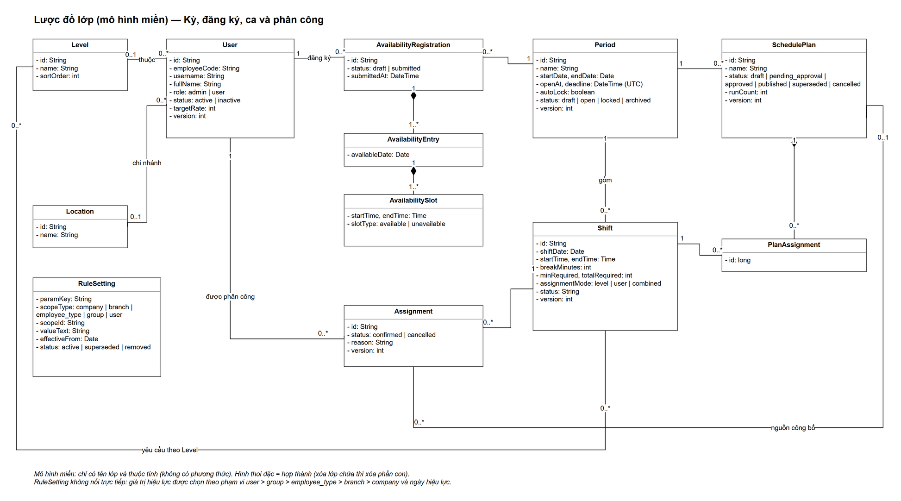
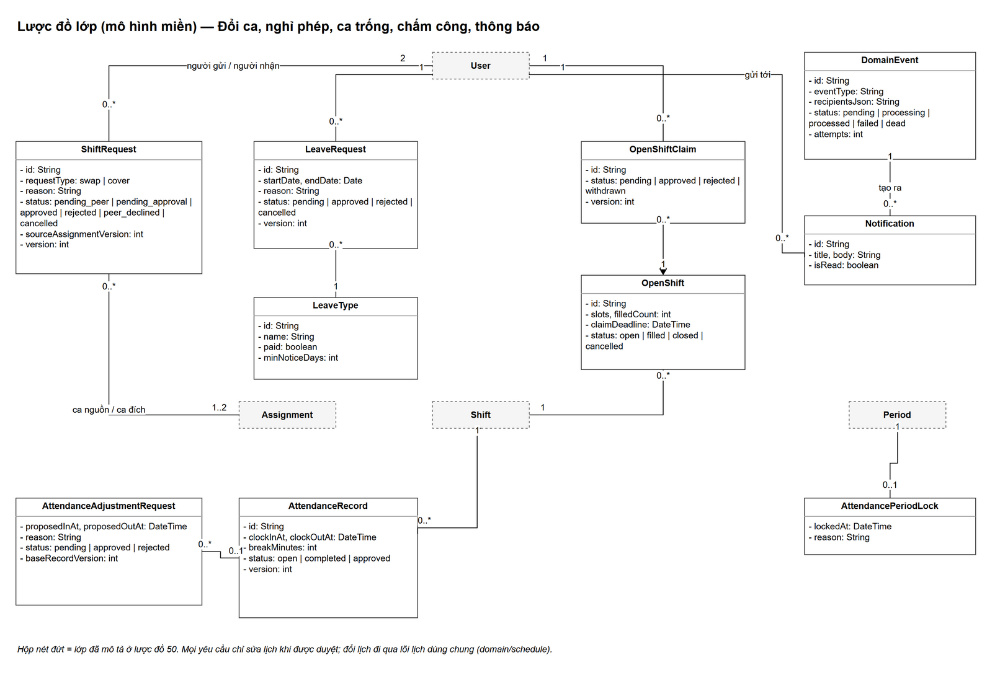
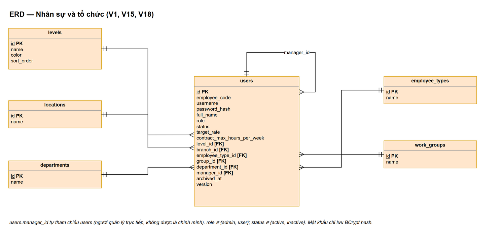
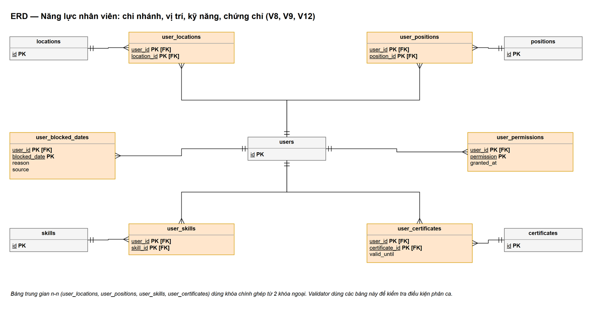
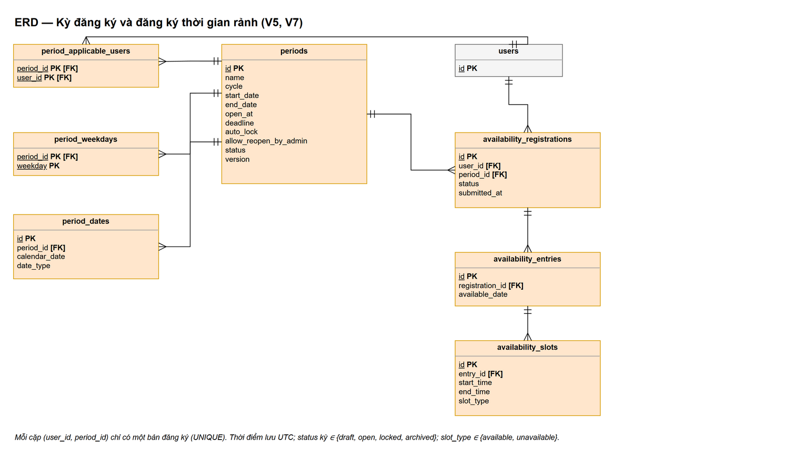
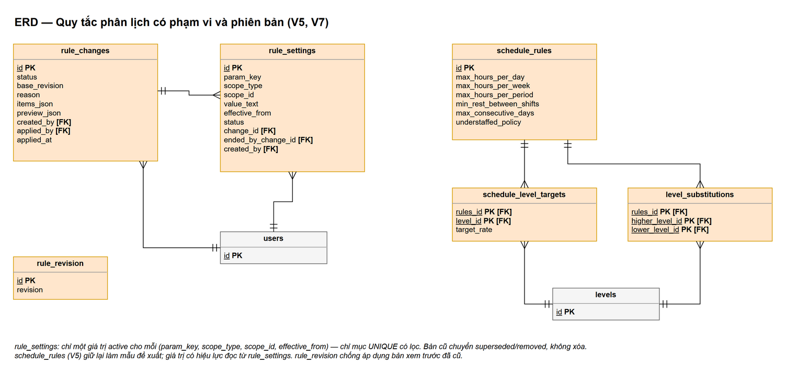
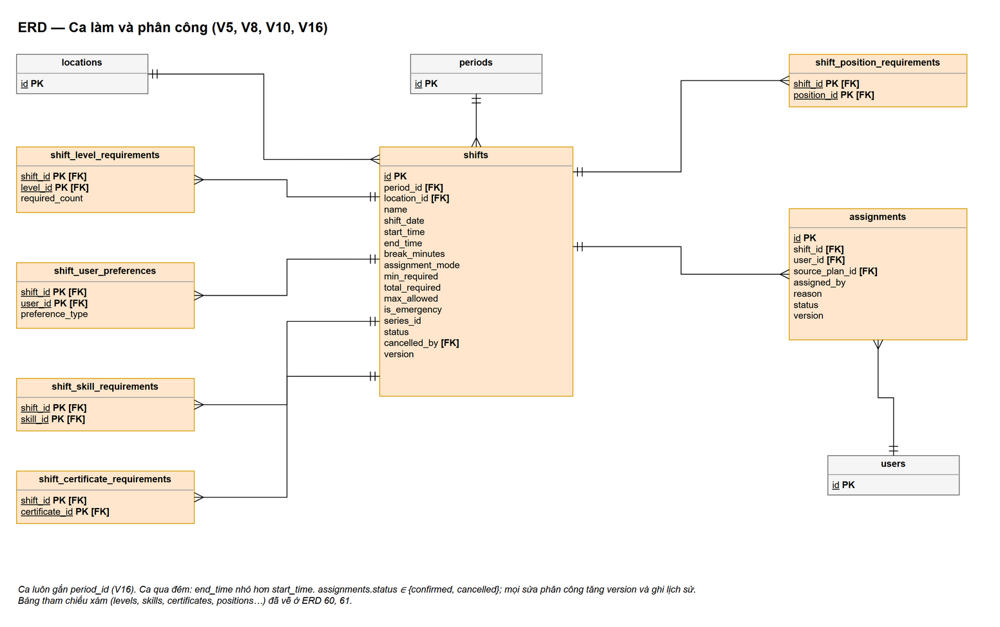
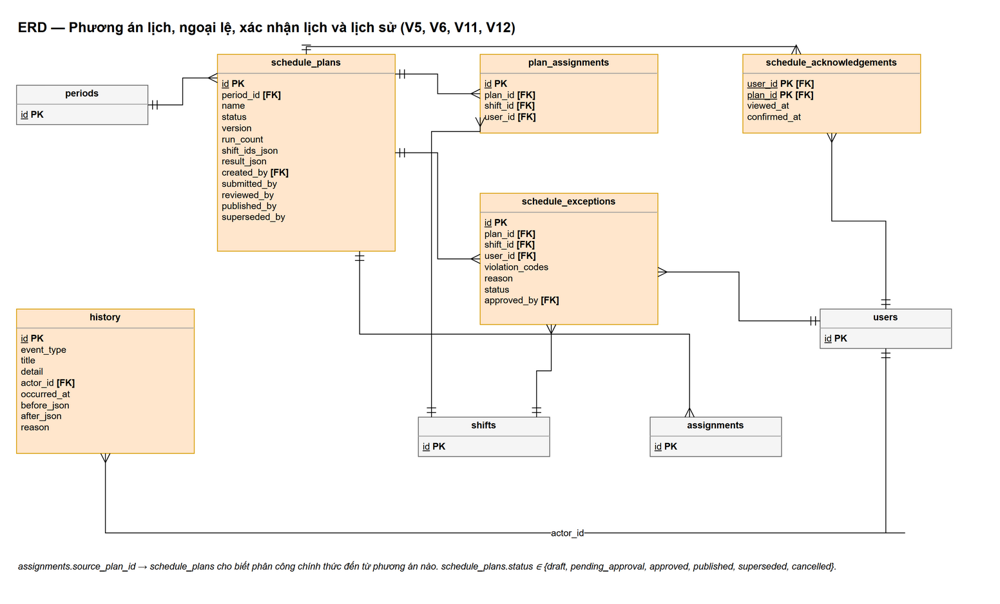
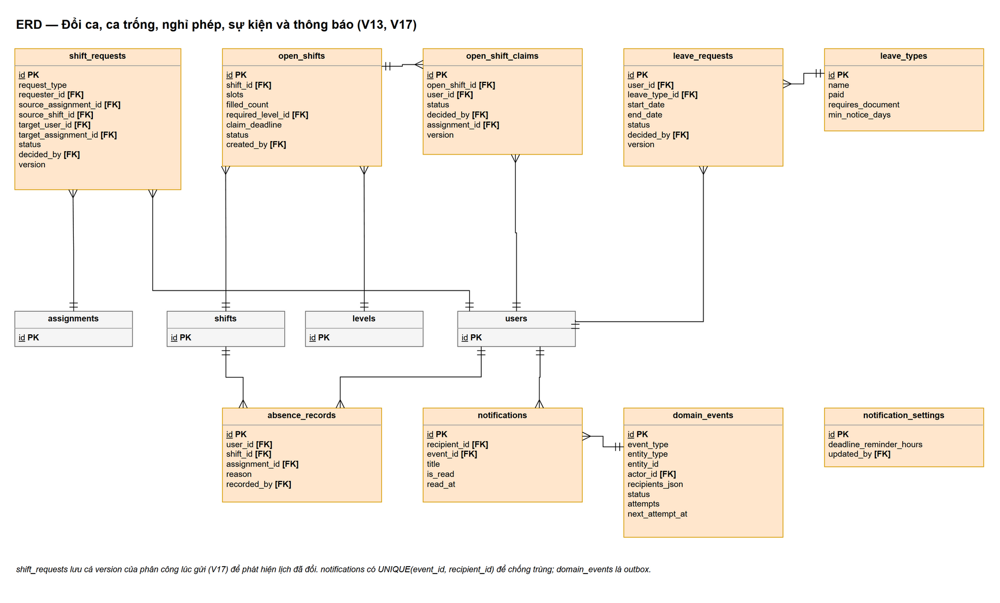
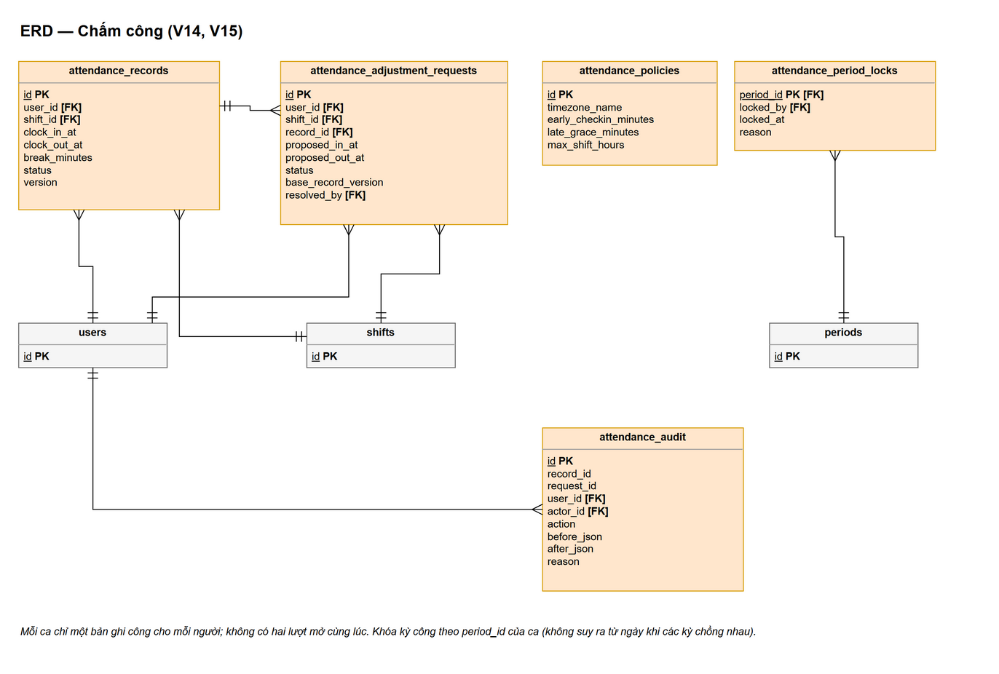

# Cấu trúc dữ liệu

> Đối chiếu với migration `V1`–`V18` trong `src/main/resources/db/migration/` (nhánh `main`, commit `a8a6da6`, 04/11/2026).
> Ký hiệu ERD: tên cột <u>gạch chân</u> + **PK** = khóa chính · **[FK]** = khóa ngoại · hai gạch = phía "1" · chân chim = phía "nhiều" · bảng xám = bảng đã vẽ chi tiết ở ERD khác.

## Mục lục

1. [Tổng quan và danh sách migration](#1-tổng-quan-và-danh-sách-migration)
2. [Mô hình miền](#2-mô-hình-miền)
3. [ERD theo nhóm nghiệp vụ](#3-erd-theo-nhóm-nghiệp-vụ)
4. [Các bảng nghiệp vụ gốc (V5–V7)](#4-các-bảng-nghiệp-vụ-gốc-v5v7)
5. [Kỳ đăng ký và quy tắc (V7)](#5-kỳ-đăng-ký-và-quy-tắc-v7)
6. [Quy ước dữ liệu](#6-quy-ước-dữ-liệu)
7. [Bảo mật và seed](#7-bảo-mật-và-seed)
8. [Nguồn dữ liệu](#8-nguồn-dữ-liệu)
9. [V18 — tổ chức và lưu trữ hồ sơ](#9-v18--tổ-chức-và-lưu-trữ-hồ-sơ)

---

## 1. Tổng quan và danh sách migration

Backend dùng SQL Server; Flyway tạo và cập nhật schema khi ứng dụng khởi động, lưu trạng thái trong `flyway_schema_history`. **Không sửa migration đã áp dụng**; thay đổi mới phải là migration kế tiếp, hiện là **`V19`**.

| Migration | Nội dung | ERD |
|---|---|---|
| `V1` | `levels`, `users` | [60](#31-nhân-sự-và-tổ-chức) |
| `V2`–`V4` | Seed 4 Level, tài khoản Admin demo, sửa hash mật khẩu seed | — |
| `V5` | Miền lịch gốc: `periods` và bảng con, `availability_*`, `shifts`, `shift_level_requirements`, `shift_user_preferences`, `assignments`, `schedule_rules`, `schedule_level_targets`, `level_substitutions`, `history` | [62](#33-kỳ-đăng-ký-và-đăng-ký-rảnh), [63](#34-quy-tắc-phân-lịch), [64](#35-ca-làm-và-phân-công) |
| `V6` | `schedule_plans`, `plan_assignments` (phương án lịch) | [65](#36-phương-án-lịch-ngoại-lệ-lịch-sử) |
| `V7` | Vòng đời kỳ, loại khoảng giờ, `rule_changes`, `rule_settings`, `rule_revision` | [62](#33-kỳ-đăng-ký-và-đăng-ký-rảnh), [63](#34-quy-tắc-phân-lịch) |
| `V8` | `locations`, `positions`, `skills`, `certificates`, `user_*`, `shift_*_requirements` | [61](#32-năng-lực-nhân-viên), [64](#35-ca-làm-và-phân-công) |
| `V9` | `user_blocked_dates`, giới hạn giờ theo hợp đồng | [61](#32-năng-lực-nhân-viên) |
| `V10` | Giờ nghỉ trong ca, `version` cho ca | [64](#35-ca-làm-và-phân-công) |
| `V11` | Trạng thái phương án lịch | [65](#36-phương-án-lịch-ngoại-lệ-lịch-sử) |
| `V12` | `schedule_exceptions`, `schedule_acknowledgements`, `user_permissions` | [65](#36-phương-án-lịch-ngoại-lệ-lịch-sử), [61](#32-năng-lực-nhân-viên) |
| `V13` | `shift_requests`, `open_shifts`, `open_shift_claims`, `leave_types`, `leave_requests`, `absence_records`, `domain_events`, `notifications`, `notification_settings` | [66](#37-đổi-ca-ca-trống-nghỉ-phép-thông-báo) |
| `V14` | `attendance_policies`, `attendance_records`, `attendance_adjustment_requests`, `attendance_period_locks`, `attendance_audit` | [67](#38-chấm-công) |
| `V15` | `employee_types`, `work_groups`, phạm vi tổ chức của nhân viên, version yêu cầu sửa công | [60](#31-nhân-sự-và-tổ-chức) |
| `V16` | Gắn `shifts.period_id` | [64](#35-ca-làm-và-phân-công) |
| `V17` | Snapshot version phân công trong `shift_requests` | [66](#37-đổi-ca-ca-trống-nghỉ-phép-thông-báo) |
| `V18` | `departments`, quản lý trực tiếp, lưu trữ hồ sơ, `users.version` | [60](#31-nhân-sự-và-tổ-chức) |

`Docs/legacy-migrations/` chỉ là tư liệu, không phải migration chạy.

## 2. Mô hình miền

Mô hình miền mô tả các lớp dữ liệu nghiệp vụ và quan hệ giữa chúng, ở mức khái niệm: chỉ có tên lớp và thuộc tính, không có phương thức. Lớp thiết kế có phương thức nằm ở [architecture.md §9](architecture.md#9-lược-đồ-lớp-thiết-kế).

### 2.1. Kỳ, đăng ký, ca và phân công

### 2.2. Đổi ca, nghỉ phép, ca trống, chấm công, thông báo

## 3. ERD theo nhóm nghiệp vụ

ERD được chia thành 8 sơ đồ nhỏ để dễ đọc. Mỗi sơ đồ chỉ ghi khóa và các cột chính; kiểu dữ liệu và ràng buộc đầy đủ xem trong file migration.

### 3.1. Nhân sự và tổ chức

### 3.2. Năng lực nhân viên

### 3.3. Kỳ đăng ký và đăng ký rảnh

### 3.4. Quy tắc phân lịch

### 3.5. Ca làm và phân công

### 3.6. Phương án lịch, ngoại lệ, lịch sử

### 3.7. Đổi ca, ca trống, nghỉ phép, thông báo

### 3.8. Chấm công

## 4. Các bảng nghiệp vụ gốc (V5–V7)

| Bảng | Nội dung |
|---|---|
| `levels` | Cấp độ nhân viên và thứ tự hiển thị. |
| `users` | Tài khoản, mã nhân viên, role, trạng thái, Level và `password_hash`. |
| `periods` | Kỳ đăng ký, ngày áp dụng, thời điểm mở/hạn chót (UTC), tự khóa, cho phép mở lại, trạng thái `draft`/`open`/`locked`/`archived` và `version` (V7). |
| `period_applicable_users` | Danh sách nhân viên được áp dụng cho kỳ; không có dòng nghĩa là áp dụng cho tất cả. |
| `period_weekdays` | Các thứ trong tuần được đăng ký. Quy ước `0=Chủ nhật` đến `6=Thứ bảy`. |
| `period_dates` | Ngày miễn đăng ký hoặc ngày đóng trong kỳ. |
| `availability_registrations` | Bản đăng ký rảnh của một nhân viên trong một kỳ; mỗi cặp user/kỳ là duy nhất. |
| `availability_entries` | Ngày có khai báo trong bản đăng ký. |
| `availability_slots` | Các khoảng giờ của từng ngày; `slot_type` = `available` (rảnh) hoặc `unavailable` (không thể làm) (V7). |
| `shifts` | Ca làm: ngày, giờ, chế độ phân công, nhu cầu và trạng thái. Ca qua ngày được biểu diễn bằng giờ kết thúc nhỏ hơn giờ bắt đầu. |
| `shift_level_requirements` | Số người yêu cầu theo Level cho từng ca. |
| `shift_user_preferences` | Nhân viên bắt buộc hoặc ưu tiên cho ca. |
| `assignments` | Phân công nhân viên vào ca, người/nguồn phân công, trạng thái và lý do. |
| `schedule_rules` | Giới hạn giờ, thời gian nghỉ, ưu tiên phân lịch và chính sách thiếu người. V5 tạo cấu hình mặc định `rules_main`. Từ V7, dòng này chỉ là **mẫu đề xuất**; giá trị có hiệu lực nằm ở `rule_settings`. Cột cũ giữ nguyên vì module khác còn đọc. |
| `schedule_level_targets` | Tỷ lệ giờ mục tiêu theo Level. |
| `level_substitutions` | Các quan hệ Level cao có thể thay Level thấp. Bảng runtime dùng chung; từ V7 được ghi lại khi Admin áp dụng tham số `level_substitutions`. |
| `history` | Lịch sử thao tác, tác nhân và snapshot JSON before/after. |
| `rule_changes` | Mỗi lần thay đổi quy tắc: lý do, danh sách thay đổi, bản xem trước, người tạo/áp dụng, trạng thái `previewed`/`applied`/`cancelled` (V7). |
| `rule_settings` | Giá trị quy tắc theo tham số, phạm vi và ngày hiệu lực; bản cũ chuyển `superseded`/`removed`, không xóa (V7). |
| `rule_revision` | Bộ đếm một dòng để chống áp dụng bản xem trước đã cũ (V7). |

Các bảng chính có primary key, foreign key, unique/check constraint và index để bảo vệ toàn vẹn dữ liệu. Snapshot lịch sử dùng JSON; dữ liệu nghiệp vụ còn lại được chuẩn hóa thành bảng quan hệ. Các bảng từ V8 trở đi xem ở mục 1 và ERD mục 3.

## 5. Kỳ đăng ký và quy tắc (V7)

### 5.1. Trạng thái kỳ

`V7` đổi `ck_periods_status` thành `draft | open | locked | archived` và chuyển mọi dòng `not_open` cũ về `draft`. Bộ trạng thái này đã chốt với người phụ trách lịch ngày 29/10/2026. Sơ đồ trạng thái: [flows.md §3.1](flows.md#31-kỳ-đăng-ký).

| Giá trị | Nhãn hiển thị | Nhân viên thấy | Nhân viên đăng ký |
|---|---|---|---|
| `draft` | Nháp | Không | Không |
| `open` | Sắp mở (trước `open_at`, tính ra, không lưu) / Đang mở đăng ký | Có | Chỉ trong cửa sổ đăng ký |
| `locked` | Đã đóng đăng ký | Có, chỉ đọc | Không |
| `archived` | Đã lưu trữ | Có, chỉ đọc | Không |

- "Đang xếp lịch" và "Đã công bố" thuộc vòng đời phương án lịch, **không** lưu ở `periods`. Màn hình ghép hai trạng thái, ví dụ "Đã đóng đăng ký · Lịch: Đã công bố".
- Chuyển trạng thái hợp lệ: `draft → open → locked → archived`, mở lại `locked → open`. Chỉ xóa cứng kỳ `draft` chưa có đăng ký.
- `allow_edit_after_deadline` (V5) vẫn còn cột nhưng backend không dùng: kỳ tự khóa thì không có ngoại lệ sửa sau hạn.
- `periods.version` tăng sau mỗi lần sửa hoặc chuyển trạng thái; API từ chối thao tác dựa trên version cũ.

### 5.2. Quy ước thời gian

- Cột thời điểm (`open_at`, `deadline`, `created_at`, `submitted_at`…) lưu **UTC**, giống mặc định `SYSUTCDATETIME()`.
- API nhận và trả giờ theo múi giờ nghiệp vụ `Asia/Ho_Chi_Minh`. Ví dụ hạn `05/10/2026 23:59` được lưu là `2026-10-05 16:59` UTC.
- Hạn chót được quyết định bằng giờ server, không dùng giờ trình duyệt.

### 5.3. Quy tắc có phạm vi và phiên bản

- Mỗi giá trị trong `rule_settings` gồm tham số (`param_key`), phạm vi (`scope_type`, `scope_id`), giá trị dạng chuỗi và `effective_from`. Danh mục tham số nằm trong code (`RuleParameter`) và được trả qua `GET /api/rules/catalog`.
- Phạm vi: `company` (`scope_id` NULL), `branch`, `employee_type`, `group`, `user`; các danh mục/context tổ chức đã được tích hợp.
- Khi nhiều giá trị cùng áp dụng, phạm vi cụ thể hơn thắng: `user > group > employee_type > branch > company`. Cùng phạm vi thì `effective_from` gần nhất mà không sau ngày đang xét sẽ thắng. Xung đột cùng mức/ngày phải được xử lý, không chọn ngẫu nhiên.
- Chỉ mục duy nhất có lọc `uq_rule_settings_active` bảo đảm mỗi tham số/phạm vi/ngày hiệu lực chỉ có một giá trị `active`.
- V7 **không seed** giá trị quy tắc nào. Tham số bắt buộc chưa cấu hình sẽ hiện trong checklist; hệ thống không tự gán số.
- Áp dụng quy tắc chỉ ghi `rule_changes`, `rule_settings`, `rule_revision`, `level_substitutions` và `history`. Không sửa `periods`, `shifts` hay `assignments`.

## 6. Quy ước dữ liệu

| Quy ước | Ví dụ |
|---|---|
| Khóa chính dạng chuỗi `VARCHAR(64)`; bảng con dùng `BIGINT IDENTITY` | `users.id`, `availability_entries.id` |
| Thời điểm `DATETIME2(3)` mặc định `SYSUTCDATETIME()` (UTC) | `created_at`, `deadline` |
| Chuỗi tiếng Việt dùng `NVARCHAR` | `full_name`, `reason` |
| Tên ràng buộc có tiền tố `pk_`, `fk_`, `uq_`, `ck_`, `df_`, `ix_` | `ck_periods_status` |
| Trạng thái chữ thường, giới hạn bằng `CHECK` | `draft`, `pending_approval` |
| Bảng trung gian n-n dùng khóa chính ghép từ 2 khóa ngoại | `user_skills (user_id, skill_id)` |
| Bản ghi quan trọng có cột `version` để chống ghi đè đồng thời | `shifts.version`, `schedule_plans.version` |

## 7. Bảo mật và seed

- Mật khẩu trong `users` phải là BCrypt hash; không lưu mật khẩu dạng rõ.
- Tài khoản Admin V3/V4 là tài khoản seed cho môi trường demo. Phải đổi mật khẩu trước production.
- `DB_PASSWORD` và `JWT_SECRET` lấy từ biến môi trường hoặc `.env` cục bộ; không commit `.env`.
- Tài khoản runtime nên dùng quyền đọc/ghi; chỉ cấp quyền DDL tạm thời khi chạy migration.

## 8. Nguồn dữ liệu

Giao diện chính (`workspace.html`, `attendance.html`) đọc/ghi dữ liệu nghiệp vụ qua API, nên **SQL Server là nguồn dữ liệu chuẩn**. `sessionStorage` chỉ giữ JWT phiên.

Bản demo cũ (`demo.html`) vẫn dùng `localStorage` (khóa tiền tố `pls_`), không đồng bộ với SQL Server và không dùng làm bằng chứng nghiệm thu. Không import ngầm dữ liệu `localStorage` của demo.

Flyway chỉ seed Level, tài khoản Admin và cấu hình `schedule_rules` mẫu; các bảng nghiệp vụ khác rỗng cho tới khi có dữ liệu nhập qua API hoặc script kiểm thử (`tests/*.sql`, chỉ chạy trên database test).

## 9. V18 — tổ chức và lưu trữ hồ sơ

Thêm bảng `departments`, các cột `users.department_id`, `manager_id`, `archived_at`, `version`, khóa ngoại và ràng buộc người quản lý không là chính mình. Lưu trữ đổi trạng thái tài khoản và giữ hồ sơ/lịch sử. Migration kế tiếp là V19; không sửa migration V1–V18 đã áp dụng.

Chấm công lọc/khóa theo `shifts.period_id`, không suy ra kỳ từ ngày khi nhiều kỳ chồng nhau. Diễn tập backup/restore và hướng dẫn vận hành nằm trong [HUONG_DAN](../HUONG_DAN/HUONG_DAN_CHAY_HE_THONG.md).
