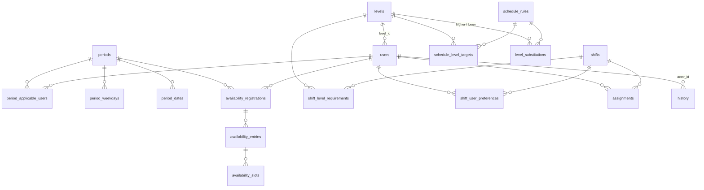

# Cấu trúc dữ liệu

> **Mục đích:** mô tả hai nơi lưu trữ dữ liệu của dự án – `localStorage` (frontend) và SQL Server (backend) – cùng cấu trúc trường, ràng buộc, dữ liệu khởi tạo và sự tương ứng giữa hai mô hình.
>
> **Nguồn:** `js/storage.js`, `js/state.js`, `src/main/resources/db/migration/V1..V5`.

---

## 1. Tổng quan

| Nơi lưu | Thành phần sử dụng | Quản lý cấu trúc | Trạng thái dữ liệu |
|---|---|---|---|
| `localStorage` của trình duyệt | Frontend SPA | Hằng `STORAGE_KEYS`, phiên bản `DATA_VERSION = '1.0.0'` | Có dữ liệu demo đầy đủ |
| SQL Server (database mặc định `ScheduleManager`) | Backend Spring Boot | Flyway migration `V1`–`V5` | Chỉ có Level, tài khoản Admin và quy tắc mặc định |

Hai nơi lưu **không đồng bộ** với nhau.

---

## 2. Lưu trữ frontend (`localStorage`)

### 2.1. Danh sách khóa

| Hằng | Khóa | Kiểu giá trị | Nội dung |
|---|---|---|---|
| `USERS` | `pls_users` | Mảng | Tài khoản Admin và nhân viên |
| `LEVELS` | `pls_levels` | Mảng | Danh mục Level |
| `PERIODS` | `pls_periods` | Mảng | Kỳ đăng ký |
| `FREE_TIME` | `pls_free_time` | Mảng | Bản đăng ký thời gian rảnh |
| `SHIFTS` | `pls_shifts` | Mảng | Ca làm việc |
| `ASSIGNMENTS` | `pls_assignments` | Mảng | Phân công nhân viên vào ca |
| `SCHEDULE_RULES` | `pls_schedule_rules` | Đối tượng | Quy tắc phân lịch |
| `HISTORY` | `pls_history` | Mảng | Lịch sử thao tác (mới nhất ở đầu, tối đa 500) |
| `CURRENT_USER` | `pls_current_user` | Đối tượng | Phiên đăng nhập `{ id, username, role, fullName }` |
| `DATA_VERSION` | `pls_data_version` | Chuỗi | Phiên bản dữ liệu demo đã khởi tạo |

Giá trị được lưu dưới dạng JSON (`JSON.stringify`/`JSON.parse`). ID mới được sinh bằng `Storage.genId(prefix)` theo mẫu `prefix_<Date.now()>_<5 ký tự ngẫu nhiên>`; tiền tố dùng trong mã: `usr`, `lvl`, `prd`, `ft`, `sh`, `asgn`, `hist`.

### 2.2. Cấu trúc đối tượng

#### User (`pls_users`)

| Trường | Kiểu | Mô tả / ràng buộc phía client |
|---|---|---|
| `id` | string | Khóa |
| `code` | string | Mã nhân viên, bắt buộc, ≤ 20 ký tự, duy nhất |
| `username` | string | `^[a-z0-9_]{3,30}$`, duy nhất, không sửa sau khi tạo |
| `password` | string | **Mật khẩu dạng rõ**, ≥ 6 ký tự |
| `fullName` | string | Bắt buộc, ≤ 100 ký tự |
| `role` | `'admin'` \| `'user'` | Form Admin chỉ tạo `user` |
| `levelId` | string \| null | Bắt buộc với `role = 'user'` |
| `status` | `'active'` \| `'inactive'` | Đang hoạt động / Tạm khóa |
| `targetRate` | number | Tỷ lệ giờ mục tiêu 0–200 (%) |
| `phone`, `email`, `joinDate`, `note` | string | Thông tin bổ sung |
| `createdAt`, `updatedAt` | ISO string | Gán bởi `State.mut.saveUser` |

#### Level (`pls_levels`)

| Trường | Kiểu | Mô tả |
|---|---|---|
| `id` | string | Khóa |
| `name` | string | Bắt buộc, ≤ 50 ký tự, duy nhất (không phân biệt hoa thường) |
| `description` | string | Mô tả |
| `color` | string | Mã màu `#rrggbb` |
| `order` | number | Thứ tự, số nguyên dương; danh sách luôn sắp tăng dần theo `order` |

#### Period – kỳ đăng ký (`pls_periods`)

| Trường | Kiểu | Mô tả |
|---|---|---|
| `id`, `name` | string | `name` bắt buộc, duy nhất |
| `cycle` | `'weekly'` \| `'monthly'` \| `'yearly'` | Theo tuần / tháng / năm |
| `startDate`, `endDate` | `YYYY-MM-DD` | `startDate ≤ endDate` |
| `openAt`, `deadline` | ISO string \| null | `deadline > openAt` nếu cả hai có giá trị |
| `autoLock` | boolean | Cờ "Tự động khóa khi hết hạn" (chỉ lưu và hiển thị) |
| `allowEditAfterDeadline` | boolean | Cho phép nhân viên sửa khi kỳ đã khóa |
| `allowReopenByAdmin` | boolean | Hiện nút "Mở lại" khi kỳ đã khóa |
| `applicableUserIds` | string[] | Rỗng = áp dụng cho tất cả nhân viên; form kỳ đăng ký luôn lưu mảng rỗng (giao diện chưa có chỗ chọn) |
| `requiredDaysOfWeek` | number[] | `0` = Chủ nhật … `6` = Thứ bảy |
| `exemptDates` | string[] | Ngày được miễn đăng ký |
| `closedDates` | string[] | Luôn được lưu là mảng rỗng |
| `status` | `'draft'` \| `'not_open'` \| `'open'` \| `'locked'` | Nháp / Chưa mở đăng ký / Đang mở đăng ký / Đã khóa |
| `createdAt`, `updatedAt` | ISO string | |

#### Free time – đăng ký thời gian rảnh (`pls_free_time`)

```json
{
  "id": "ft_...",
  "userId": "nv001",
  "periodId": "period_oct2026",
  "status": "draft | submitted",
  "entries": [
    { "date": "2026-10-01", "slots": [ { "start": "07:00", "end": "21:00" } ] }
  ],
  "submittedAt": "ISO string | null",
  "updatedAt": "ISO string"
}
```

Mỗi cặp `userId` + `periodId` có tối đa một bản đăng ký (`State.get.freeTimeByUserPeriod`). Trạng thái "Chưa đăng ký" là trường hợp không có bản ghi.

#### Shift – ca làm việc (`pls_shifts`)

| Trường | Kiểu | Mô tả |
|---|---|---|
| `id`, `name` | string | `name` bắt buộc |
| `date` | `YYYY-MM-DD` | Ngày làm |
| `startTime`, `endTime` | `HH:MM` | Ca qua đêm khi `endTime ≤ startTime` |
| `mode` | `'level'` \| `'user'` \| `'combined'` | A – Theo Level / B – Theo User / C – Kết hợp |
| `levelRequirements` | `[{ levelId, count }]` | Nhu cầu theo Level |
| `mandatoryUsers` | `[{ userId, type: 'mandatory' }]` | Nhân viên bắt buộc |
| `preferredUsers` | `[{ userId, type }]` | Nhân viên ưu tiên (`type` có thể là `preferred` hoặc `substitutable`) |
| `totalRequired` | number | Tổng nhu cầu, số nguyên dương |
| `note` | string | Ghi chú |
| `status` | string | Giá trị được gán trong mã: `not_scheduled`, `draft`, `published` |
| `createdAt`, `updatedAt` | ISO string | |

#### Assignment – phân công (`pls_assignments`)

| Trường | Kiểu | Mô tả |
|---|---|---|
| `id` | string | Khóa |
| `shiftId`, `userId` | string | Ca và nhân viên |
| `assignedBy` | `'auto'` \| `'admin'` | Nguồn phân công: thuật toán hoặc thủ công |
| `assignedAt` | ISO string | Thời điểm phân |
| `reason` | string | Lý do (phân công thủ công) |
| `status` | `'confirmed'` | Giá trị duy nhất được gán trong mã |

#### Schedule rules – quy tắc (`pls_schedule_rules`)

| Trường | Mặc định (seed) | Có trên form | Được thuật toán/kiểm tra sử dụng |
|---|---|---|---|
| `id` | `rules_main` | — | — |
| `standardHours` | 80 | ✅ (1–744) | ✅ tính giờ mục tiêu |
| `maxHoursPerDay` | 12 | ✅ (1–24) | ✅ |
| `maxHoursPerWeek` | 48 | ✅ (1–168) | ✅ |
| `maxHoursPerPeriod` | 80 | ❌ | ❌ |
| `minRestBetweenShifts` | 8 | ✅ (0–24) | ✅ (cảnh báo) |
| `levelTargetRates` | `{ lvl1: 75, lvl2: 100, lvl3: 100, lvl4: 100 }` | ✅ | ✅ (khi tỷ lệ riêng falsy) |
| `levelSubstitutions` | 6 quy tắc (mục 2.3) | ✅ | ✅ |
| `schedulingPriority` | `most_needed` (`most_needed` \| `least_hours`) | ✅ | ❌ |
| `understaffedPolicy` | `warn` (`warn` \| `block`) | ✅ | ❌ |
| `updatedAt` | thời điểm lưu | — | — |

Lưu ý: khi lưu từ màn hình Quy tắc, đối tượng mới được tạo lại từ các trường trên form nên trường `maxHoursPerPeriod` không còn trong dữ liệu đã lưu.

#### History – lịch sử (`pls_history`)

| Trường | Mô tả |
|---|---|
| `id` | Khóa |
| `type` | Loại sự kiện (bảng dưới) |
| `title`, `detail` | Tiêu đề, chi tiết |
| `actor` | ID người thực hiện (hoặc `admin`/`system` khi không xác định) |
| `timestamp` | ISO string |
| `before`, `after` | Ảnh chụp dữ liệu trước/sau (có thể `null`) |
| `reason` | Lý do |

| `type` | Phát sinh khi |
|---|---|
| `user_save` | Thêm/cập nhật nhân viên |
| `user_status` | Khóa/mở khóa tài khoản |
| `level_save` | Thêm/cập nhật Level |
| `period_create` | (chỉ có trong dữ liệu demo) |
| `period_save` | Tạo/cập nhật kỳ |
| `period_open`, `period_lock`, `period_reopen` | Mở / khóa / mở lại kỳ |
| `free_time_submit` | Nhân viên gửi đăng ký |
| `shift_save`, `shift_delete` | Tạo/cập nhật ca, xóa ca |
| `rules_update` | Lưu quy tắc (kèm `before`/`after`) |
| `schedule_run` | Áp dụng kết quả phân lịch |
| `schedule_publish` | Công bố ca |
| `manual_assign` | Phân công thủ công (kèm `after`, `reason`) |
| `manual_unassign` | Xóa phân công của ca đã công bố (kèm `before`, `reason`) |

Xóa Level (`deleteLevel`) và đổi mật khẩu không ghi lịch sử. Bản ghi mới được ghi ngay xuống `localStorage`, nhưng giao diện chỉ hiển thị sau khi tải lại trang (xem [architecture.md – mục 3.5](./architecture.md#35-quản-lý-trạng-thái)).

### 2.3. Dữ liệu demo (`seedDemoData`)

Chỉ chạy khi `pls_data_version ≠ '1.0.0'`. Các ngày được tính **theo tháng hiện tại** của máy (`thisMonth`).

**Level**

| id | Tên | Mô tả | Màu | Thứ tự |
|---|---|---|---|---|
| `lvl1` | Level 1 | Nhân viên mới | `#7c3aed` | 1 |
| `lvl2` | Level 2 | Nhân viên chính thức | `#be185d` | 2 |
| `lvl3` | Level 3 | Nhân viên kỳ cựu | `#c2410c` | 3 |
| `lvl4` | Level 4 | Trưởng ca | `#065f46` | 4 |

**Tài khoản** (mật khẩu: `admin` → `admin123`; nhân viên → `user123`)

| id / username | Mã | Họ tên | Level | Trạng thái | Tỷ lệ |
|---|---|---|---|---|---|
| `admin` | ADM001 | Nguyễn Quản Trị | — (role `admin`) | active | 100 |
| `nv001` | NV001 | Trần Văn An | lvl1 | active | 75 |
| `nv002` | NV002 | Lê Thị Bích | lvl1 | active | 75 |
| `nv003` | NV003 | Phạm Minh Châu | lvl1 | active | 50 |
| `nv004` | NV004 | Hoàng Thanh Dũng | lvl2 | active | 100 |
| `nv005` | NV005 | Vũ Ngọc Emm | lvl2 | active | 100 |
| `nv006` | NV006 | Đặng Thị Phương | lvl2 | active | 75 |
| `nv007` | NV007 | Nguyễn Xuân Giàu | lvl3 | active | 100 |
| `nv008` | NV008 | Bùi Thị Hoa | lvl3 | active | 100 |
| `nv009` | NV009 | Trương Văn Ích | lvl3 | **inactive** | 75 |
| `nv010` | NV010 | Đinh Thị Kim | lvl4 | active | 100 |
| `nv011` | NV011 | Lý Văn Lực | lvl4 | active | 100 |
| `nv012` | NV012 | Mai Xuân Minh | lvl2 | active | 50 |

**Quy tắc thay thế Level mặc định:** lvl4 → lvl3, lvl2, lvl1; lvl3 → lvl2, lvl1; lvl2 → lvl1.

**Kỳ đăng ký**

| id | Ngày áp dụng | Mở đăng ký | Hạn chót | Trạng thái |
|---|---|---|---|---|
| `period_oct2026` | Ngày 1 → ngày cuối của tháng hiện tại | Ngày 20 tháng trước, 08:00 | Ngày 5 tháng hiện tại, 23:59:59 | `open` |
| `period_nov2026` | Tháng kế tiếp | Ngày 20 tháng hiện tại, 08:00 | Ngày 5 tháng kế tiếp, 23:59 | `not_open` |
| `period_sep2026` | Tháng trước | Ngày 20 hai tháng trước, 08:00 | Ngày 5 tháng trước, 23:59 | `locked` |

Tên kỳ được ghi cố định là "Kỳ tháng 10/<năm>", "Kỳ tháng 11/<năm>", "Kỳ tháng 9/<năm>" trong khi ngày áp dụng tính theo tháng hiện tại. Cả ba kỳ: chu kỳ `monthly`, ngày cần đăng ký Thứ Hai–Thứ Bảy, `autoLock = true`, `allowEditAfterDeadline = false`, `allowReopenByAdmin = true`; kỳ `period_oct2026` có ngày miễn là ngày 10.

**Đăng ký thời gian rảnh** (kỳ `period_oct2026`, các ngày Thứ Hai–Thứ Bảy trừ ngày 10)

| Nhân viên | Trạng thái | Khung giờ |
|---|---|---|
| nv001 | submitted | 07:00–21:00 |
| nv002 | draft | 07:00–15:00 (10 ngày đầu) |
| nv003 | — (chưa đăng ký) | — |
| nv004 | submitted | 13:00–22:00 với ngày kết thúc bằng 0 hoặc chia hết cho 7; còn lại 06:00–22:00 |
| nv005 | submitted | 07:00–22:00 |
| nv006 | submitted | 13:00–22:00 |
| nv007 | submitted | 06:00–15:00 |
| nv008 | submitted | 07:00–15:00 |
| nv010, nv011 | submitted | 06:00–23:59 |
| nv012 | submitted | 08:00–14:00 (Thứ Hai–Thứ Sáu) |

**Ca làm việc** (theo từng ngày làm việc của tháng hiện tại, chỉ số `i` tính từ 0)

| Ca | Giờ | Ngày áp dụng | Chế độ | Nhu cầu | Trạng thái |
|---|---|---|---|---|---|
| Ca sáng | 07:00–15:00 | Mọi ngày làm việc | `combined` khi `i % 3 = 0` (bắt buộc nv010, ưu tiên nv007), còn lại `level` | 6 (lvl1: 2, lvl2: 2, lvl3: 1, lvl4: 1) | `published` khi `i < 10`, `draft` khi `i < 15`, còn lại `not_scheduled` |
| Ca tối | 14:30–22:30 | Ngày không phải Thứ Bảy/Chủ Nhật | `level` | 5 (lvl1: 2, lvl2: 1, lvl3: 1, lvl4: 1) | `published` khi `i < 8`, `draft` khi `i < 12`, còn lại `not_scheduled` |
| Ca đêm | 22:00–06:00 | 4 ngày Thứ Bảy đầu tiên | `user` (bắt buộc nv010, nv011; ưu tiên nv008) | 3 | `published` cho 2 ca đầu, còn lại `draft` |

**Phân công mẫu:** mỗi ca `published` được gán người bắt buộc, người ưu tiên, sau đó bổ sung lần lượt nhân viên đang hoạt động theo thứ tự danh sách cho đủ `totalRequired` (`_pickAssignees`, `assignedBy: 'auto'`). Các phân công mẫu này **không đi qua** `SafetyCheck`.

**Lịch sử mẫu:** 6 bản ghi (`period_create` ×2, `period_open`, `schedule_run`, `schedule_publish`, `manual_assign`).

### 2.4. Vòng đời dữ liệu

- Dữ liệu gắn với **origin** (giao thức + host + cổng) và profile trình duyệt; đổi cổng máy chủ tĩnh sẽ dùng một vùng `localStorage` khác.
- `resetDemoData()` xóa toàn bộ khóa trong `STORAGE_KEYS` rồi khởi tạo lại dữ liệu demo. Hàm `App.resetDemo()` gọi chức năng này sau hộp xác nhận, nhưng giao diện hiện **không có nút** gọi `App.resetDemo()`.
- Smoke test (`tests/browser-smoke.js`) tạm xóa và khôi phục các khóa có tiền tố `pls_`.

---

## 3. Lưu trữ backend (SQL Server)

### 3.1. Migration Flyway

| Phiên bản | Tệp | Nội dung |
|---|---|---|
| V1 | `V1__create_levels_and_users.sql` | Tạo `levels`, `users`, index `ix_users_level_id` |
| V2 | `V2__seed_initial_levels.sql` | `MERGE` 4 Level giống dữ liệu demo frontend |
| V3 | `V3__seed_admin_user.sql` | `MERGE` tài khoản Admin `usr_admin_001` (mật khẩu dev `Admin@123`, BCrypt cost 10) |
| V4 | `V4__fix_admin_password_hash.sql` | Cập nhật lại hash mật khẩu Admin cho khớp `Admin@123` |
| V5 | `V5__create_schedule_domain.sql` | Tạo 15 bảng nghiệp vụ, index, và dữ liệu quy tắc mặc định `rules_main` |

Flyway lưu trạng thái tại `flyway_schema_history`. Không sửa migration đã áp dụng; thay đổi lược đồ phải tạo migration phiên bản kế tiếp (`V6__...`).

### 3.2. Sơ đồ quan hệ



### 3.3. Chi tiết bảng

Ký hiệu: **PK** khóa chính, **FK** khóa ngoại, **UQ** duy nhất, **CK** ràng buộc kiểm tra, **DF** giá trị mặc định. `SYSUTCDATETIME()` là giờ UTC.

#### `levels` (V1)

| Cột | Kiểu | Ràng buộc |
|---|---|---|
| `id` | VARCHAR(64) | PK |
| `name` | NVARCHAR(100) | NOT NULL, UQ |
| `description` | NVARCHAR(500) | NULL |
| `color` | CHAR(7) | NOT NULL |
| `sort_order` | INT | NOT NULL, UQ |
| `created_at` | DATETIME2(3) | DF `SYSUTCDATETIME()` |

#### `users` (V1)

| Cột | Kiểu | Ràng buộc |
|---|---|---|
| `id` | VARCHAR(64) | PK |
| `employee_code` | VARCHAR(20) | NOT NULL, UQ |
| `username` | VARCHAR(30) | NOT NULL, UQ |
| `password_hash` | VARCHAR(255) | NOT NULL (BCrypt) |
| `full_name` | NVARCHAR(100) | NOT NULL |
| `role` | VARCHAR(20) | CK `IN ('admin','user')` |
| `level_id` | VARCHAR(64) | NULL, FK → `levels(id)`, index `ix_users_level_id` |
| `status` | VARCHAR(20) | DF `'active'`, CK `IN ('active','inactive')` |
| `target_rate` | DECIMAL(5,2) | DF `100`, CK `0 ≤ target_rate ≤ 200` |
| `phone` | VARCHAR(30) | NULL |
| `email` | NVARCHAR(254) | NULL |
| `join_date` | DATE | NULL |
| `note` | NVARCHAR(1000) | NULL |
| `created_at`, `updated_at` | DATETIME2(3) | DF `SYSUTCDATETIME()` |

#### `periods` (V5)

| Cột | Kiểu | Ràng buộc |
|---|---|---|
| `id` | VARCHAR(64) | PK |
| `name` | NVARCHAR(120) | NOT NULL |
| `cycle` | VARCHAR(20) | NOT NULL |
| `start_date`, `end_date` | DATE | NOT NULL; CK `end_date >= start_date` |
| `open_at`, `deadline` | DATETIME2(3) | NULL; CK `deadline > open_at` khi cả hai khác NULL |
| `auto_lock` | BIT | DF 1 |
| `allow_edit_after_deadline` | BIT | DF 0 |
| `allow_reopen_by_admin` | BIT | DF 1 |
| `status` | VARCHAR(20) | CK `IN ('draft','not_open','open','locked')` |
| `created_at`, `updated_at` | DATETIME2(3) | DF `SYSUTCDATETIME()` |

#### `period_applicable_users` (V5)

| Cột | Kiểu | Ràng buộc |
|---|---|---|
| `period_id` | VARCHAR(64) | PK (ghép), FK → `periods` ON DELETE CASCADE |
| `user_id` | VARCHAR(64) | PK (ghép), FK → `users` |

Không có dòng nào cho một kỳ nghĩa là kỳ áp dụng cho tất cả nhân viên (tương ứng `applicableUserIds = []`).

#### `period_weekdays` (V5)

| Cột | Kiểu | Ràng buộc |
|---|---|---|
| `period_id` | VARCHAR(64) | PK (ghép), FK → `periods` ON DELETE CASCADE |
| `weekday` | TINYINT | PK (ghép), CK `BETWEEN 0 AND 6` (`0` = Chủ nhật) |

#### `period_dates` (V5)

| Cột | Kiểu | Ràng buộc |
|---|---|---|
| `id` | BIGINT IDENTITY(1,1) | PK |
| `period_id` | VARCHAR(64) | FK → `periods` ON DELETE CASCADE |
| `calendar_date` | DATE | NOT NULL |
| `date_type` | VARCHAR(20) | CK `IN ('exempt','closed')` |
| `note` | NVARCHAR(300) | NULL |
| | | UQ (`period_id`, `calendar_date`, `date_type`) |

#### `availability_registrations` (V5)

| Cột | Kiểu | Ràng buộc |
|---|---|---|
| `id` | VARCHAR(64) | PK |
| `user_id` | VARCHAR(64) | FK → `users` |
| `period_id` | VARCHAR(64) | FK → `periods` |
| `status` | VARCHAR(20) | CK `IN ('draft','submitted')` |
| `submitted_at` | DATETIME2(3) | NULL |
| `created_at`, `updated_at` | DATETIME2(3) | DF `SYSUTCDATETIME()` |
| | | UQ (`user_id`, `period_id`) |

#### `availability_entries` (V5)

| Cột | Kiểu | Ràng buộc |
|---|---|---|
| `id` | BIGINT IDENTITY(1,1) | PK |
| `registration_id` | VARCHAR(64) | FK → `availability_registrations` ON DELETE CASCADE |
| `available_date` | DATE | NOT NULL; UQ (`registration_id`, `available_date`) |

#### `availability_slots` (V5)

| Cột | Kiểu | Ràng buộc |
|---|---|---|
| `id` | BIGINT IDENTITY(1,1) | PK |
| `entry_id` | BIGINT | FK → `availability_entries` ON DELETE CASCADE |
| `start_time`, `end_time` | TIME(0) | NOT NULL; CK `start_time <> end_time` |

#### `shifts` (V5)

| Cột | Kiểu | Ràng buộc |
|---|---|---|
| `id` | VARCHAR(64) | PK |
| `name` | NVARCHAR(120) | NOT NULL |
| `shift_date` | DATE | NOT NULL |
| `start_time`, `end_time` | TIME(0) | NOT NULL (ca qua đêm: `end_time < start_time`) |
| `assignment_mode` | VARCHAR(20) | CK `IN ('level','user','combined')` |
| `total_required` | INT | CK `> 0` |
| `note` | NVARCHAR(1000) | NULL |
| `status` | VARCHAR(20) | CK `IN ('not_scheduled','draft','full','understaffed','published')` |
| `created_at`, `updated_at` | DATETIME2(3) | DF `SYSUTCDATETIME()` |
| | | Index `ix_shifts_date_status (shift_date, status)` |

#### `shift_level_requirements` (V5)

| Cột | Kiểu | Ràng buộc |
|---|---|---|
| `shift_id` | VARCHAR(64) | PK (ghép), FK → `shifts` ON DELETE CASCADE |
| `level_id` | VARCHAR(64) | PK (ghép), FK → `levels` |
| `required_count` | INT | CK `> 0` |

#### `shift_user_preferences` (V5)

| Cột | Kiểu | Ràng buộc |
|---|---|---|
| `shift_id` | VARCHAR(64) | PK (ghép), FK → `shifts` ON DELETE CASCADE |
| `user_id` | VARCHAR(64) | PK (ghép), FK → `users` |
| `preference_type` | VARCHAR(20) | CK `IN ('mandatory','preferred')` |

#### `assignments` (V5)

| Cột | Kiểu | Ràng buộc |
|---|---|---|
| `id` | VARCHAR(64) | PK |
| `shift_id` | VARCHAR(64) | FK → `shifts` ON DELETE CASCADE |
| `user_id` | VARCHAR(64) | FK → `users` |
| `assigned_by` | VARCHAR(64) | NOT NULL (không có FK) |
| `assigned_at` | DATETIME2(3) | DF `SYSUTCDATETIME()` |
| `reason` | NVARCHAR(1000) | NULL |
| `status` | VARCHAR(20) | DF `'confirmed'`, CK `IN ('confirmed','cancelled')` |
| | | UQ (`shift_id`, `user_id`); index `ix_assignments_user (user_id, status)` |

#### `schedule_rules` (V5)

| Cột | Kiểu | Ràng buộc |
|---|---|---|
| `id` | VARCHAR(64) | PK |
| `standard_hours` | DECIMAL(6,2) | > 0 |
| `max_hours_per_day` | DECIMAL(5,2) | > 0 |
| `max_hours_per_week` | DECIMAL(6,2) | > 0 |
| `max_hours_per_period` | DECIMAL(7,2) | > 0 |
| `min_rest_between_shifts` | DECIMAL(4,2) | ≥ 0 |
| `scheduling_priority` | VARCHAR(30) | CK `IN ('most_needed','least_hours')` |
| `understaffed_policy` | VARCHAR(20) | CK `IN ('warn','block')` |
| `updated_at` | DATETIME2(3) | DF `SYSUTCDATETIME()` |

#### `schedule_level_targets` (V5)

| Cột | Kiểu | Ràng buộc |
|---|---|---|
| `rules_id` | VARCHAR(64) | PK (ghép), FK → `schedule_rules` ON DELETE CASCADE |
| `level_id` | VARCHAR(64) | PK (ghép), FK → `levels` |
| `target_rate` | DECIMAL(5,2) | CK `BETWEEN 0 AND 200` |

#### `level_substitutions` (V5)

| Cột | Kiểu | Ràng buộc |
|---|---|---|
| `rules_id` | VARCHAR(64) | PK (ghép), FK → `schedule_rules` ON DELETE CASCADE |
| `higher_level_id` | VARCHAR(64) | PK (ghép), FK → `levels` |
| `lower_level_id` | VARCHAR(64) | PK (ghép), FK → `levels` |
| | | CK `higher_level_id <> lower_level_id` |

#### `history` (V5)

| Cột | Kiểu | Ràng buộc |
|---|---|---|
| `id` | VARCHAR(64) | PK |
| `event_type` | VARCHAR(80) | NOT NULL |
| `title` | NVARCHAR(200) | NOT NULL |
| `detail` | NVARCHAR(2000) | NULL |
| `actor_id` | VARCHAR(64) | NULL, FK → `users` |
| `actor_name` | NVARCHAR(100) | NOT NULL |
| `occurred_at` | DATETIME2(3) | DF `SYSUTCDATETIME()`, index `ix_history_occurred_at (occurred_at DESC)` |
| `before_json`, `after_json` | NVARCHAR(MAX) | NULL; CK `ISJSON(...) = 1` khi khác NULL |
| `reason` | NVARCHAR(1000) | NULL |

### 3.4. Dữ liệu khởi tạo trong SQL Server

| Migration | Dữ liệu |
|---|---|
| V2 | 4 Level `lvl1`–`lvl4` (tên, mô tả, màu, thứ tự giống bảng ở mục 2.3) |
| V3/V4 | User `usr_admin_001` – mã `ADM001`, username `admin`, họ tên `Administrator`, role `admin`, `level_id = NULL`, `status = active`, `target_rate = 100`, hash BCrypt của `Admin@123` |
| V5 | `schedule_rules`: `rules_main` (80, 12, 48, 80, 8, `most_needed`, `warn`); `schedule_level_targets`: lvl1 = 75, lvl2 = 100, lvl3 = 100, lvl4 = 100; `level_substitutions`: 6 quy tắc như frontend |

Các bảng kỳ, đăng ký rảnh, ca, phân công, lịch sử **được tạo rỗng**; nhân viên thường (`nv001`…) chưa có trong SQL Server.

---

## 4. Tương ứng giữa hai mô hình

| Frontend (đối tượng.trường) | SQL Server (bảng.cột) | Ghi chú |
|---|---|---|
| `user.code` | `users.employee_code` | |
| `user.password` | `users.password_hash` | Dạng rõ ↔ BCrypt |
| `user.levelId`, `targetRate`, `joinDate` | `users.level_id`, `target_rate`, `join_date` | |
| `level.order` | `levels.sort_order` | API trả về trường `order` |
| `period.applicableUserIds[]` | `period_applicable_users` | |
| `period.requiredDaysOfWeek[]` | `period_weekdays.weekday` | Cùng quy ước 0–6 |
| `period.exemptDates[]` / `closedDates[]` | `period_dates` với `date_type = 'exempt'` / `'closed'` | |
| `freeTime` / `entries[]` / `slots[]` | `availability_registrations` / `availability_entries` / `availability_slots` | |
| `shift.date`, `mode` | `shifts.shift_date`, `assignment_mode` | |
| `shift.levelRequirements[]` | `shift_level_requirements` | `count` ↔ `required_count` |
| `shift.mandatoryUsers[]`, `preferredUsers[]` | `shift_user_preferences` | CSDL chỉ cho phép `mandatory`/`preferred`; frontend còn có giá trị `substitutable` |
| `assignment.*` | `assignments.*` | `assignedBy` ↔ `assigned_by` |
| `rules.levelTargetRates{}` | `schedule_level_targets` | |
| `rules.levelSubstitutions[]` | `level_substitutions` | |
| `history.type`, `actor`, `timestamp`, `before`, `after` | `history.event_type`, `actor_id`/`actor_name`, `occurred_at`, `before_json`, `after_json` | |

Khác biệt định danh: Admin trong frontend có `id = 'admin'`, mật khẩu `admin123`; trong SQL Server có `id = 'usr_admin_001'`, mật khẩu `Admin@123`.

---

## 5. Bảo mật dữ liệu

- Mật khẩu trong SQL Server phải là BCrypt hash; không lưu mật khẩu dạng rõ.
- Tài khoản Admin V3/V4 là dữ liệu cho môi trường phát triển; chú thích trong migration yêu cầu **đổi mật khẩu trước lần triển khai production đầu tiên**.
- `DB_PASSWORD` và `JWT_SECRET` lấy từ biến môi trường hoặc tệp `.env` cục bộ; `.gitignore` loại trừ `.env` và `.env.*` (trừ `.env.example`).
- Khuyến nghị: tài khoản runtime chỉ cần quyền đọc/ghi; quyền DDL chỉ cần khi Flyway chạy migration.
- Dữ liệu `localStorage` của frontend (bao gồm mật khẩu dạng rõ) có thể đọc được bằng công cụ phát triển của trình duyệt; chỉ dùng dữ liệu demo.
