# Luồng nghiệp vụ, luồng request và vòng đời trạng thái

> Đối chiếu với mã nguồn nhánh `main`, commit `a8a6da6` (04/11/2026). Mỗi sơ đồ vẽ theo code thật; tên lớp/hàm trong sơ đồ có trong repo.
> Ký hiệu lưu đồ hoạt động: chấm đen = bắt đầu · chấm đen có vòng = kết thúc · hình thoi = rẽ nhánh, mỗi nhánh có điều kiện `[…]` · hình thoi nhỏ = gộp luồng · ô đỏ = lỗi / bị chặn.
> Ký hiệu sơ đồ tuần tự: nét liền mũi tên đặc = gọi đồng bộ · nét đứt = trả về · `alt` = rẽ nhánh · `loop` = lặp.

## Mục lục

1. [Lưu đồ hoạt động](#1-lưu-đồ-hoạt-động)
   - [1.1. Đăng ký thời gian rảnh](#11-đăng-ký-thời-gian-rảnh)
   - [1.2. Thuật toán phân lịch tự động](#12-thuật-toán-phân-lịch-tự-động)
   - [1.3. Gửi duyệt, duyệt và công bố lịch](#13-gửi-duyệt-duyệt-và-công-bố-lịch)
   - [1.4. Đổi ca / làm thay ca](#14-đổi-ca--làm-thay-ca)
   - [1.5. Chấm công, sửa công và khóa kỳ công](#15-chấm-công-sửa-công-và-khóa-kỳ-công)
2. [Sơ đồ tuần tự (luồng request)](#2-sơ-đồ-tuần-tự-luồng-request)
   - [2.1. Đăng nhập và gọi API có JWT](#21-đăng-nhập-và-gọi-api-có-jwt)
   - [2.2. Duyệt yêu cầu đổi ca](#22-duyệt-yêu-cầu-đổi-ca)
   - [2.3. Gửi thông báo qua outbox](#23-gửi-thông-báo-qua-outbox)
3. [Sơ đồ trạng thái](#3-sơ-đồ-trạng-thái)
   - [3.1. Kỳ đăng ký](#31-kỳ-đăng-ký)
   - [3.2. Phương án lịch](#32-phương-án-lịch)
   - [3.3. Yêu cầu đổi / thay ca](#33-yêu-cầu-đổi--thay-ca)

Luồng nghiệp vụ tổng: **kỳ đăng ký → đăng ký rảnh → ca → phân lịch nháp → duyệt → công bố → đổi ca / nghỉ / ca trống → chấm công → báo cáo**.

---

## 1. Lưu đồ hoạt động

### 1.1. Đăng ký thời gian rảnh

Nhân viên khai báo khoảng giờ rảnh hoặc không thể làm cho từng ngày của kỳ. Hệ thống luôn kiểm tra hạn bằng **giờ server**, nên form mở trước hạn mà gửi sau hạn vẫn bị chặn.

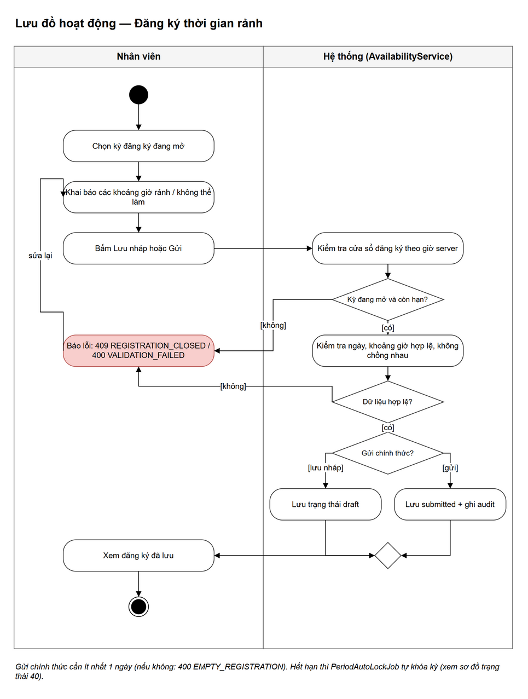

Code liên quan: `api/availability/AvailabilityService.java` (`saveMine`, `submitMine`, `requireWindowOpen`, `validateEntries`), `api/periods/RegistrationWindow.java`.

### 1.2. Thuật toán phân lịch tự động

Thuật toán tham lam: xếp ca khó (ít ứng viên) trước, lọc ứng viên bằng ràng buộc cứng, chọn người tốt nhất theo tiêu chí mềm, kiểm tra lại rồi mới chốt. Không có người hợp lệ thì giữ thiếu người và ghi lý do.

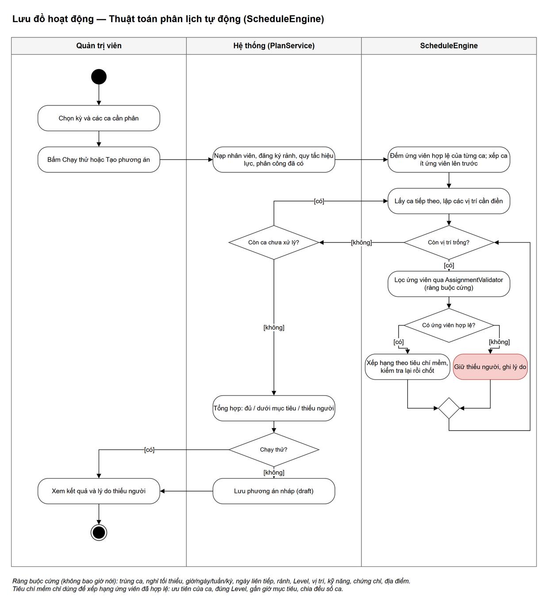

Code liên quan: `schedule/engine/ScheduleEngine.java` (`run`, `planShift`), `schedule/validation/AssignmentValidator.java`, `schedule/plan/PlanService.java` (`dryRun`, `create`, `rerun`).

### 1.3. Gửi duyệt, duyệt và công bố lịch

Mỗi bước đều kiểm tra lại ràng buộc cứng và version. Công bố chỉ thực hiện khi kỳ đã khóa đăng ký, đủ ngoại lệ đã duyệt và chính sách thiếu người cho phép.

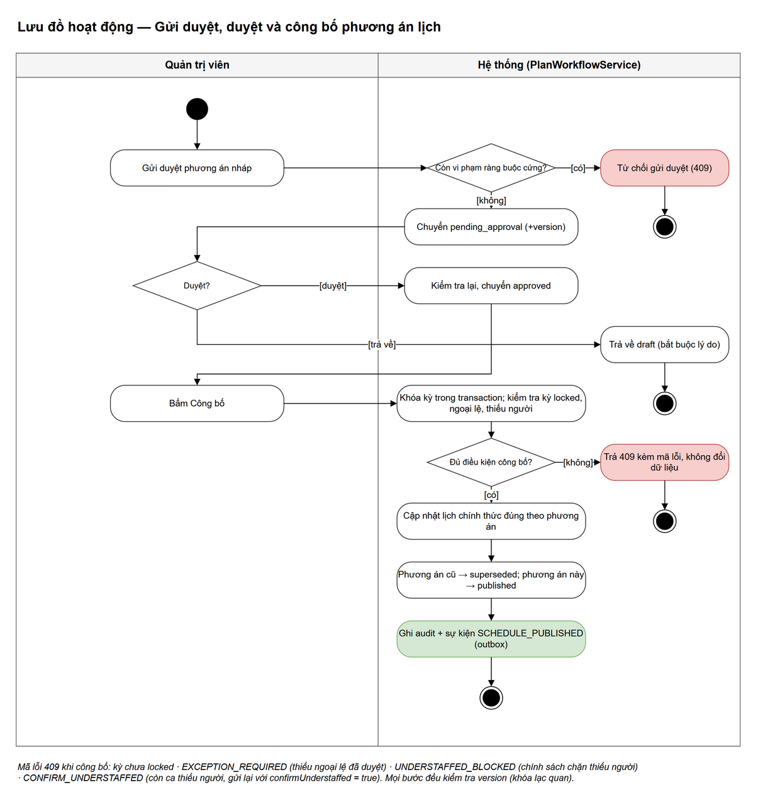

Code liên quan: `schedule/plan/PlanWorkflowService.java` (`submit`, `approve`, `reject`, `publish`).

### 1.4. Đổi ca / làm thay ca

Hai bước đồng ý: đồng nghiệp đồng ý trước, sau đó Admin duyệt. Hệ thống chụp snapshot lịch lúc gửi và kiểm tra lại ở mỗi bước.

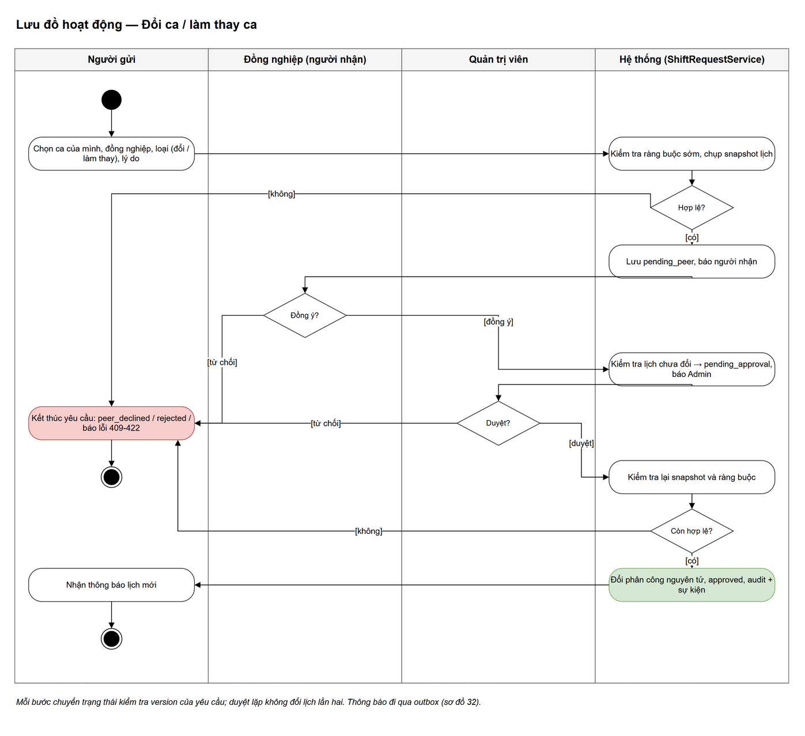

Code liên quan: `api/requests/ShiftRequestService.java` (`create`, `peerRespond`, `approve`, `reject`, `cancel`).

### 1.5. Chấm công, sửa công và khóa kỳ công

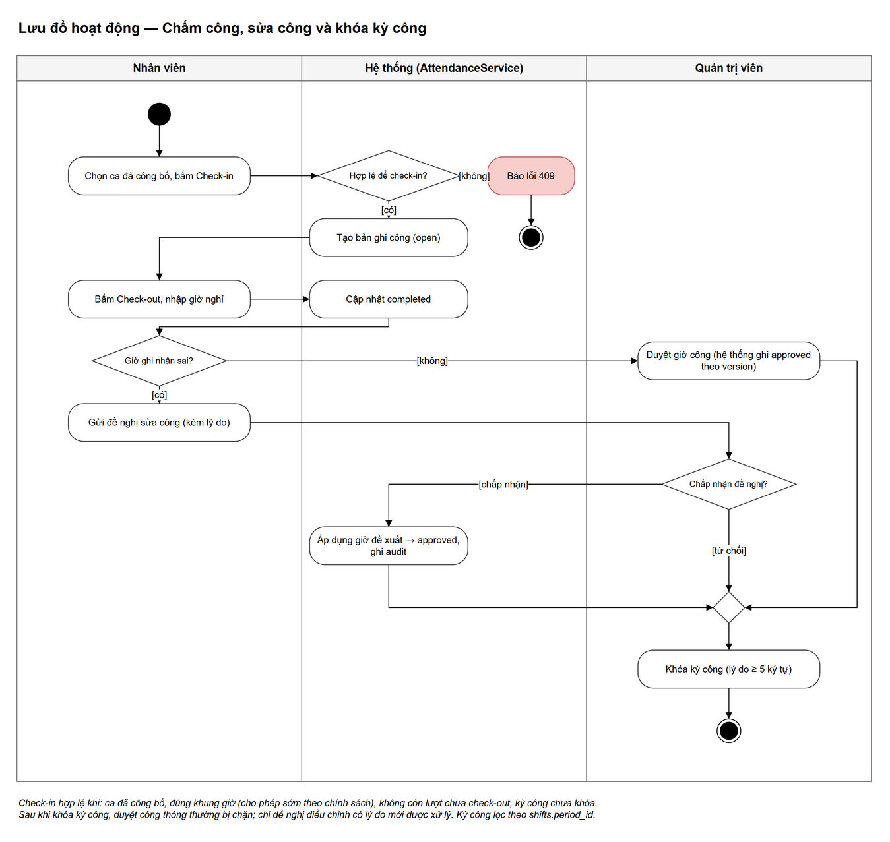

Code liên quan: `api/attendance/AttendanceService.java` (`checkIn`, `checkOut`, `request`, `approvePunch`, `review`, `lockPeriod`).

---

## 2. Sơ đồ tuần tự (luồng request)

### 2.1. Đăng nhập và gọi API có JWT

Phần trên: đăng nhập lấy token. Phần dưới (`loop`): mỗi lần gọi API, token được kiểm tra chữ ký, hạn dùng, rồi kiểm tra lại tài khoản trong DB.

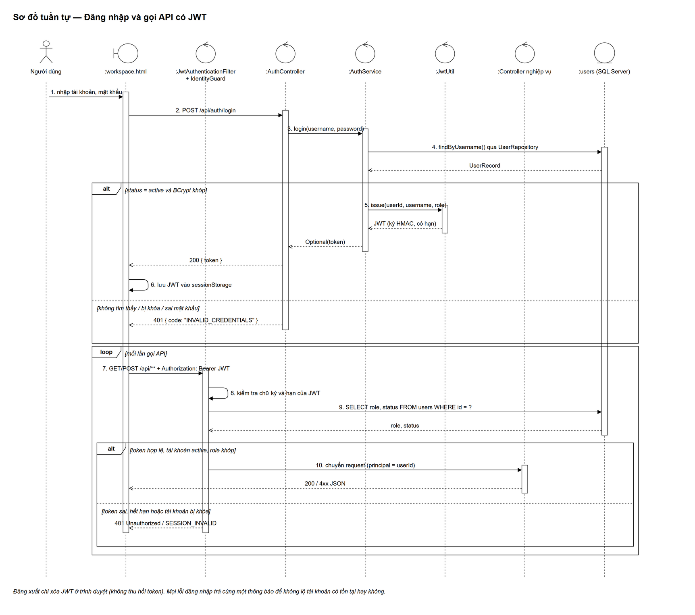

Code liên quan: `api/auth/AuthController.java`, `api/auth/AuthService.java`, `security/JwtUtil.java`, `security/JwtAuthenticationFilter.java`, `common/IdentityGuard.java`.

### 2.2. Duyệt yêu cầu đổi ca

Ví dụ điển hình cho một thao tác ghi quan trọng: kiểm tra quyền → kiểm tra version và snapshot → kiểm tra ràng buộc → đổi phân công → ghi audit → ghi sự kiện, **tất cả trong một transaction**.

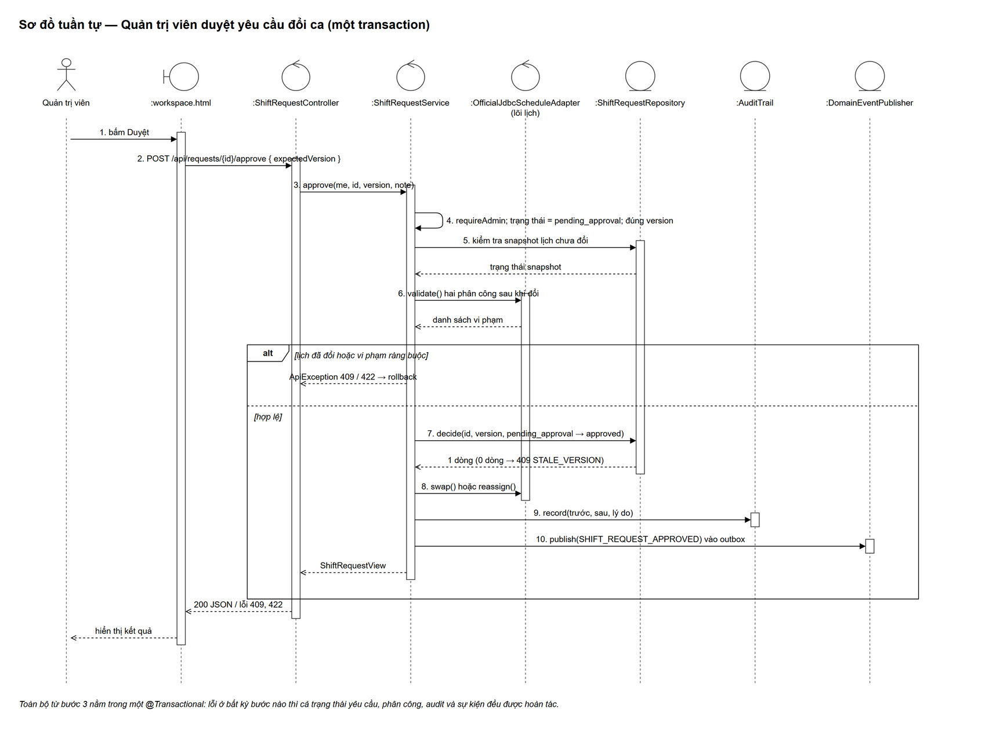

Code liên quan: `api/requests/ShiftRequestController.java`, `api/requests/ShiftRequestService.java#approve`, `domain/schedule/OfficialJdbcScheduleAdapter.java`, `common/AuditTrail.java`, `domain/events/DomainEventPublisher.java`.

### 2.3. Gửi thông báo qua outbox

Thông báo không gửi trực tiếp trong request mà đi qua bảng outbox `domain_events`. Nhờ vậy nếu transaction nghiệp vụ bị hủy thì cũng không có thông báo sai.

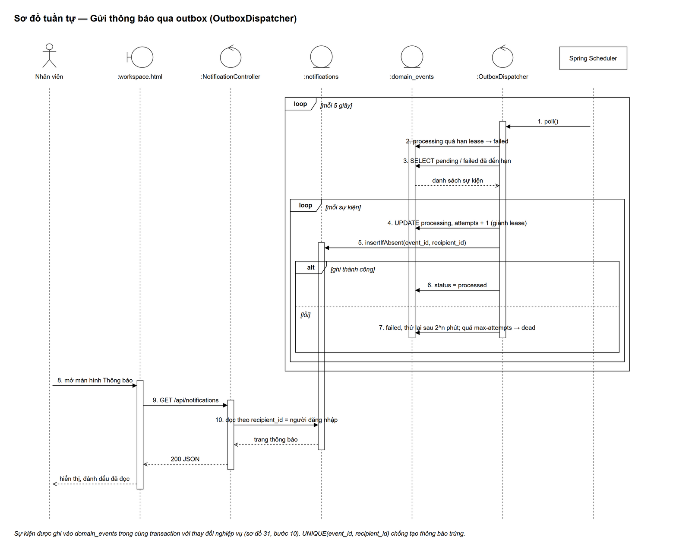

Code liên quan: `domain/events/OutboxDispatcher.java` (`poll`, `deliver`, `markFailed`, `recoverExpiredLeases`), `api/notifications/NotificationController.java`.

---

## 3. Sơ đồ trạng thái

Mỗi sơ đồ chỉ mô tả vòng đời của **một** đối tượng. Nhãn chuyển trạng thái theo dạng `sự kiện [điều kiện] / hành động`. Tên trạng thái trùng với giá trị trong ràng buộc `CHECK` của database.

### 3.1. Kỳ đăng ký

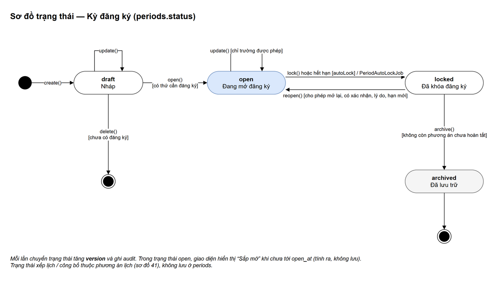

Code liên quan: `api/periods/PeriodService.java`, `api/periods/PeriodStatus.java`, `api/periods/PeriodAutoLockJob.java`; ràng buộc trong migration `V7`.

### 3.2. Phương án lịch

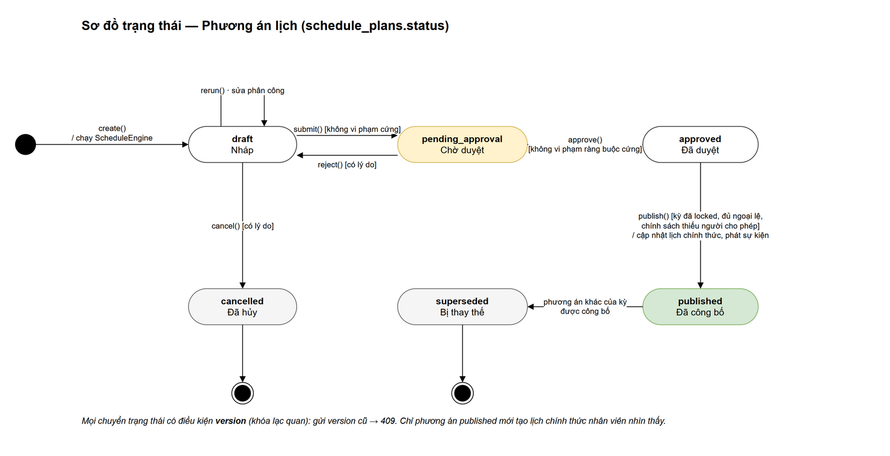

Code liên quan: `schedule/plan/PlanService.java`, `schedule/plan/PlanWorkflowService.java`, `schedule/plan/PlanRepository.java`; ràng buộc trong migration `V11`.

### 3.3. Yêu cầu đổi / thay ca

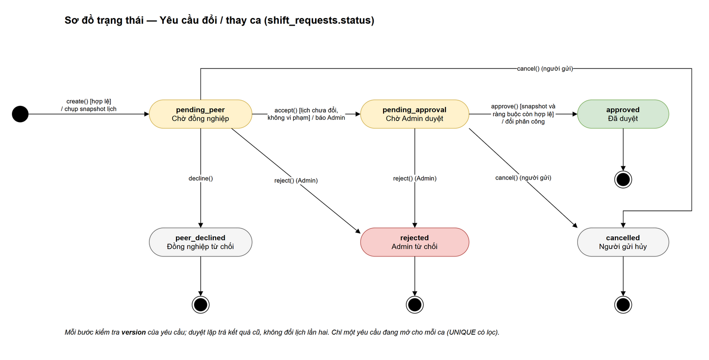

Code liên quan: `api/requests/ShiftRequestService.java`, `api/requests/ShiftRequestStatus.java`; ràng buộc trong migration `V13`.
