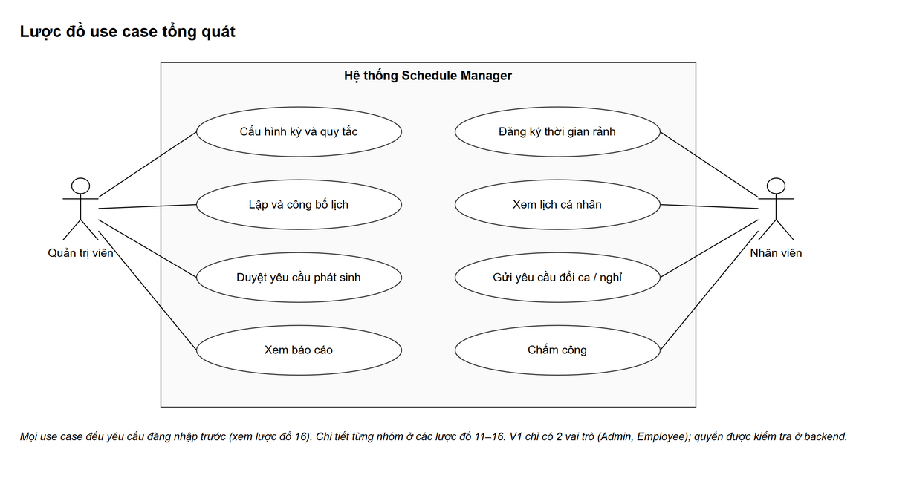
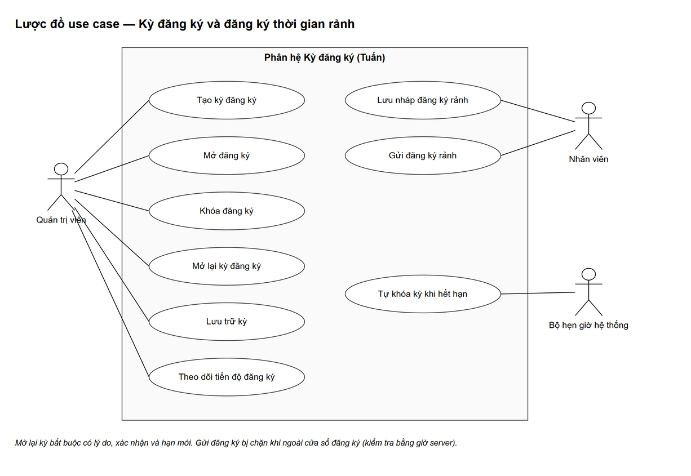
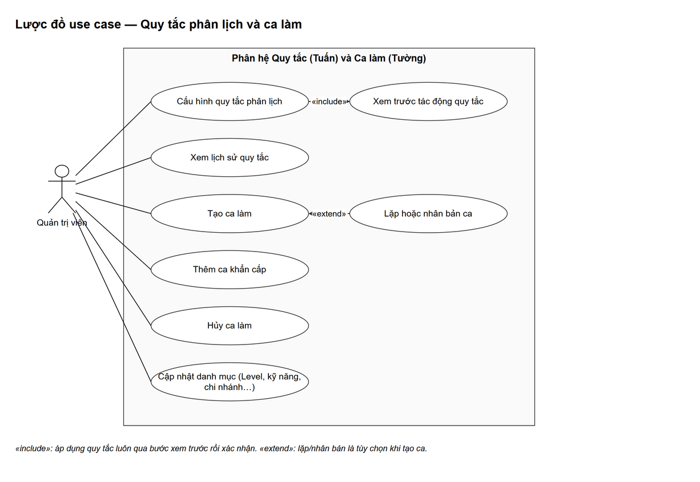
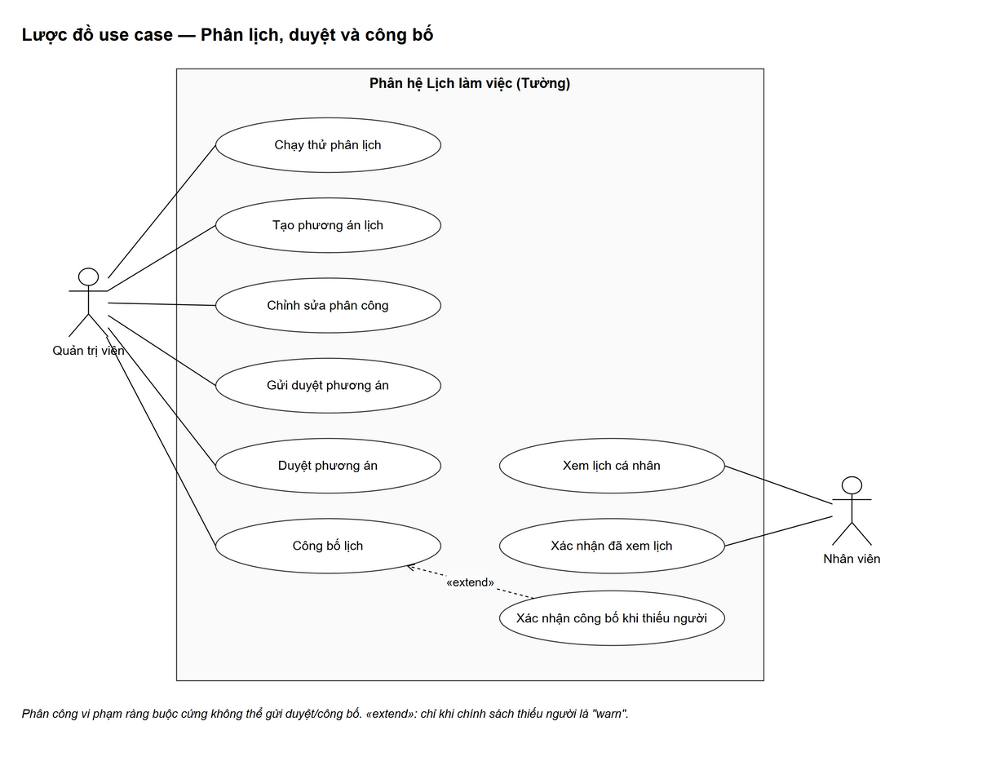
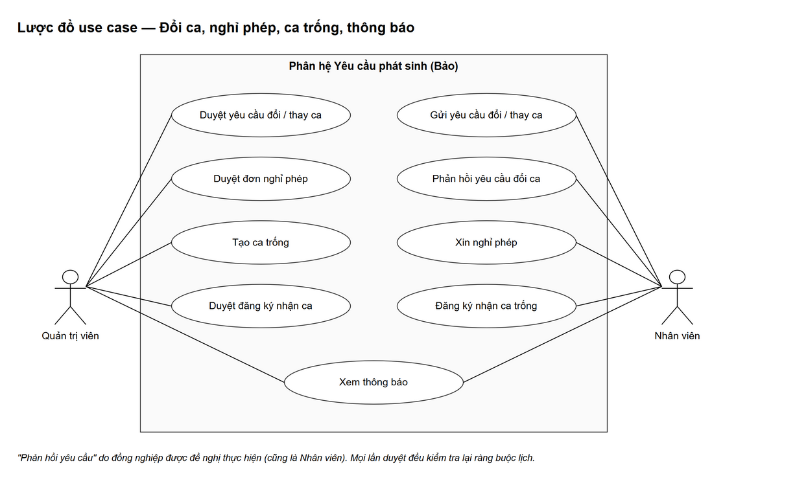
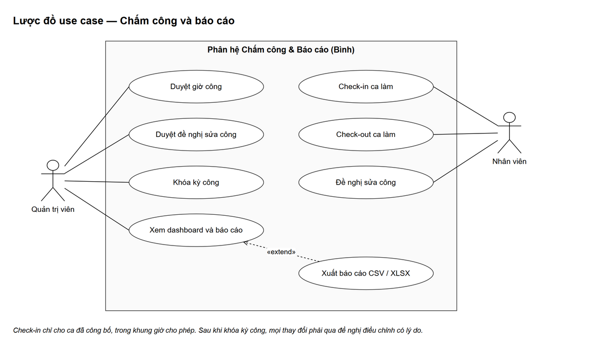
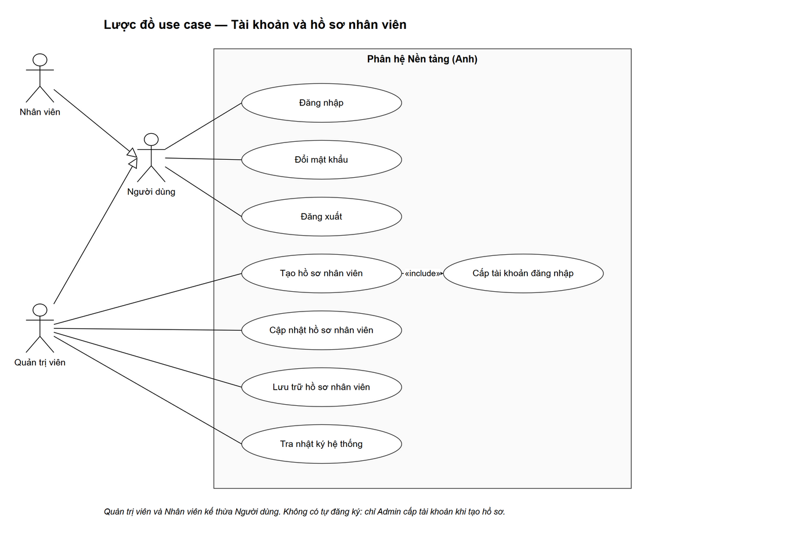

# Lược đồ use case

> Đối chiếu với mã nguồn nhánh `main`, commit `a8a6da6` (04/11/2026). Mỗi lược đồ dưới 10 use case. Use case đặt tên bằng động từ, tác nhân bằng danh từ.
> Ký hiệu: nét liền = tác nhân tham gia use case · `«include»` = luôn thực hiện kèm · `«extend»` = chỉ thực hiện trong điều kiện riêng · tam giác rỗng = kế thừa.

## Mục lục

1. [Tác nhân](#1-tác-nhân)
2. [Tổng quát](#2-tổng-quát)
3. [Kỳ đăng ký và đăng ký thời gian rảnh](#3-kỳ-đăng-ký-và-đăng-ký-thời-gian-rảnh)
4. [Quy tắc phân lịch và ca làm](#4-quy-tắc-phân-lịch-và-ca-làm)
5. [Phân lịch, duyệt và công bố](#5-phân-lịch-duyệt-và-công-bố)
6. [Đổi ca, nghỉ phép, ca trống, thông báo](#6-đổi-ca-nghỉ-phép-ca-trống-thông-báo)
7. [Chấm công và báo cáo](#7-chấm-công-và-báo-cáo)
8. [Tài khoản và hồ sơ nhân viên](#8-tài-khoản-và-hồ-sơ-nhân-viên)

---

## 1. Tác nhân

| Tác nhân | Mô tả | Trong code |
|---|---|---|
| Người dùng | Bất kỳ ai có tài khoản; là lớp cha của 2 tác nhân dưới | `users` |
| Quản trị viên | Quản lý toàn công ty: kỳ, quy tắc, ca, lịch, duyệt yêu cầu, chấm công, báo cáo, nhân viên | `role = admin` → `ROLE_ADMIN` |
| Nhân viên | Chỉ thao tác trên dữ liệu của chính mình: đăng ký rảnh, xem lịch, đổi ca, nghỉ phép, chấm công | `role = user` → `ROLE_USER` |
| Bộ hẹn giờ hệ thống | Tác nhân hệ thống chạy định kỳ: tự khóa kỳ hết hạn, nhắc hạn, gửi thông báo | `PeriodAutoLockJob`, `DeadlineReminderJob`, `OutboxDispatcher` |

## 2. Tổng quát

Mọi use case đều cần đăng nhập trước (lược đồ ở mục 8).

## 3. Kỳ đăng ký và đăng ký thời gian rảnh

| Use case | Tác nhân | Điều kiện chính | API |
|---|---|---|---|
| Tạo kỳ đăng ký | Quản trị viên | Kỳ mới ở trạng thái `draft` | `POST /api/periods` |
| Mở đăng ký | Quản trị viên | Kỳ `draft`, có ít nhất một thứ cần đăng ký | `POST /api/periods/{id}/open` |
| Khóa đăng ký | Quản trị viên | Kỳ `open` | `POST /api/periods/{id}/lock` |
| Mở lại kỳ đăng ký | Quản trị viên | Kỳ `locked`, cho phép mở lại; bắt buộc xác nhận, lý do, hạn mới | `POST /api/periods/{id}/reopen` |
| Lưu trữ kỳ | Quản trị viên | Kỳ `locked`, không còn phương án chưa hoàn tất | `POST /api/periods/{id}/archive` |
| Theo dõi tiến độ đăng ký | Quản trị viên | Ai đã gửi, ai đang nháp, ai chưa đăng ký | `GET /api/availability/progress` |
| Lưu nháp đăng ký rảnh | Nhân viên | Trong cửa sổ đăng ký | `PUT /api/availability/my` |
| Gửi đăng ký rảnh | Nhân viên | Trong cửa sổ đăng ký, có ít nhất 1 ngày | `POST /api/availability/my/submit` |
| Tự khóa kỳ khi hết hạn | Bộ hẹn giờ | Kỳ `open`, bật `autoLock`, đã quá hạn | `PeriodAutoLockJob` (mỗi 60 giây) |

> Đường dẫn API chi tiết: xem [api.md](api.md).

## 4. Quy tắc phân lịch và ca làm

| Use case | Ghi chú |
|---|---|
| Cấu hình quy tắc phân lịch | Đặt giá trị theo phạm vi (công ty → cá nhân) và ngày hiệu lực; luôn **«include»** bước *Xem trước tác động quy tắc* rồi mới xác nhận |
| Xem lịch sử quy tắc | Xem các lần thay đổi, ai làm, lý do |
| Tạo ca làm | Gắn với kỳ; chọn cách phân (`level`, `user`, `combined`), số người, yêu cầu Level/kỹ năng/chứng chỉ |
| Lặp hoặc nhân bản ca | **«extend»** Tạo ca: tùy chọn tạo hàng loạt theo ngày/thứ |
| Thêm ca khẩn cấp | Ca phát sinh ngoài kế hoạch |
| Hủy ca làm | Bắt buộc lý do; giữ lịch sử |
| Cập nhật danh mục | Level, chi nhánh, bộ phận, vị trí, kỹ năng, chứng chỉ |

## 5. Phân lịch, duyệt và công bố

| Use case | Ghi chú |
|---|---|
| Chạy thử phân lịch | Chạy thuật toán nhưng không lưu, để xem trước kết quả |
| Tạo phương án lịch | Chạy thuật toán và lưu phương án `draft` |
| Chỉnh sửa phân công | Thêm / bỏ / chuyển người trong phương án nháp; vẫn qua kiểm tra ràng buộc |
| Gửi duyệt phương án | Chặn nếu còn vi phạm ràng buộc cứng |
| Duyệt phương án | Duyệt hoặc trả về nháp (bắt buộc lý do) |
| Công bố lịch | Chỉ khi kỳ đã `locked`; thay lịch chính thức bằng phương án |
| Xác nhận công bố khi thiếu người | **«extend»** Công bố lịch: chỉ khi chính sách thiếu người là `warn` |
| Xem lịch cá nhân | Nhân viên chỉ thấy lịch đã công bố của mình |
| Xác nhận đã xem lịch | Ghi vào `schedule_acknowledgements` |

## 6. Đổi ca, nghỉ phép, ca trống, thông báo

| Use case | Tác nhân | Ghi chú |
|---|---|---|
| Gửi yêu cầu đổi / thay ca | Nhân viên | `swap` (đổi chéo) hoặc `cover` (làm thay); kiểm tra ràng buộc sớm |
| Phản hồi yêu cầu đổi ca | Nhân viên (đồng nghiệp được đề nghị) | Đồng ý thì chuyển Admin duyệt |
| Duyệt yêu cầu đổi / thay ca | Quản trị viên | Kiểm tra lại lịch và ràng buộc rồi mới đổi phân công |
| Xin nghỉ phép | Nhân viên | Theo loại nghỉ (có lương, cần giấy tờ, báo trước) |
| Duyệt đơn nghỉ phép | Quản trị viên | Hiển thị các ca bị ảnh hưởng |
| Tạo ca trống | Quản trị viên | Mở chỗ cho nhân viên đăng ký nhận |
| Đăng ký nhận ca trống | Nhân viên | Chỉ một người nhận được chỗ cuối cùng |
| Duyệt đăng ký nhận ca | Quản trị viên | Duyệt thì tạo phân công |
| Xem thông báo | Cả hai | Đọc / đánh dấu đã đọc; thông báo tạo từ outbox |

## 7. Chấm công và báo cáo

| Use case | Tác nhân | Ghi chú |
|---|---|---|
| Check-in ca làm | Nhân viên | Ca đã công bố, đúng khung giờ, không còn lượt chưa check-out |
| Check-out ca làm | Nhân viên | Nhập giờ nghỉ |
| Đề nghị sửa công | Nhân viên | Đề xuất giờ vào/ra mới kèm lý do |
| Duyệt giờ công | Quản trị viên | `completed → approved`, kiểm tra version |
| Duyệt đề nghị sửa công | Quản trị viên | Chấp nhận thì áp dụng giờ đề xuất |
| Khóa kỳ công | Quản trị viên | Lý do ≥ 5 ký tự; sau khóa chỉ sửa qua đề nghị điều chỉnh |
| Xem dashboard và báo cáo | Quản trị viên | Giờ theo lịch, giờ thực tế, giờ đã duyệt, ca thiếu người |
| Xuất báo cáo CSV / XLSX | Quản trị viên | **«extend»** Xem báo cáo |

## 8. Tài khoản và hồ sơ nhân viên

| Use case | Ghi chú |
|---|---|
| Đăng nhập | Mọi lỗi trả cùng một thông báo: `401 INVALID_CREDENTIALS` — "Tên đăng nhập hoặc mật khẩu không đúng." |
| Đổi mật khẩu | Phải nhập đúng mật khẩu hiện tại; mật khẩu mới ≥ 8 ký tự |
| Đăng xuất | Xóa JWT phía trình duyệt |
| Tạo hồ sơ nhân viên | **«include»** Cấp tài khoản đăng nhập; không có tự đăng ký |
| Cập nhật hồ sơ nhân viên | Liên hệ, bộ phận, quản lý trực tiếp, Level, năng lực |
| Lưu trữ hồ sơ nhân viên | Khóa tài khoản, giữ lịch sử; chặn nếu còn phân công tương lai |
| Tra nhật ký hệ thống | Chỉ Admin; xem trước/sau của thao tác |
